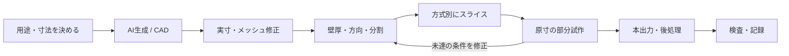

# AIから3Dモデルを作り、3Dプリンターで出力するための調査

調査日：2026-11-04。本文は日本語。英語・日本語・中国語・ドイツ語・フランス語・スペイン語・韓国語の公開資料を調べ、作業に使える手順へ整理した。

**最初は「AIで外観を作る→実寸と形状を修正→正しい機種設定でスライス→原寸の部分試作→本出力」の順で進める。** 寸法を合わせる部品は、パラメトリックCADを中心にする。

| 文書 | 分かること |
| --- | --- |
| [01 全体工程と方法の選び方](01_workflow-and-choices.md) | 目的別の経路、工程ごとの合格条件、ファイル形式 |
| [02 AI生成](02_ai-generation.md) | 画像・プロンプト、クラウド/ローカル、版と利用条件 |
| [03 メッシュ修復とCAD](03_mesh-and-cad.md) | Blenderの具体的操作、単位、厚み、交差、再メッシュ |
| [04 印刷設計](04_design-for-print.md) | 壁厚、公差、片側隙間と直径差、方向、分割、接合 |
| [05 FDM/FFF](05_fdm-printing.md) | 材料、乾燥、スライス、校正、初層、本出力、仕上げ |
| [06 光造形](06_resin-printing.md) | 露光、island、支持、中空化、排液、洗浄・乾燥・硬化 |
| [07 症状別の切り分け](07_troubleshooting.md) | 26の症状、確認する原因、戻る工程、再試作 |
| [08 制作レシピと指示文](08_recipes-and-prompts.md) | マスコット、寸法付きプレート、浮き彫り、外注の準備 |
| [09 多言語調査](09_multilingual-research.md) | 7言語の検索と知見、用語対照、資料の矛盾と限界 |
| [10 チェックと記録](10_checklists-and-records.md) | 工程別チェック、保存構成、費用、受け渡し |
| [出典一覧](sources.csv) | 39件の一次資料、言語、URL、確認範囲、適用条件 |

記入用テンプレート：[仕様メモ](templates/project-brief.md)、[印刷記録CSV](templates/print-log.csv)、[比較試験CSV](templates/experiment-log.csv)、[制作記録JSON](templates/project-record.example.json)。

対象は家庭用・小規模工房で使うFDM/FFFと光造形（SLA・MSLA・DLP）。人物、マスコット、装飾品に加え、寸法を合わせるケースや治具も扱う。プリンター機種は未指定のため、機種・材料に依存する設定値と、設計上の一般原則を区別する。

このディレクトリは調査資料であり、実機での造形結果や、特定サービスの比較実験を記録したものではない。試作の出発点となる数値には、条件と確認方法を付ける。39件は出典ページの件数で、公式翻訳や地域版を含む。独立した39件の実験ではない。

実際のSTL、スライサー設定、G-code、印刷済み作品は含めていない。まず使う機種と材料を決め、対応する公式プロファイルで小試作するための資料として使う。
