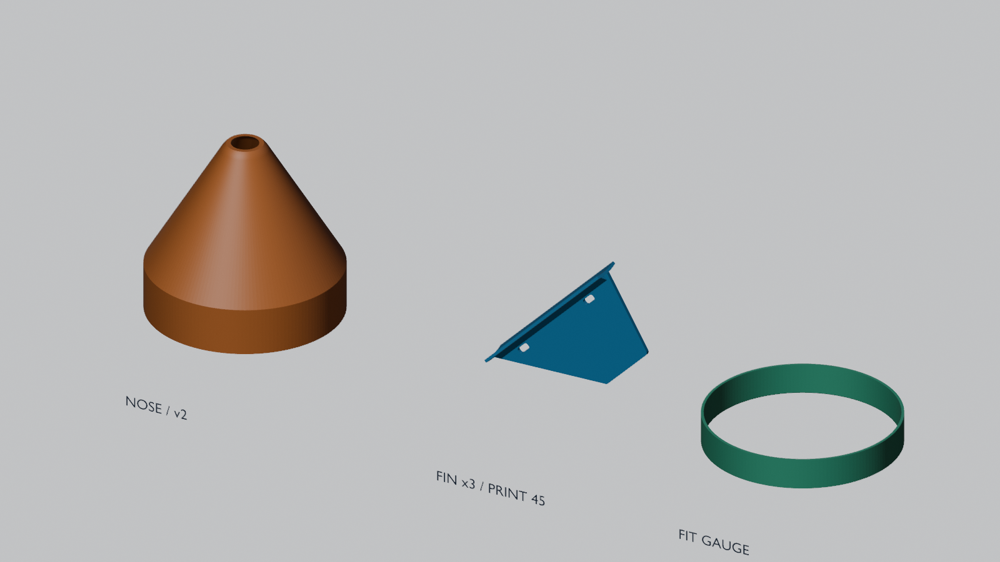
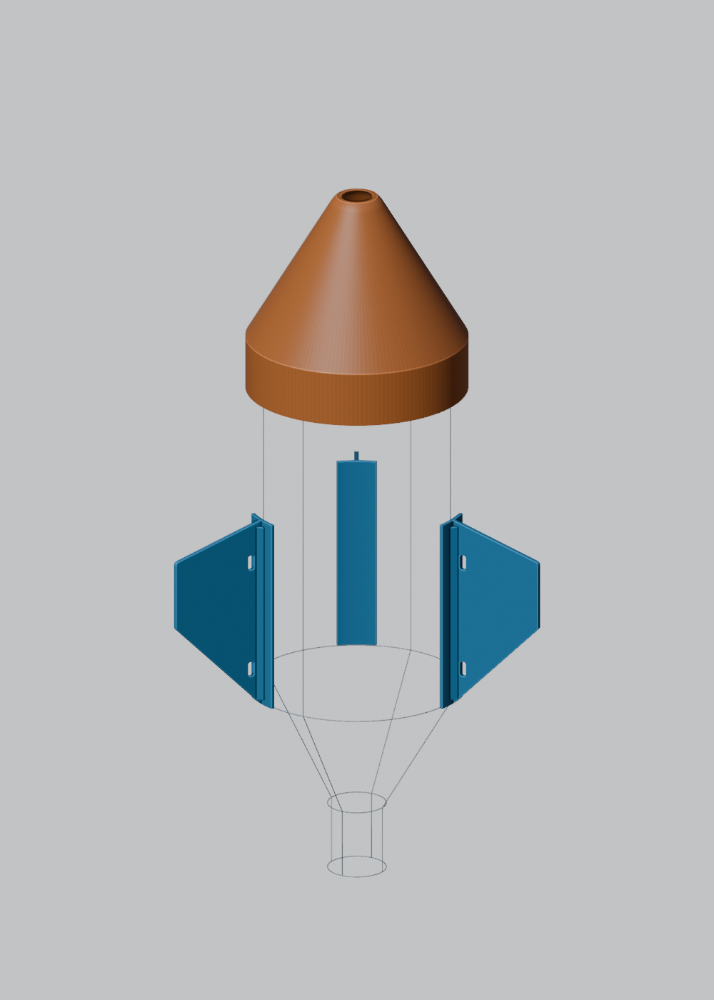

# コカ・コーラ2Lを想定したコーンとフィンの試作

非加圧の外装コーンと外付けフィン3枚を、寸法調整できる形状として生成した。独立レビューで見つかった印刷姿勢、根元の補強、穴周り、先端、嵌合確認の課題を改善した版が`improved/`。**現物への適合・実印刷・強度・飛行安定性は未確認で、飛行用の完成品ではない。** ボトル本体や口金を加工する形状は含まない。

ボトル径110 mm・高さ315 mmは設計仮定であり、コカ・コーラの公称寸法や実測値ではない。地域・製造時期による違いも吸収できるよう、[parameters.json](parameters.json)で胴径、すきま、接触位置を変更できる。



## 使用するファイル

| ファイル | 用途・数量 | 寸法の目安 mm |
| --- | --- | --- |
| [nose_cone.stl](improved/nose_cone.stl) | コーン1個。入口を下に印刷 | 外径114 × 高さ103.875、内径110.8 |
| [fin.stl](improved/fin.stl) | フィンを3個。45°の印刷姿勢を適用済み | 97.595 × 20.650 × 高さ72.627 |
| [fit_ring.stl](improved/fit_ring.stl) | コーンの18 mm挿入範囲を先に試すリング1個 | 外径114 × 高さ18、内径110.8 |
| [mount_gauge.stl](improved/mount_gauge.stl) | フィンの100 mm長サドルの接触を試すゲージ1個 | 長さ100、端面を下に配置済み |
| [parts.blend](improved/parts.blend) | 編集・観察用。部品と仮組立の2シーン | 単位mm |
| [fin_assembly.stl](improved/fin_assembly.stl) | 組立参照用のフィン。ボトル中心を原点とする座標 | 追加印刷する部品ではない |
| [geometry.json](improved/geometry.json) / [assembly.json](improved/assembly.json) | 生成時の検査値・仮配置と未検証項目 | 実測結果ではない |

先端は内径16 mmの開口を持ち、**別途、硬い開口縁を覆う軟質キャップが必要**。キャップ本体・固定方式・回収装置・帯は未設計で、このセットには含めていない。R16の硬質肩だけで柔らかい先端にはならない。

## 今回の改善

| 初版の課題 | 改善版 |
| --- | --- |
| フィン直立時は接地が小さく、重心投影が接地外 | 前縁を下にする45°姿勢をSTLへ適用 |
| 根元に補強がなく、スロットの内側余肉が1.8 mm | 両面3 mmの三角ウェブ、余肉4 mm、丸い長穴 |
| 翼の外周が鋭い | 外形の角をR2で丸めた。翼厚は2.4 mm |
| コーンの傾斜面肉厚が法線方向では約1.454 mm | 法線肉厚1.6 mmを明示。入口面取り部の最薄は1.2 mm |
| 閉じたコーン頂部の内部支持を除去しにくい | 軟質キャップ用開口を設け、硬質シェル内の閉じた天井をなくした |
| 短いリングだけでは接触域全体を試せない | 挿入18 mmのリングと全長100 mmのサドルゲージ。入口面取り0.4 mm |
| 枚数・軸方向位置が部品モデルだけでは分からない | 3枚120°配置の仮組立を別シーンに収録 |

ゲージの凸面を下に置く試案も、初期層の大きな張り出しがレビューで見つかり、平らな円弧端面を下にする姿勢へ修正した。基準版の[baseline/](baseline/)は比較用に保持している。

[独立レビューと改善結果](REVIEW.md)に、3視点の指摘・修正・残課題をまとめた。[幾何の検査結果](reports/geometry-verification.json)は全5STL合格、[実スライス](reports/printing/README.md)は4部品ともベッド内・途中欠層なし・支持経路なし。フィンの局所的な張り出しなど、実機で確認する箇所も記録している。

## 一般的なFDMで試す順序

機種不明のため、220×220×250 mmの造形域、0.4 mmノズル、0.2 mm層、0.45 mm線幅、PLAでの形状試作を検討条件とした。これは特定機種の校正済みプロファイルではない。温度・速度・材料プロファイルは実機のメーカー設定を使う。

1. 実物の取付予定位置の直径を複数方向で測り、胴径と位置を入力する。直径クリアランスは現在0.8 mm（片側0.4 mm）。非円形のくびれや底の張り出しも確認する。
2. `fit_ring.stl`を印刷し、予定の18 mm挿入位置で無理なく着脱できるか確認する。サドルは`mount_gauge.stl`で100 mm全長の浮きと接触を確認する。押し込んでボトルを変形させる合い方は採用しない。
3. `fin.stl`をまず1枚印刷する。再び45°回さず、底面Z=0で配置する。穴2個が通り、根元ウェブが一体で、層の割れや大きな反りがないか確認する。
4. 寸法が合えばコーンと残りのフィンを作る。暫定のスライス検討は壁3周、上下4層、インフィル20%、支持なし、外側のみ8 mmブリム。内側ブリムや象の足を嵌合面に残さない。ノーズ開口を自動補修で塞がない。
5. 実重量と取付状態を記録する。帯やバックルを含む保持、軟質キャップ、回収、全機CG/CP、ランチャーの保持・解除・ガイドとの干渉は別途検証する。

コーン＋フィン3枚の質量は、密度1.24 g/cm³でSTLの材料領域を充填した計算で**約102.94 g**（初版101.60 g）。コーン内部の設計空洞は残す。実際の押出量・実重量とは異なり、帯・キャップ・接着剤・ボトル・水は含まない。補強による重量と配置の変化があるため、形状修正だけを安定性向上の根拠にはしない。

## 再生成

Blender 5.2.2 LTSで生成。作業ディレクトリをこのフォルダーにし、実行ファイルがPATHにある場合：

```powershell
blender --background --factory-startup --python-exit-code 1 --python build.py -- --config parameters.json --out improved --render
```

`parameters.json`の値を変更した場合、STL・Blender・検査結果をまとめて作り直す。再生成は数値的な微小継ぎ目を0.00001 mm以内で処理し、体積変化の上限、単一連結、閉じた面、非多様体、ゼロ面積面、非隣接面の交差を検査する。これらは幾何の検査であり、印刷成功・保持強度・飛行安定性の合格判定ではない。

独立STL検査はnumpy/scipyのあるPythonで次を実行する。直下のbinary STL全件を読み、修復せず検査し、不合格は終了コード1になる。スライスの再現手順は[印刷記録](reports/printing/README.md#再現)を参照する。

```powershell
python verify_stl.py --directory improved --out reports/geometry-verification.json
```


