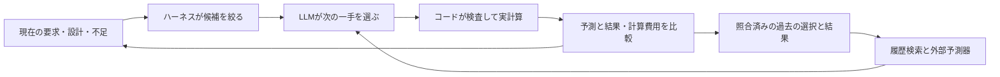

# 解析の読み取りと、デモで伝える筋

2026-11-07。指定された解析チャット57ターンのユーザー発言・最終回答と、最新ターンの進捗を確認した。実装・検証の主な記録はPR #60の公開版 `cd5ea92fe3b7c58a4ea1279edb6701f430c83a49`へ固定して照合した。全ツールログの再読や、生データ全件の再検算・解析の再実行を行ったという意味ではない。

中心は、**上位要求を満たすために、次に解くべき問いをLLMが選び、検証可能な計算と履歴で設計を更新する仕組み**。一つの性能を改善しても、他の要求や数値精度を満たしたことにはならない。この難しさが、分野間の反復をつなぐ必要性になる。

## 1. 混ぜずに説明する3つの軸

| 軸 | 分けるもの | デモでの役割 |
| --- | --- | --- |
| 設計変数の階層 | 要求／構成・配分／部品／運用 | どこを固定し、どの変数へ戻れるか |
| 解析の意味の階層 | 低層：部品・形状の特性／中層：組立機体の時間応答／高層：ミッションの成否 | 何を何へ伝え、どの問いに答えるか |
| 手法と精度 | 簡易モデル／詳細モデル、格子・メッシュ・時間刻み等 | 今の判断にどこまでの精度が必要か |

前の構成案の「階層性＝簡易探索→詳細解析」という説明を修正する。粗密は第3の軸であり、部品→機体→ミッションという階層とは別。空力・熱・構造・振動は解析カテゴリ、噴射・惰性上昇・回収はフェーズで、層を横断する。

| 解析の層 | 入力・問いの例 | 次へ渡すもの |
| --- | --- | --- |
| 低層 | フィン形状・材料・取付で、どんな力、モーメント、質量・剛性になるか | 特性と適用条件、誤差・根拠 |
| 中層 | その機体が風・推進・荷重を受け、どの姿勢・変形・振動になるか | 飛行と荷重の時系列、応答と不確かさ |
| 高層 | 指定の高度・回収・搭載物・予算を満たせるか | 要求ごとの判定、未達原因、次の検討事項 |

要求と必要精度は上から下へ、計算結果と不確かさは下から上へ伝える。上位の許容誤差が変われば、下位で調べる対象や手法も変わる。ただし現在の精度配分は局所的な感度等に基づくもので、真の誤差保証とはしない。

## 2. 適応性は、対象・手法・評価の組を選び直すこと

事前の候補プールには「何を変える・調べるか」「どう解析するか」「何で評価するか」を持つ。変数の値、同層の影響、上下層の要求、依存する結果、適用範囲、精度、残りの計算資源に合わせて候補を絞る。

- **ハーネス**：合法な組、必要な入力、依存関係、予算、合否を管理。変更の影響を受けた古い判定を失効させ、影響しない結果を再利用する。
- **LLM／目標構成のClaude API**：候補と不足・履歴を読み、次の対象・手法・評価と理由を選ぶ。
- **スクリプト・ソルバー**：指定した条件でCAD、熱、推進、CFD、飛行、FEM、振動・安定性等を計算する。

依存関係で必須になる一意の処理は `forced_dependency` として区別する。候補が一つしかない処理の実行を、すべてLLMの選択として数えない。原因探索の評価指標は変えられるが、最終要求・合格基準は固定する。

## 3. フィードバックは、検証した経験と別の予測器

入力・結果・成果物のハッシュ等を照合した近い条件の履歴を参照する。外部のリッジ回帰がシミュレーションの高度差の予測残差と計算時間を学び、参照例と補正予測を次のLLM判断へ渡す。LLMの重みを自動更新した結果ではない。

公開記録は学習4変更・未使用の評価2形状。高度差予測の平均絶対誤差は物理モデル0.034169 m、平均残差補正0.016727 m、回帰補正0.016734 m。回帰の方がわずかに良いという結果ではなく、2条件での予測比較である。実飛行精度や探索全体の高速化には換算しない。[履歴と予測器の公開記録](https://github.com/masatoshibukawa/RocketCreater/blob/cd5ea92fe3b7c58a4ea1279edb6701f430c83a49/docs/claude-learned-selection.md)

## 4. 必要性を伝える、具体的な一件

段階7の厚さの分岐試験では、フィン厚を2.4→3.6 mmにすると、たわみ／スパンは0.01977→0.01051へ減った。一方、乾燥質量は285.83→327.20 g、概算高度は15.168→13.196 mとなった。その後、実ローカルLLMはフィンのスパン変更を選んだ。

動画の核は、**変形を減らす変更→質量と飛行への影響→要求を再確認→別の設計変数へ戻る**。この一件が、なぜ単一分野の最適化だけでは足りず、設計と解析の往復をつなぐ必要があるかを具体化する。

これは分岐試験用の条件付きシミュレーションであり、実機実験や段階6の採用案の成功ではない。数値を映像に使うなら「分岐検証の計算例」と条件を示し、収録する案件の値と混ぜない。[段階5〜7の公開記録](https://github.com/masatoshibukawa/RocketCreater/blob/cd5ea92fe3b7c58a4ea1279edb6701f430c83a49/docs/local-learning-stage-results.md)

## 5. 実証できた仕組みと、未達の機体を分ける

| 確認した記録 | 結果と範囲 |
| --- | --- |
| 段階5 | 3版、実LLM選択9回・依存実行13回。概算高度17.549→20.605→21.465 m。既知の変更も含むため、未知条件での方策評価とは数えない |
| 段階6 | GPU34条件、熱・飛行・構造等の確認を完了。確認高度18.857 m／要求30 m、静安定余裕0.375／要求1口径、格子差14.412%／基準5%。未達・採用仕様なし |
| 段階7 | 運用から材料への切替、厚さと質量、精度ゲート、古い判定の失効、定理の適用条件の5試験が通過。分岐試験の精度条件は製作用の採用条件と別 |
| 履歴・予測器 | 検証済み履歴と補正予測が次の選択に渡る。一般的な探索効率の向上は未証明 |
| 実物 | 材料、取付、現在機体の空力等の実測照合が残る。印刷の実写は別の既存2L案の試作 |

段階5の概算高度と段階6の詳細確認高度を、同じ精度での改善前後のように並べない。過去の30m前後の簡易試算、21.033mの別の長い探索、今回の18.857mも別の記録として保持する。LaSalle等の前提を満たす局所モデルと、全飛行・実機の安定性は区別する。

数値ソースは `a431e37`／`135e902dd2068536f43982526c8f3e299b2566c49b195bfd8d0dfde849f84210`。今回読んだ公開JSONは[local-learned-stages.json](https://github.com/masatoshibukawa/RocketCreater/blob/cd5ea92fe3b7c58a4ea1279edb6701f430c83a49/scenarios/adaptive_design/local-learned-stages.json)。記録されている40マニフェスト・415ファイルと段階7の36マニフェスト・136ファイルの全件照合を、この動画計画作業でやり直したとはしない。

## 6. 全体構成と9枚への反映

冒頭50秒は維持する。B02で分野間の受け渡し、B03で上の厚さ・質量・高度の一件を伝え、B05〜B06でその課題に答える仕組みを示す。

B06の38秒では、上位の未達→部品・機体への原因追跡→合法な候補から選択→再計算→現在版で再判定→履歴が次の判断へ戻る、一つの連続した場面にする。計算待ちは省略と表示し、変更後も古い合格表示を残さない。

9枚の画像は引き続き構図の参考。3枚目の意味を厚さ・質量・飛行のトレードオフ、6枚目を部品→機体→ミッションと候補選択・フィードバックへ具体化する。画像そのものを実解析の証拠にしない。

現在の確認済み実行はGemma 4 12B。ユーザーの目標構成は全ローカルLLM判断のClaude API化、開発の主力はClaude Codeである。履歴参照と外部予測器はその構成に対応させ、Claudeでの実行を採る場合は移行後の入力・選択・結果を収録する。この作業ではAPI移行や新規解析を実行しない。
