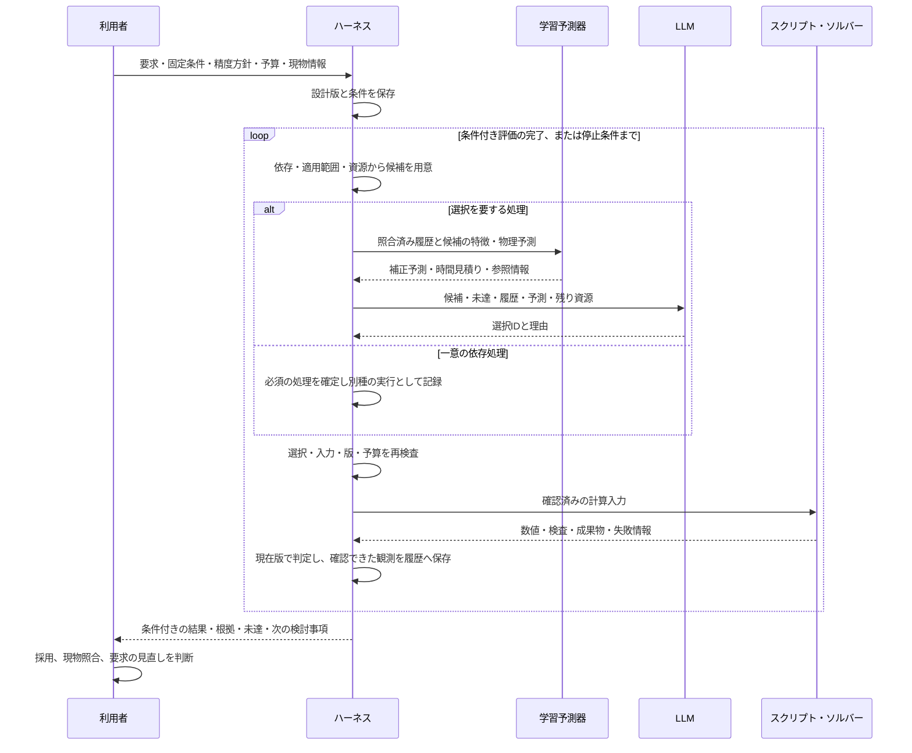

# 利用者・ハーネス・スクリプト・LLM・学習予測器の役割

**利用者が目的を定め、ハーネスが実行全体を制御し、LLMが次の一手を選び、学習予測器が見込みを補助し、スクリプトが計算する。**

運用時の5者を責務で分ける。ハーネスもプログラムで実装されるため、「スクリプト」という言語・ファイル形式との分類ではない。ここでは実行を制御するコードをハーネス、個々の計算を行うコードを解析スクリプト・ソルバーと呼ぶ。

## 5者の入力・責任・出力

| 担当 | 受け取るもの | 担当すること | 返すもの・権限の範囲 |
| --- | --- | --- | --- |
| **利用者** | 説明、候補、根拠、未確定事項 | ミッション、固定条件、変えてよい条件、予算・精度の方針を決め、現物情報を与える。得た結果を次の検討や実際の利用へ進めるか判断 | 要求と制約、実測値、必要なら新しい要求。専門的な解析設定は説明付きの既定値を使える設計を目指す |
| **ハーネス** | 要求、現在の設計版、登録済み候補、履歴、各処理の結果 | 適用条件・依存関係・入力・時間・メモリを検査し、候補と実行を管理。変更の影響を受ける判定を失効させ、使える結果を再利用。計算結果の現在版との対応を確認し、状態を確定 | 実行可能な候補、実行指示、除外理由、現在版の判定、根拠と未達。固定した要求に従う |
| **LLM** | 候補、要求の未達、現在値、参照履歴、予測器の見込み、残り資源 | どの対象を、どの手法で、何を評価して次に確かめるか選ぶ。必要なら別の層・設計変数へ戻る理由を説明 | 許可候補のIDと理由。実行前にハーネスが再検査する。合格基準や計算結果を自分の判断で変更する権限は持たせない |
| **学習予測器** | 照合済みの過去の計算結果・実行時間、現在候補の特徴量と物理モデルの予測 | 予測と結果のずれ・計算時間を学び、候補の見込みを補正する | 高度差の補正予測、計算時間の見積り、使用した履歴・モデルの識別情報。見込みは実計算で確認する |
| **スクリプト・ソルバー** | 確認済みの設計データ、材料・環境・数値設定 | CAD、熱、推進、空力、飛行、構造、振動・安定性等を計算し、評価量と手法固有の検査結果を返す | 数値・時系列・図・出力ファイル、収束・適用範囲・失敗の情報。要求の変更や次の設計方針の選択は担当しない |

利用者が定めた条件内の反復は自動で進める。結果が揃えばハーネスがモデル上の条件付き評価を確定し、予算不足・未達・候補不足なら理由を残して返す。要求を変える場合は、旧結果と区別できる新しい条件として扱う。

履歴に蓄積するのは確認できた計算結果と費用。現在、学習予測器が更新するのは外部の回帰の係数で、出力は高度差の補正と計算時間の見積りである。LLMは更新された判断材料を読む。予測器の不確かさは未校正で、最終合否は実計算の検査に従う。

## 決定権を具体化する

| 判断 | 主担当 | 他の役割との境界 |
| --- | --- | --- |
| 何を達成したいか、何を固定するか | 利用者 | LLMが聞き取り・整理を支援し、コードが固定条件を保持 |
| 今の条件で何が実行可能か | ハーネス | 事前に登録・検証した対象・手法・評価の契約を使う |
| どの一手を次に試すか | LLM | 複数の候補から選ぶ。一意の依存処理はハーネスが自動実行し、LLM選択と別に記録 |
| 変更するとどうなりそうか | 物理モデルと学習予測器 | 物理予測を履歴で補正。数値計算済みの結果や合格へ置き換えない |
| 実際にどうなったか | スクリプト・ソルバー | そのモデルと設定での計算結果。現物についての実測とは区別 |
| 予算内で実行してよいか | ハーネス | 予測器の時間見積りだけで保守的な予約量を引き下げない |
| 今の設計版がモデル上の基準を満たすか | スクリプトの検査＋ハーネスの統合判定 | 手法ごとの数値検査を計算側が返し、ハーネスが現在版・依存・完了状態を確認して確定 |
| 結果を採用し、実際の製作・実測等へ進むか | 利用者・その作業の担当者 | モデル上の判定と、現物で使うための判断を分ける |

候補プール、数式、適用範囲、評価基準、検証データの設計は、事前の開発・専門家側の仕事。通常利用者に毎回すべての解析実装を指定させる構成にはしない。今回の開発の主力であるClaude Codeは、この開発側の支援役。製品実行中の判断を担うClaude APIとは分ける。

APIは接続の窓口として整理する。アプリAPIは画面と実行管理をつなぎ、Claude APIはLLMの呼び出しに使う。どちらも、別の判断主体を追加するものとして数えない。

## 一巡の流れ

これは論理的な一巡の説明。学習予測器は現在、必要な判断時に近い有効履歴から局所回帰を当てはめる。毎回すべての処理が走る構成や、一つの巨大モデルを毎反復で追加学習する構成とはしない。

## フィンの変更を例にする

1. **利用者**が高度・搭載物・回収・予算等を固定する。
2. **スクリプト**の結果から、フィンを厚くすると変形は減るが質量・高度が悪化する状況が分かる。
3. **ハーネス**が影響する結果を失効させ、形状・材料・運用や精度改善のうち使える候補を提示する。
4. **学習予測器**が、似た変更の結果から改善量と再計算費用の見込みを補助する。
5. **LLM**が、その情報を使って次に検討する形状等を選ぶ。
6. **ハーネス**が選択を検査し、**スクリプト**を実行して結果を確認する。高度だけ改善しても、他の固定要求を含めて再判定する。

この例の実証範囲と試験条件は[解析の分析メモ](analysis-story.md)を参照。現行の実証はGemma、目標構成は全ローカルLLM判断のClaude API化。今回の整理でAPI移行や新規解析を実行したとは扱わない。

## デモでの短い表示

この分担は、背景と階層型・適応型の概念を、プロダクトの機能・性能と実演へ接続するために示す。[橋渡しの設計](concept-to-demo.md)に沿い、B05の01:28〜01:40で関係を説明した後、B06の一巡で確かめる。

**利用者：目的を決める／ハーネス：実行と整合を管理する／LLM：次の一手を選ぶ／学習予測器：見込みを補助する／スクリプト：計算する。**

B05で5者の関係を短く示し、B06で同じ色・位置を使って今どこが動いているか表示する。部品→機体→ミッションの物理階層図と、この実行上の分担図は別に見せる。アプリAPIは要求・状態・進捗を運ぶ接続として扱う。

確認した実装はPR #60の`cd5ea92`に固定。`rocketwright/analysis/predictor.py`は検証・重複除去した4件以上の観測で残差と費用を回帰する。`worker.py`が評価量と検査を返し、`service.py`が現在版の整合・完了状態と判定を管理する。モデル上の評価には`model_criteria_met`と`screening_criteria_met`の区別があり、実機保証とは分ける。参照資料と未達の範囲は`analysis-story.md`へまとめる。
