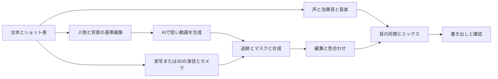

# SF映画とヒーロー映像の作り方

迫力のあるSF短編は、シーンをショットへ分け、演技、カメラ、光、効果、編集、音を同じ出来事に合わせて作る。このPCで最初に目指すなら、短いAI映像を編集する予告編が取り組みやすい。同じ宇宙船や装置を複数の角度から正確に見せる場合は、3Dを基準にする制作へ進む。

## アベンジャーズの制作から学べること

ILMの『Avengers: Endgame』公式事例では、Smart Hulkに俳優の演技を反映するため、Disney Researchと開発したAnymaによる高精細なパフォーマンスキャプチャを使ったと説明している。学ぶ点は、表情の細部と演技の一貫性を、キャラクターの大きさや派手さと同じくらい重視することである。[ILM公式事例](https://www.ilm.com/vfx/avengers-endgame/)。

Framestoreの公式事例では、衣装のCG置換、デジタルダブル、量子エフェクト、環境制作を紹介している。量子効果では合成・ライティング・FXを組み合わせ、熱による歪み、光学効果、煙等を使って前景と背景をつないでいる。これは当時の映画VFXの説明であり、現在の文章からの動画生成サービスを使ったという意味ではない。[Framestore公式事例](https://www.framestore.com/work/avengers-endgame?language=en)。

## 制作規模に応じた三つの構成

| 構成 | 作業の中心 | 向く作品 | 課題 |
| --- | --- | --- | --- |
| AI生成と編集 | 基準画像、I2V、TTS、編集 | SF予告編、コンセプト映像、短い印象的な場面 | 顔や衣装、機体の連続性 |
| 実写とAIと合成 | 撮影、マスク、背景生成、追跡、音 | 人物の演技を残したSFシーン | 背景との光、遮蔽、影、カメラの一致 |
| 3DとAIと合成 | 3Dレイアウト、カメラ、照明、FX、AIによる素材制作 | 宇宙船、機械、同じ舞台の繰り返し撮影 | モデリング、レンダリング、キャッシュ管理 |

上の選択は制作上の判断である。AI、CG、実写のいずれか一つへ全工程を統一する必要はなく、修正したい部分を個別に扱える構成にする。

## 迫力を作る具体的な制作案

| 要素 | 試す設計 | 確認すること |
| --- | --- | --- |
| スケール | 手前に人物、中景に構造物、遠景に巨大物を置く | 比較対象がない巨大物になっていないか |
| 質量 | 動き出しと停止に加減速を付ける | 大きな物体が軽く滑っていないか |
| 光 | 発光体の色を人物、床、煙にも反映する | 光る球だけが貼り付いて見えないか |
| 奥行き | 前景の遮蔽、煙、遠景のコントラスト低下を使う | 全ての素材が同じ平面に見えないか |
| カメラ | 主人公の登場はゆっくり接近、反応は短いカットへ分ける | 全ショットが大きな旋回になっていないか |
| 合成 | 黒レベル、粒状感、ブレ、被写界深度を合わせる | 前景と背景が違う撮影条件に見えないか |
| 音 | 予兆、衝撃、余韻を映像の動きへ合わせる | 常に大音量になり、強弱を失っていないか |

これらは採用するモデルに依存しない演出案であり、特定ツールの自動処理を保証する機能一覧ではない。

## 実写へSF装置を合成する例

1. カメラを固定して人物の演技を撮る。背景だけの素材も用意する。
2. 装置を置く位置と人物の手の接触位置を決める。カメラを動かす場合は先に追跡を解く。
3. 装置と発光、煙、背景を別素材にする。人物の前を通る部分と後ろを通る部分を分ける。
4. 発光時の明るさを人物や床にも反映する。
5. エッジ、遮蔽、影、色を調整し、最後に音と編集でタイミングを仕上げる。

Fusionはノードによる合成、マスク、2D・平面・3Dカメラ追跡、キーイング、粒子などを公式に案内している。個別機能には版による差があるので、無料版とStudio版を同一機能とは扱わない。[Blackmagic Design Fusion公式](https://www.blackmagicdesign.com/products/davinciresolve/fusion)。

## 3Dで宇宙船と都市を作る場合

Unreal Engineでレイアウトとカメラを決め、シーケンスをMovie Render QueueまたはMovie Render Graphで出力し、合成へ渡す経路がある。公式Movie Render Pipelineはオフラインの動画・画像連番レンダリングを扱う。[Epic公式Movie Render Pipeline](https://dev.epicgames.com/documentation/en-us/unreal-engine/movie-render-pipeline-in-unreal-engine)。

初回は短いカメラ移動を作り、プレビューと最終出力を分ける。韓国語の公式資料でも、解像度、フレームレート、シャッター、アンチエイリアス、OCIO等の項目を確認できる。導入したエンジンの版に対応する設定を選ぶ。[Epic韓国語レンダリング設定](https://dev.epicgames.com/documentation/ko-kr/unreal-engine/cinematic-render-settings-and-formats-in-unreal-engine)。

人物や機体の輪郭を守りたいショットでは、3D出力を完成画として使い、背景や細かな素材のみAIで作る案を比較する。3D動画全体をAIで変換する場合は、意図した動きが残るかを個別に確認する。

## 煙と発光と衝撃

HoudiniのPyroは、煙、炎、爆発等のボリューム流体を扱う。公式導入では、ソースの生成、ソルバー、キャッシュ、シェーディングの順で扱える。最初はSimple FXから短い煙の素材を作り、解像度を上げる前に動きとタイミングを決める。[SideFX Pyro公式導入](https://www.sidefx.com/docs/houdini/pyro/intro.html)。

オリジナルのエネルギーゲートなら、中心の光、周囲の煙、床の反射、手前の火花を別々に作る。人物がゲートを横切る瞬間は遮蔽を正しくし、中心の光だけで画面全体を白くしない。衝撃音の前に短い静けさを置く案も試す。

## AIで全部を生成する場合のショット設計

大人数の戦闘、都市の崩壊、複数人物の会話を一つの長い生成に押し込まず、意味のあるカットへ分ける。例として、遠景の異変、人物の反応、手元の起動、巨大物の出現、人物の決断を別々に生成する。カットごとの衣装、光源方向、視線、進行方向をショット表で管理する。

制作記録には、入力画像、ワークフローJSON、重みの識別子、seed、プロンプト、生成版、採用テイクを残す。後から修正できる素材構成が、完成度を上げる作業を支える。
