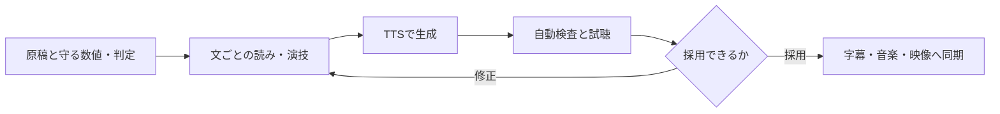

# 応用：長尺・多言語・動画への組み込みと評価

確認日：2026年11月7日。以下は、原理と公式の制御仕様から組み立てた制作案。音声の生成や比較試聴を実施した結果ではない。[原理](01-principles.ja.md) と [出典](sources.json) を併読する。

## 1. 用途が変われば、優先する制御も変わる

| 用途 | 優先するもの | 作り方と検証 |
| --- | --- | --- |
| 技術・製品デモ | 数字・単位・判定、説明の明瞭さ | 既成話者を固定。原稿を意味の単位で生成し、数値と未達・予定を試聴 |
| SFの導入・締め | 間、強調、声の一貫性 | 一つの声で演技を変える。主説明と同じ音質・近い聞こえ方を保つ |
| コックピット内のAI | 主ナレーターとの役割の区別 | 短い補助発話から試す。フィルターや残響で説明が隠れないか比較 |
| 多言語の吹替 | 意味と文化に合う表現、尺 | 翻訳→各言語の読み→合成→再編集。語数や元音声の長さだけで速度を決めない |
| 本人の声による紹介 | 参照音声と本人らしさ | 許諾済み録音を使い、声質、読み、収録環境の移り方を別に確認 |
| 対話・リアルタイム案内 | 最初の音までの待ち時間、途切れ | TTFAとRTFを別に測り、ストリーミングの継ぎ目も確認 |
| 画面内人物の会話 | 音声と口の同期 | 声を確定後にリップシンクを検討。画面外ナレーションには不要 |

表は制作上の整理で、特定サービスの品質保証ではない。モデルの指示制御、声の設計・複製、ストリーミングの例は [S19 Qwen公式](https://github.com/QwenLM/Qwen3-TTS)、[S21 CosyVoiceのモデルカード](https://huggingface.co/FunAudioLLM/Fun-CosyVoice3-0.5B-2512) に基づく。

## 2. 声を長くつなぐ

全文を一括生成する方法と、文単位に細かく分ける方法は、どちらも比較対象になる。長い一括生成で直したい箇所が出れば再生成範囲が大きくなる。細かくしすぎればリズムと音質の接続を確認する箇所が増える。作品の段落・息継ぎ・ショットの役割を基準に分ける。

声をつなぐときは、話者IDだけでなく、モデル版、参照音声、演技、音量調整、ノイズ処理もそろえる。固有の声を毎回文章から設計し直す方法では、同一人物に聞こえるか確認する。必要なら、採用した生成音声を参照として使えるモデルの公式経路を調べる。[S19 QwenのVoiceDesign→再利用の説明](https://github.com/QwenLM/Qwen3-TTS)。

Qwenの論文は長尺評価も報告しているが、そこでの条件が今回の日本語技術原稿と同じとは限らない。モデルの「長尺対応」だけで省略せず、冒頭・中盤・末尾で声、速度、脱落、反復を確認する。[S18 Qwen3-TTS](https://arxiv.org/html/2601.15621v1)。

### 接続の作業例

1. 章ごとに、淡々と説明する箇所と強調する箇所を原稿へ注記する。
2. 文の前後を含めて候補テイクを作る。毎回の生成で固定できる条件を記録する。
3. 素のWAVで発音を確認し、次に前後の文を続けて聞く。
4. 無音区間で切り、必要な余白を付ける。音節の途中をクロスフェードで隠さない。
5. 直した文を差し替え、後続字幕・効果音の時刻も更新する。

この例は編集上の案である。各エンジンの一回の合成上限、前後文脈の指定、参照音声の形式は別に確認する。

## 3. 尺は「指定」「推定」「編集」を区別する

| 尺の扱い | 意味 | 注意点 |
| --- | --- | --- |
| 音素・特徴フレームの長さを制御 | モデル内部やAPIで生成時間へ働きかける | FastSpeech 2のduration制御が、採用アプリから使えるとは限らない |
| 参照録音や文字数から推定 | 出力の長さを見積もる | 日本語、数字、略語で比率が変わる。推定を保証としない |
| 生成後に速度変更 | 波形を時間伸縮する | 声の高さを保っても、間と明瞭さを保てるとは限らない |
| 原稿と映像を編集 | 情報量や見せる時間を変える | 意味と判定を保った短縮から試す |

根拠：[S11 FastSpeech 2](https://arxiv.org/abs/2006.04558)、[S16 F5-TTSの推論時の長さ推定](https://arxiv.org/html/2410.06885v3)、[S30 FFmpeg](https://www.ffmpeg.org/ffmpeg-filters.html)。

今回の仮v1には各ショットの枠がある。次の声が枠を超えたときは、まず言い回しと間、次に生成側の話速、最後に小さな時間伸縮を比較する。数値の桁を減らすときは画面に精密値を残し、「約」を付ける。未達を達成へ、予定を実施済みへ変えて尺を縮めない。

## 4. 多言語化は、文字列の翻訳だけでは終わらない

翻訳する内容、画面の数値、発音辞書、ナレーションの長さを対応させる。原語の専門用語を残す箇所と、説明へ置き換える箇所を決め、各言語の話者または確認者に意味と発音を見てもらう。

中国語の公式文書にはピンインや数字の読み分け、韓国語のAPIには音色・速度・感情等の設定例がある。スペイン語の公式SSML文書にも発音・声・間を分ける説明がある。ただし、それぞれのタグ、値、対応話者はサービス固有である。[S06 Alibaba Cloud](https://help.aliyun.com/zh/isi/user-guide/ssml-overview)、[S05 NAVER Cloud](https://api.ncloud-docs.com/docs/ai-naver-clovavoice-ttspremium)、[S31 Microsoft公式スペイン語版](https://learn.microsoft.com/es-es/azure/ai-services/speech-service/speech-synthesis-markup)。

SSMLは制御を記述する方法で、入力すれば全モデルに効く共通の魔法ではない。タグの対応、読みの文字体系、感情指定の対象話者を公式仕様で調べる。非対応なら発音用文字列と音声編集で処理する。[S23 W3C SSML 1.1](https://www.w3.org/TR/speech-synthesis11/)。

## 5. 比較する指標と、指標では分からないこと

| 項目 | 確認方法 | 限界 |
| --- | --- | --- |
| 内容の忠実さ | 人が転記と数字・否定・単位を照合。ASRも補助利用 | ASRが自然な文章へ補って誤りを見逃す場合を想定する |
| 読み・アクセント | 日本語の確認者が専門語を重点的に試聴 | 文字の一致だけではアクセントの自然さを評価できない |
| 自然さ・演技 | 音量をそろえ、順序と名称を隠したA/B比較 | 好みと正確さは別。少人数の感想を一般的順位にしない |
| 話者の維持 | 文間・章間の試聴。必要なら同一encoderの埋込み類似度 | 類似度が高くても、内容・演技・読みの合格ではない |
| CER/WER | ASR出力を正解と照合。正規化規則と単位を記録 | 日本語のWERは分かち書きに左右される。数字の正規化で重大な誤りを消さない |
| 尺 | 生WAV・編集済み・最終MP4それぞれの時刻 | 推定秒数を実尺と記録しない |
| RTF | 合成の経過秒 ÷ 出力音声の秒数 | モデル読込を含むか、GPU、精度、バッチ等で変わる |
| TTFA | リクエスト開始から再生可能な最初の音まで | 低RTFでも、最初の待ちが短いとは限らない |
| VRAM・RAM | 冷起動／合成中のピークと同時プロセスを記録 | モデルのパラメータ数だけでは動作可否を保証できない |
| 最終音量 | ラウドネス、トゥルーピーク、BGMとの明瞭さ | PCMの最大振幅とラウドネスは別 |

CERの基本形は`(置換+削除+挿入)/正解文字数`。WERは同様に単語単位で計算する。生のASR出力、比較用の正規化後文字列、数値と否定の人による判定を残す。句読点や表記揺れの許容を、数字・単位・否定の誤りの許容と混ぜない。

論文の評価例は [S12 VITS](https://arxiv.org/abs/2106.06103)、[S16 F5-TTS](https://arxiv.org/html/2410.06885v3)、[S18 Qwen3-TTS](https://arxiv.org/html/2601.15621v1) を参照。主観評価の規格の入口は [S25 ITU-T P.800](https://www.itu.int/rec/T-REC-P.800/en)、[S26 P.808](https://www.itu.int/rec/T-REC-P.808/en)。今回は規格本文を使った実験設計やMOS測定を実施しておらず、規格準拠や統計的優位を主張しない。

大きな評価を行う場合は、原稿、確認者数、母語、機器、提示順、質問、集計と不確かさを残す。別の論文からMOSの値だけを集めてランキングにしない。A/Bの好み比較と、同一話者かを問うABX型の識別試験も同じ試験ではない。

## 6. 字幕と口の同期

字幕時刻は、採用した音声を編集した後の時刻へ結び付ける。TTSが返す時刻、ASRの推定時刻、正解文を使うforced alignmentは別の情報である。

MFAの公式手順は、音声・転記に、対応する辞書と音響モデルを組み合わせて位置を合わせる。これは転記した文が本当に正しく発話されたかの証明ではない。言語と音素体系が合わないモデルを使った時刻も、そのまま採用しない。[S24 MFA](https://montreal-forced-aligner.readthedocs.io/en/latest/user_guide/workflows/alignment.html)。

実写の印刷5秒を維持したままナレーションを替える場合も、前後の語尾、無音、効果音の位置を再確認する。口のない画面外ナレーションには、口の同期を生成する工程を加える必要はない。

## 7. 無料・ローカルで試す順序

1. 編集しやすさを見たいならAivisSpeech／VOICEVOX、既存の話者やモデルを直接調整するならStyle-Bert-VITS2。
2. 声の設計や指示制御を比較するならQwen3-TTS。モデルの種類・サイズと機能を固定する。
3. 多言語・ストリーミングの要件があればCosyVoice 3、軽さを比較するなら既存調査のKokoroやMeloTTSも検討する。
4. F5-TTSは原理と研究実験に有用。ただし公式READMEはコードMIT、事前学習重みCC-BY-NCと説明しており、無料の製品紹介向けの無条件候補にしない。

これは候補を選ぶ順序の提案で、測定した順位ではない。CosyVoiceの対象配布物は`Fun-CosyVoice3-0.5B-2512`でApache-2.0表示を確認した。論文中の1.5B等と混同しない。MeloTTSのライブラリのMIT表示から、将来使う任意の追加重みの条件まで推測しない。[S21 CosyVoiceカード](https://huggingface.co/FunAudioLLM/Fun-CosyVoice3-0.5B-2512)、[S29 MeloTTS](https://github.com/myshell-ai/MeloTTS)、[S17 F5公式のライセンス説明](https://github.com/SWivid/F5-TTS#license)。

Windowsでは既存ComfyUIのPythonへ異なる音声依存を混ぜず、専用環境や公式アプリを使う。WSL・Linuxの手順があるだけでWindowsの検証済み手順としない。今回の4090での品質、推論時間、必要VRAMは未測定。契約、課金、モデルの導入は、この調査の結果には含まない。

## 8. 今回の試験素材と、次に作るもの

自動化する場合の役割分担は、内容を守るLLM、文と設定とテイクを管理する制御コード、波形を作るTTS、候補の脱落や反復を探すASR、採否を決める確認者に分ける。LLMに「自然」と言わせるだけで試聴の合格にしない。

[試験計画のJSON](evaluation-plan.example.json) は未実行の入力と記録項目。候補の版・話者・条件を確定してから使用する。短い比較で発音と声を選び、その後、章をつないだ長めの素材で声の維持を確認する。

音声を全て作り直す前に、背景のフィンの例、階層型・適応型と5者の分担、未達の数値、締めの4種類で比較する。元の数字と判定は維持する。人の判断が必要な項目を、自動検査の合格値で置き換えない。

合格したテイクだけを動画へ差し替え、再生確認する。今回のv1は従来のWindows音声のままで、新しいモデルでの合成、試聴、差し替えはまだ行っていない。
