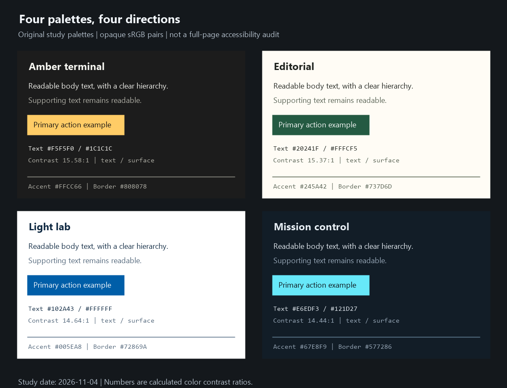

# 03. 配色を設計する

## 1. 色相より、まず役割と明るさ

色は印象を作ると同時に、読む場所、操作できる場所、状態を伝えます。好きな色を並べる前に役割を決めます。

| 役割 | 使う場所 | 設計上の問い |
| --- | --- | --- |
| background | ページの地 | 長く見ても内容が読みやすいか |
| surface | パネルや本文の面 | 背景との関係が理解できるか |
| text / muted | 本文 / 補助情報 | 「補助」を薄すぎる文字で表していないか |
| accent / on-accent | 主操作 / その上の文字 | 塗りと文字の組み合わせが読めるか |
| border | 必要な境界 | 操作対象の区別に使う線か、単なる装飾か |
| success / warning / danger | 状態 | 色を見分けなくても意味が分かるか |
| chart-* | データ系列 | 状態色や主操作の色と混同しないか |
| focus | キーボードの現在位置 | 周囲の面と区別できるか |

ブランド色と機能色を分ける考え方は、[Ant Designの色彩ガイド](https://ant.design/docs/spec/colors-cn)（S13）も参考になります。色名の変数を直接ばらまくより、役割の変数を介す方がテーマ変更を整理できます。

## 2. 色相・彩度・明度を区別する

- 色相: 青、赤などの色味。
- 彩度・クロマ: 色の鮮やかさ。厳密には色空間で意味が異なる。
- 明度: 明るく見える度合い。

違う色相でも明るさが近いと読みにくくなることがあります。暗い背景へ鮮やかな文字を載せただけでは、読みやすさは保証されません。

[MDNのOKLCH説明](https://developer.mozilla.org/en-US/docs/Web/CSS/Reference/Values/color_value/oklch)（S18）では、知覚上の明るさL、クロマC、色相hを分けて扱えます。階調を作る道具として有用ですが、同じLならどんな組み合わせも同じコントラストになる、という意味ではありません。最終的な表示色で確認します。

## 3. 数値で確認する条件

[WCAGの文字コントラスト説明](https://www.w3.org/WAI/WCAG22/Understanding/contrast-minimum.html)（S02）を参照してください。

| 対象 | AAの基準の要約 |
| --- | --- |
| 通常の文字 | 4.5:1以上 |
| 大きな文字 | 3:1以上 |
| 非アクティブ・純粋な装飾・ロゴ等 | 適用の例外がある。本文を装飾扱いにして回避しない |

「大きな文字」の目安は18pt（24 CSS px）、または14pt（約18.67 CSS px）の太字以上です。太字かどうかが曖昧な場合は通常文字として4.5:1以上を確保すると判断しやすくなります。サイズだけで可読性全体が決まるわけではありません。

[非テキストのコントラスト](https://www.w3.org/WAI/WCAG22/Understanding/non-text-contrast.html)（S03）では、操作対象・状態を識別するために必要な視覚情報や、意味を理解するための図の部分に、隣接色との3:1以上が求められます。全ての装飾線に一律で適用するという意味ではありません。

[色の使用](https://www.w3.org/WAI/WCAG22/Understanding/use-of-color.html)（S50）では、色だけを情報伝達の手段にしないことが重要です。「緑なら合格」だけでなく、「合格」という文字、形、位置などを併用します。

## 4. 独自パレットの出発点



以下は**本資料で作った配色例**です。既存サイトや映画の公式パレットではありません。まず実際の本文と操作対象に当て、必要な組み合わせを検査してください。

| 名前 | background | surface | text | muted | accent | on-accent |
| --- | --- | --- | --- | --- | --- | --- |
| Mission control | #0B1117 | #121D27 | #E6EDF3 | #9AAABA | #67E8F9 | #0B1117 |
| Editorial | #F5F1E8 | #FFFCF5 | #20241F | #586254 | #245A42 | #FFFFFF |
| Light lab | #F7FAFC | #FFFFFF | #102A43 | #52667A | #005EA8 | #FFFFFF |
| Amber terminal | #111111 | #1C1C1C | #F5F5F0 | #B1B0A7 | #FFCC66 | #111111 |

| 名前 | text / surface | muted / surface | on-accent / accent |
| --- | --- | --- | --- |
| Mission control | 14.44:1 | 7.18:1 | 13.09:1 |
| Editorial | 15.37:1 | 6.23:1 | 8.03:1 |
| Light lab | 14.64:1 | 5.93:1 | 6.63:1 |
| Amber terminal | 15.58:1 | 7.82:1 | 12.66:1 |

sRGBの相対輝度から算出した値を表示用に丸めています。判定には丸め前の値を使用しました。[palette-contrast.csv](palette-contrast.csv) に、境界線とフォーカスを含む24組を保存しています。これは指定した不透明な二色の組み合わせの確認で、ページ全体のWCAG適合を意味しません。

[check_contrast.py](examples/check_contrast.py) で再計算できます。sRGBの各成分を線形化し、相対輝度を求め、明るい方の輝度+0.05を暗い方の輝度+0.05で割っています。透明色や写真との合成は扱いません。

同じaccentでも、上に載せる文字色が違います。水色や黄色のボタンに白文字を載せる癖を避け、組み合わせごとに決めます。透明度、グラデーション、写真、hover、disabledの色は別途検査が必要です。

## 5. 配色をCSSへ落とす

以下はMission controlの例です。数値は提案パレットから取っています。

```css
:root {
  color-scheme: dark;
  --background: #0b1117;
  --surface: #121d27;
  --text: #e6edf3;
  --muted: #9aaaba;
  --accent: #67e8f9;
  --on-accent: #0b1117;
  --control-border: #577286;
  --focus: #fbbf24;
}

body {
  background: var(--background);
  color: var(--text);
}
.panel { background: var(--surface); }
.button-primary {
  background: var(--accent);
  color: var(--on-accent);
}
:focus-visible {
  outline: 3px solid var(--focus);
  outline-offset: 3px;
}
```

この断片だけではhover・active・disabledなどの状態は実装されません。フォーカス線が別の背景やボタン上に来た場合も確認します。

## 6. グラフの配色は別に設計する

カテゴリの違い、量の大小、基準からの正負は別の情報です。

| 情報 | 配色の考え方 | 例 |
| --- | --- | --- |
| 順序のない分類 | 区別できるカテゴリ色 | 設計案A・B・C |
| 小から大へ変化する量 | 明るさなどが単調に変わる連続色 | 密度や強さ |
| 基準を中心に分かれる量 | 中立点を持つ発散色 | 目標との差 |
| 警告 | 状態の意味を統一 | 許容範囲の超過 |

[Carbonの可視化パレット](https://carbondesignsystem.com/data-visualization/color-palettes/)（S40）は、分類用と連続量用などを区別して学ぶ入口です。既定パレットを採用しても、線の細さ、背景、隣接色、凡例は自分の画面で確認します。

系列名を線の近くに置く、線種や点の形を変える、表でも読めるようにすると、色だけへの依存を減らせます。小さな差を強い色差で誇張しないことも大切です。

## 7. よくある失敗と直し方

| 症状 | 起きやすい理由 | 修正 |
| --- | --- | --- |
| 全体が派手で主役が分からない | 高彩度の色を広い面積に使用 | 基本の面を落ち着かせ、主操作に強調を残す |
| 暗色テーマで補足が読めない | 灰色を暗くしすぎる | 明るさを上げ、優先順位は位置やサイズでも示す |
| 映画っぽいが疲れる | 発光・線・色を常に強調 | 発光を状態変化や焦点に絞る |
| 色で意味が食い違う | 装飾色と状態色が未分離 | 意味のトークンを決める |
| 明暗を反転したら崩れる | ライトとダークを単純反転 | 面の階層、影、境界、画像をテーマ別に見直す |

「60:30:10」などの面積比は構成を考える補助として使えますが、合格条件でも普遍的な法則でもありません。重要な操作や情報が適切に目立つかを先に判断します。
