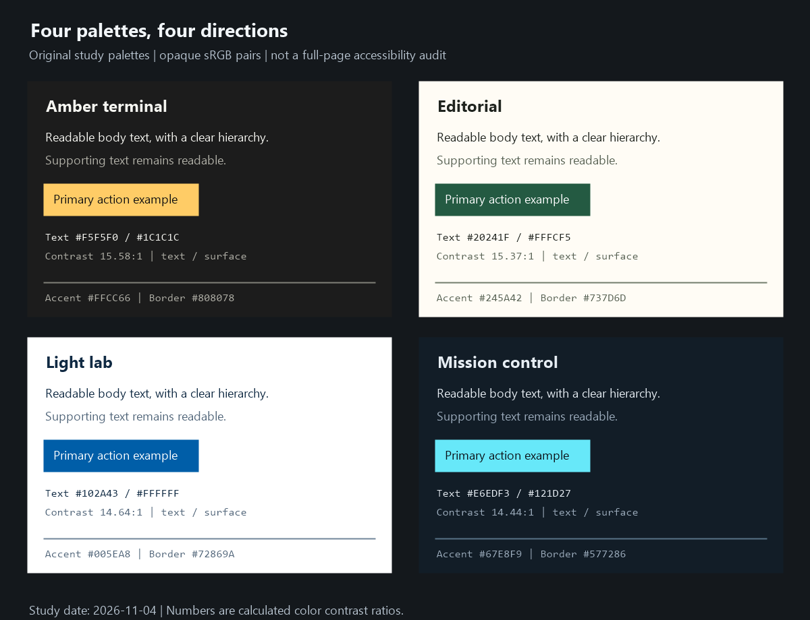

# Webデザイン調査ノート

調査日: **2026-11-04（日本時間）**。日本語で読み進められる、制作のための資料集です。

「かっこよさ」を、目的が伝わること、視覚的な個性、読みやすさ、操作の確かさから考えます。日本語・英語・フランス語・ドイツ語・スペイン語・中国語・韓国語・ポルトガル語の資料を探索しました。国ごとの好みを一般化する調査ではありません。

## 読み始める場所

| 資料 | 内容 |
| --- | --- |
| [調査方法と読み方](00_research-method.md) | 情報の確かさ、8言語の探索、調査範囲と限界 |
| [デザインの基礎](01_foundations.md) | 目的、情報設計、階層、余白、整列、統一と変化 |
| [参考サイトと探し方](02_references-and-discovery.md) | 実例8件、ギャラリー、多言語検索、観察テンプレート |
| [配色](03_color.md) | 色の役割、4パレット、コントラスト、グラフの色 |
| [フォントと文字配置](04_typography-and-layout.md) | 日本語と欧文、文字階層、行長、行間、CSS例 |
| [Webサイトの作り方](05_building-websites.md) | 技術の役割、制作工程、最小HTML、状態設計、検証 |
| [SF映画のUIをWebに生かす](06_scifi-interfaces.md) | 一次資料、世界観、情報の層、CSS、動きの条件 |
| [AIと独自性](07_ai-and-originality.md) | 定型的に見える原因、改善例、AIへの具体的な指示 |
| [実践計画と応用案](08_practice-and-project-application.md) | 学習順序、練習、チェックリスト、RocketWrightへの提案 |
| [原資料の読書ガイド](09_reading-guide.md) | 8言語の入口、目的別の深掘り、調査の限界 |
| [出典台帳](sources.csv) | 原題、発行主体、言語、URL、確認方法、用途 |
| [配色の計算結果](palette-contrast.csv) | 独自パレット24組のコントラスト比 |

基礎から順番に読むなら01→03→04→05、表現を深めるなら02→06→07、すぐ試作へ進むなら08を入口にしてください。外部資料は50件を台帳に記録しています。確認の粒度は資料ごとに異なります。

追加調査: [CDPによる画面確認の高速化とWeb性能改善](../2026-11-04_cdp-optimization/README.md)。接続方式、一括取得、待機、撮影、トレース、測定条件を整理しています。

追加調査: [Webサイトのデプロイ・公開と無料枠](../2026-11-07_web-deployment/README.md)。公開先の選び方、料金の範囲、静的・動的サイトの手順を整理しています。

## 配色を見比べる



画像は本資料で作成した配色見本です。実在サイトのスクリーンショットではありません。各色とコントラスト値は [配色の章](03_color.md) と [計算結果](palette-contrast.csv) にあります。

## 計算と画像を再現する

このディレクトリで実行します。コントラスト確認はPython標準ライブラリのみ、画像の再生成はWindows PowerShellとSystem.Drawingを使用します。

```powershell
python examples/check_contrast.py
& ./examples/render-palettes.ps1
```

[計算スクリプト](examples/check_contrast.py) は24組の公開値と基準色を確認します。[画像生成スクリプト](examples/render-palettes.ps1) はCSVから配色見本を作ります。Webページ全体を監査するツールではありません。

## 先に持っておきたい判断軸

1. 誰が、何を理解し、何をする画面なのかを一文で決める。
2. 実際に使う文章・図・データを用意してからレイアウトを考える。
3. 参考を「配色」「文字」「構造」「動き」に分解して集める。
4. 画面で一番重要なものを決め、他の要素との差をつける。
5. 色・文字・余白の少数のルールを定め、必要な場所で意図的に変化をつける。
6. 小さい画面、キーボード、文字拡大、動きの軽減でも確認する。

これは調査結果を制作に落とし込むための**本資料の提案**です。唯一の正解や効果を保証する手順ではありません。

## 出典の扱い

本文の `S01` などは [sources.csv](sources.csv) のIDです。外部情報に依存する説明には、近くに原資料へのリンクも付けます。規格は原文を優先し、デザインシステム固有の数値と、ここで提案する初期値を区別します。

資料本文・実例画像・映画画面の転載集ではありません。文章は要約と独自の考察で、元の画像や映像はリンク先で確認してください。

## 確認したことと限界

- 11本のMarkdownについて、ローカルリンク26箇所、コードブロックの対応、出典IDの整合を確認しました。
- 出典台帳50件のID、URL形式、確認日、確認方法を検査しました。本文・該当説明の確認43件、転送先確認4件、検索抜粋2件、本文取得が不十分な候補1件を区別しています。
- 配色24組を再計算し、CSVの値と一致すること、各組の参照閾値を満たすことを確認しました。白黒と同色の基準例も確認しました。
- HTML学習例のIDと内部リンク、補助スクリプトの構文を確認し、配色見本画像を生成して目視確認しました。
- HTML例のブラウザ表示、既存アプリの動作、参考サイトの全画面幅・実機操作は検証していません。今回の変更にアプリ実装は含めていません。

この資料から実装へ進む際は、実際の内容・操作・端末であらためて確認してください。

## English summary

A Japanese research notebook on web design, based on 50 source entries explored in eight languages. It covers foundations, discovery, color, typography, implementation, sci-fi interfaces, AI-assisted design, and practice. Accessibility requirements, design-system conventions, and original recommendations are distinguished. Retrieval limitations, contrast data, and reproducible palette examples are included.
