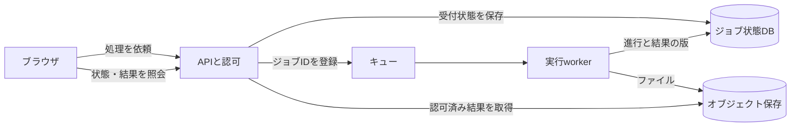

# 長時間ジョブと進行表示

短い計算ならAPIで返せる。長い解析や生成では、リクエストの寿命とジョブの寿命を分ける。HTTP接続が切れても、完了・失敗・再開の判断に使う状態を残す。

## APIとworkerをつなぐ例



これは構成例。小規模なら、同じDBのジョブテーブルをキューとして使い、別製品を追加せずに始められる。

1. APIが利用者と入力を確認し、受付状態を永続化する。ジョブ記録とキューが別システムなら、片方だけ成功した場合の再送や照合を設計する。DB内で登録と送信用の記録を一緒に保存するoutboxは候補になる。
2. `202 Accepted` とジョブID・状態照会先を返す。202は受付の意味で、成功や実行完了とは区別する。
3. workerが処理を引き受ける。入力の版、実行期限、試行数、並行数、CPU/GPUや外部APIの予算を記録する。
4. 結果を別領域に書き、検証済みのファイルと版を登録してから成功へ進める。中断された途中データを完了扱いにしない。
5. 画面は状態を問い合わせる。再読み込み時にも保存された状態と結果を読めるようにする。

受付の例であり、既存アプリの実際のURLではない。

```json
{
  "job_id": "job_example_001",
  "status": "queued",
  "status_url": "/jobs/job_example_001"
}
```

## 再試行・重複・中断

同じ利用者の同じ操作・入力版に同じ受付を返す方法を決める。例えば一意制約とidempotency keyを使い、同じkeyで内容が異なる要求は明示的に扱う。Cloudflare Queuesのようなat-least-once配送では、同じメッセージが再度届くため、worker側でも重複実行・重複登録への対策が必要になる。[Queuesの配送保証](https://developers.cloudflare.com/queues/reference/delivery-guarantees/) [B33]

処理中のworkerが停止した場合は、取得期限と試行番号で再実行の担当を決める。古い試行が後から返っても新しい成功を上書きしないよう、結果登録時に現在の試行・入力版と照合する。高価な外部APIや課金が伴う処理は、結果が不明な失敗を無条件に再実行せず、利用量を予約・記録し、提供側の重複防止手段も確認する。

状態の例は `queued` → `running` → `succeeded` / `failed`。必要な場合に `retrying`、取消要求、`canceled` を分ける。取消を受理しても、外部の処理まで停止したと確認できるまでは完了扱いにしない。

## APIの制限とジョブの制限は別

FastAPIの `BackgroundTasks` はレスポンス後に同じアプリの軽い処理を行う方法。再起動をまたぐ永続ジョブには、別workerや保存されたジョブ状態が必要になる。APIのworkerプロセスを増やす場合は、メモリやプロセス内キャッシュが共有されない前提で測る。[Background Tasks](https://raw.githubusercontent.com/fastapi/fastapi/master/docs/en/docs/tutorial/background-tasks.md) [B01]、[デプロイのプロセスとメモリ](https://raw.githubusercontent.com/fastapi/fastapi/master/docs/en/docs/deployment/concepts.md) [B02]

Cloud Run Serviceの応答期限は既定5分、設定上限60分。504で接続が閉じた後もコンテナの処理が続く場合がある。Cloud Run Jobsはタスク試行ごとの期限で、既定10分、条件により長く設定できる。長い設定値が無中断の実行を保証するわけではなく、GPUの条件は別に確認する。[Serviceの期限](https://docs.cloud.google.com/run/docs/configuring/request-timeout) [B06]、[Jobの期限](https://docs.cloud.google.com/run/docs/configuring/task-timeout) [B07]

Cloudflare Queues Freeは10,000操作/日、メッセージ保持24時間。保持期限と、実行処理の上限、利用者に表示する結果の保存期限を別にする。メッセージには大きな成果物を詰め込まず、IDと参照を渡す。[料金](https://developers.cloudflare.com/queues/platform/pricing/) [B27]、[制限](https://developers.cloudflare.com/queues/platform/limits/) [B28]

## 進行をどう表示するか

最初は間隔を空けたポーリングで状態を読める。実際に逐次更新が必要ならSSEなどを検討する。プロキシのバッファリング、アイドル期限、再接続時の取りこぼしを実経路で確認する。通信の切断をジョブ失敗や成功に読み替えず、状態照会で再同期する。根拠のない百分率を表示せず、実際の段階と利用者ができる操作を返す。
