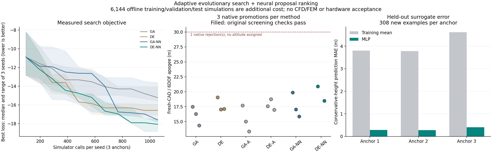

# GA・DEの適応化とNNによる候補の絞り込み

後続の[PPO・SACによる逐次設計の実験](reinforcement-design-search.md)では、同じ初期候補と
実シミュレーション予算で強化学習による設計変更も比較している。

旧GA・SciPy DEを比較用に残し、`ga-adaptive` と `de-adaptive` を追加した。
両方式は従来と同じ12変数、同じ要求・圧力上限・概算目的関数を使う。
探索対象や合格条件を変えず、候補の作り方を比較できる。

- GA：SBX交叉、成功率に応じた変異幅、親子集団からのエリート保持。
- DE：current-to-pbestとrandの混合、置換された個体のアーカイブ、成功したF/CRの反映。
- 共通：材料の離散操作、境界での反射、停滞・多様性低下時の新規候補投入、完全一致候補の回避。
- 昇格：各初期機体の進化探索で実際に計算した最良個体を優先し、その後に要求違反度で補充。

これは小規模な独自実装で、JADEやNSGA-IIの準拠実装ではない。
1世代の実計算回数を集団数に固定し、従来方式との予算を合わせる。
停止要求や不正な非有限目的値は握りつぶさない。

NNは3初期機体ごとに、単位区間の11連続変数と材料のone-hot表現から、保守側高度・
初期静安定余裕・梁たわみ比を予測する64→32のMLP。学習は任意の追加依存
`scripts/requirements-search-ml.txt`、推論はJSON重みとNumPyのみを使う。
候補は既存の熱・推進・軸方向飛行・梁の概算計算でラベル付けし、実機データとは区別する。

データの70%を学習、15%を有効化判断、残り15%を独立評価に事前配分する。
同じ設計ハッシュを分割間で重複させない。正規化は学習部分のみ。
評価用ラベルで学習・方式選択は行わない。未知の初期機体への汎化は未検証。
高度と静安定余裕の検証誤差が平均値予測より良い場合だけNNを有効にする。

NN利用時は3倍の候補を生成し、約30%を予測順位に依存しない探索に残す。
生存選択と最良値には、必ず実際に計算した目的値を使う。NNの予測で合格にはしない。
学習データの計算費用は探索の追加費用として別に報告し、無料の高速化として扱わない。

参照：[SciPy DE](https://docs.scipy.org/doc/scipy/reference/generated/scipy.optimize.differential_evolution.html)、
[pymoo DEのF/CRと変異方式](https://pymoo.org/algorithms/soo/de.html)、
[MLPRegressor](https://scikit-learn.org/stable/modules/generated/sklearn.neural_network.MLPRegressor.html)、
[データ漏洩を防ぐ分割](https://scikit-learn.org/stable/common_pitfalls.html)。
参照実装を実行したという意味ではなく、今回の独自実装・利用ライブラリは上記の通り。

通常の探索にも `--optimizer de-adaptive --surrogate-dir output/nn-search1` のように指定できる。
モデルと機体・CAD・物理ソースが違う場合は拒否し、検証で有効化されなかったモデルは
NNなしへ戻る。現在のモデルは `initial` プロファイル専用で、guided用に流用しない。

```powershell
python -m scripts.train_search_surrogate output/ga-pilot2 output/nn-search1 --count 2048 --workers 2
python -m scripts.benchmark_evolution output/nn-search1 output/evolution-comparison1 --population 32 --generations 10 --workers 3
python -m scripts.report_evolution_benchmark output/nn-search1 output/evolution-comparison1 scenarios/adaptive_design/adaptive-evolution.json
```

比較は旧GA・旧DE・適応GA・適応DE・各NN併用版の6方式、3初期機体、3乱数設定。
各組は同じ初期32個体と10世代で352回を計算する。NNの事前学習6,144回は別計上する。
各方式について、初期機体ごとに3設定中で最良の実計算個体を選び、計3案を新規CAD・6DOFへ進める。
全18案を確認対象とした。これらの候補生成改善は空力精度や実機安全性の証明ではない。

## 学習データと予測性能

2026-11-07、`4c0a0a6`で新たに6,144例を生成した。3初期機体×2,048例で、
各例の12変数をLHSで同時に変える。すべて計算完了、設計ハッシュ重複なし。
学習4,299例・有効化判断921例・独立評価924例。収集と学習の経過時間は172.11秒。
この時間は同PC・今回の条件の記録であり、一般的な所要時間を保証しない。

| 初期機体 | 独立評価数 | 高度MAE | 平均値予測の高度MAE | 静安定余裕MAE |
|---|---:|---:|---:|---:|
| provided | 308 | 0.290 m | 3.806 m | 0.0298口径 |
| independent-light | 308 | 0.275 m | 3.778 m | 0.0299口径 |
| D40-2l | 308 | 0.404 m | 4.615 m | 0.0262口径 |

高度は概算の保守側シナリオの値。実飛行や高精度CFDに対する精度ではない。
高度の最大誤差は1.82 mで、MAEは誤差上限ではない。梁たわみ比も学習するが、
最大誤差0.321の例があり、強度合否やguided探索の順位には使用していない。
熱環境・圧力・ペイロードを変えた汎化、未知の初期機体への汎化は検証していない。

通常の探索CLIとの接続も実行した。`adaptive-nn-integration1` は3モデルが有効、
予測648候補、実計算456回、新規CAD・6DOFが3件完了。102ファイルを照合した。
これは1世代の接続確認であり、下記の探索比較に混ぜない。

## 同じ探索予算での比較結果

`a5d42d5`の実装で54試行、19,008回の概算計算を行った。各方式3,168回。
同じ乱数設定・初期機体では、6方式の初期集団ハッシュと評価回数が一致した。
NNは追加で17,280候補を予測したが、これらを実計算の回数や合格数には加えていない。

| 方式 | 3設定の最良目的値の中央値↓ | 対応する旧方式を上回った組 | 確認計算の最高高度 | 完了／試行 |
|---|---:|---:|---:|---:|
| 旧GA | −15.221 | — | 17.476 m | 3/3 |
| 旧DE | −16.586 | — | 19.039 m | 3/3 |
| 適応GA | −13.271 | 2/9 | 17.681 m | 3/3 |
| 適応DE | −15.656 | 3/9 | 18.744 m | 3/3 |
| 適応GA＋NN | −17.600 | 6/9 | 19.859 m | 3/3 |
| 適応DE＋NN | −18.077 | 8/9 | 20.893 m | 2/3 |

中央値は各設定で3初期機体の最良目的値を取り、その3値の中央値。
9組は3初期機体×3乱数設定であり、9種類の独立した機体を意味しない。
目的関数は `2000 * max(0, 1.12 - 初期静安定余裕) - 保守側高度`。
負値の改善をそのまま飛行高度の改善と解釈せず、右列の再計算と区別する。

最高高度は、新規CAD・6自由度・時間刻み・空力適用範囲・初期余裕1口径・迎角の確認を
通った候補に限定。GA＋NNは旧GA比13.6%、DE＋NNは旧DE比9.7%高い候補を見つけた。
これは今回の予算と候補範囲の比較で、最適解や一般的な優越性の証明ではない。
NNなしの適応化だけは中央値が悪化し、適応GAの1試行では初期余裕1口径の候補も見つからなかった。
したがって既定の旧DEは維持し、今回改善したNN併用を明示的に選べる方式として扱う。

DE＋NNの1案は、フィンCADに非隣接面の自己交差3組が見つかり形状検査で棄却した。
計算失敗を高度0として平均したり、成功例に置き換えたりしていない。
NNは製作形状の検査を代替できず、合否は実際のCAD・シミュレーションで決める。
18案中17案が確認計算を完了し、その17案は上記のスクリーニング条件を満たした。
ただし全案で30 mは未達。これらの新案について高精度CFD・FEM・実機安全性は未確認。

585件の原データファイル、54件の探索ログ、モデル・学習例のハッシュを照合した。
探索＋確認の経過時間546.45秒は同時実行の記録。学習用6,144回・172.11秒も追加で必要なので、
同じ総計算費用で高速化したという主張はしない。既存モデルを再利用する場合の損益分岐も未評価。



[比較数値・条件・照合情報](../scenarios/adaptive_design/adaptive-evolution.json)。
原データは `output/nn-search1`、`output/evolution-comparison1`、接続確認は
`output/adaptive-nn-integration1`。上記コマンドでは新しい出力先を指定して再実行する。
