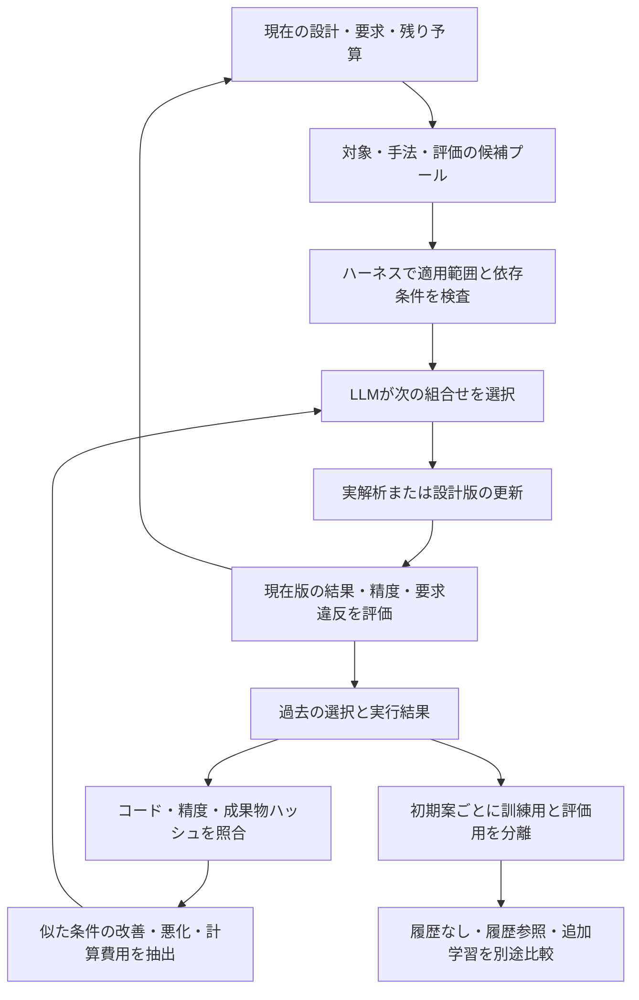
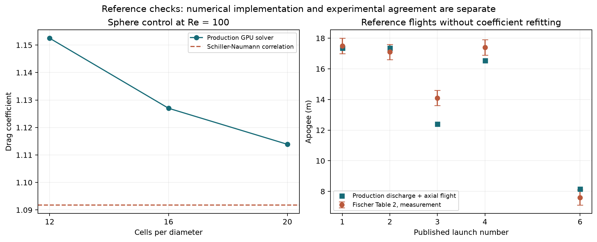

# 複数初期案と反復履歴を使う設計探索

固定案の精度検証と、要求を満たす候補の探索を別の段階として実行する。要求高度、ペイロード、静安定余裕、最終精度のしきい値は探索中に変更しない。

## 実行の流れ

1. 入力案、D01・D02由来の運用初期値、独立生成の運用案、独立した軽量形状の5案を準備する。文献案の質量や合格判定は引き継がず、共通のCAD・質量モデルで計算する。
2. 各案で実CAD、熱、推進、解析的空力の6自由度解析を実行する。選択前に、複数の運用・形状・材料・部品位置を鉛直モデルで比較する。CADを比例換算した予測は、変更後の実CADで確認する。
3. LLMは候補の高度・質量・静安定余裕の予測差、再計算費用、同じ解析条件で得た過去の改善・悪化を参照して一手を選ぶ。選択、候補全体、理由、結果、実行時間を保存する。
4. 過去の版を含む実6自由度計算の記録から、要求違反の合計が小さい案を暫定選択する。これは最適性や優劣の確定ではない。
5. 選択案を新しい検証案件として固定し、元の精度要求でCFD・FEM・確認計算を行う。探索側の簡易解析の合格は採用に使わない。

全体で一つの計算予算を持つ。探索に割り当てる時間と確認用の予約時間を先に分け、子案件の消費と経過時間の両方を控除する。既存案件の予算を初期化して継続する処理はない。固定案の監査は `max_versions=1` として明示し、再設計を含む実行には版数と一巡後の操作数を確保する。

## 3つの棚

| 棚 | 実行する選択肢 | 使い方 |
|---|---|---|
| 対象 | 圧力、水量、ノズル径、フィン厚・根元弦・先端弦・スパン・後退量・位置、ノーズ長・肉厚、部品位置、材料、取付 | 運用候補と形状候補を同時に比較する。無効な形状と既訪問案を除く |
| 手法 | CAD比例換算＋鉛直推進飛行、実CAD＋解析的空力6DOF、3D LBM、暖機後梁、固体FEM、定理の前提検査 | 適用範囲と費用を保持する。鉛直モデルは姿勢安定性を証明しない |
| 評価 | 要求違反の変化、質量・静安定余裕との両立、数値設定差、文献差、実行時間、厳密解との比較 | 暫定探索用の評価と、現在版の最終確認を分離する |

Prusament ASAの密度1070 kg/m³と水平試験片の引張弾性率1.6 GPaを[メーカーTDS p2](https://storage.googleapis.com/prusa3d-content-prod-14e8-wordpress-prusament-prod/2024/05/bc8551ef-tds_prusament-asa_2024_en.pdf)から追加した。印刷方向・形状による差を省いた等方性近似で、温度による剛性比0.5は仮定。破壊強度の許容値やS5印刷プロファイルを確定した意味ではない。登録済み材料以外をLLMが作ることはできない。

## 履歴参照と追加学習



履歴はコード、精度条件、変更した変数と方向、容量・圧力・水量・ノズル・フィン・ペイロード・材料の近さで絞る。結果ファイルと生データmanifestのハッシュが一致するものだけを参照する。異なる解析コード、異なる精度、失敗・未完了、改変済みの記録は改善量の推定に使わない。

高度が下がった変更も削除せず保持する。標本が少ない間は履歴の得点への影響を縮める。実測した解析時間と予算上の課金時間は別に記録する。数値細分化にも、同じ機体での精度残差の減少量と計算時間を記録する。これらは局所的な経験則で、因果効果の保証や強化学習済みモデルではない。

候補の全記録をそのままプロンプトには入れない。9,000文字以内の判断用表示に、現在値、要求違反、予測差、関連履歴の平均改善量と費用をまとめる。候補が多い場合も変数の種類ごとの最上位候補を残し、表示から外したIDと実際に送った内容を保存する。モデルの文脈枠は16kを明示する。合法な操作が一つしかない依存処理は `forced_dependency` と記録して実行し、LLMによる選択とは数えない。

`learning.json` は選択時点の候補・理由と、その後の観測を対応付ける。モデルの重みは自動更新しない。将来学習する場合は、機体・初期案単位で訓練用と評価用を分離し、履歴なし、履歴参照、追加学習の3方式を同じ予算で比較する。合格率、確認までの計算時間、選択の失敗率、予測誤差を測り、評価に使った結果を同じ評価の入力へ漏らさない。

追加学習の前に、`scripts/audit_iteration_learning.py` で初期案を一つずつ丸ごと除外する予測監査を行う。選択された変更の実測高度差に対し、鉛直モデルだけの予測と、別の初期案の履歴で縮約補正した予測を比較する。同じ初期案の将来の版を訓練側へ入れない。出典名、旧機体の質量、回収傘だけが違い、実CADの質量を使う上昇解析の条件が同じ案も同じグループとして除外する。5登録開始点を5つの独立した上昇条件とは数えない。これは予測の監査であり、選択されなかった変更の結果は不明なので、探索方針そのものの効率改善を証明しない。

選択理由の文章を正解ラベルにはしない。SFTを行うなら、要求と適用条件を満たした判断例に絞る。優劣を学習するなら、同じ判断状態から実際に両方を計算した比較対を用意する。異なる条件の成功例と失敗例を、そのまま優劣の対として使わない。未測定の成功を作る自己学習は行わず、評価用の初期案と解析コード版を固定する。

## 文献と解析実装の照合

[Fischer et al. の第9節・表2](https://arxiv.org/html/2001.08828)の1 L・143 g・ノズル9 mm・胴半径40 mmの5飛行を、現在の時間分解した推進モデルと鉛直飛行モデルで比較する。論文の圧力は絶対圧として読み、周囲圧を引いて入力する。抗力係数0.6を使用し、0.4〜0.8も比較する。既存モデルの調整に使った飛行と、追加照合・発射不調を伴う条件を区別し、係数の再調整はしない。

別に、定推力と真空弾道、有限根元支持を持つ一様梁、断熱膨張のpV^γ、熱平衡の厳密解を照合する。実装の数値検証と実験との一致は別の結果として保存する。文献機体と異なる現在の機体のCFD・材料強度まで検証済みとはしない。[NASAのV&V資料](https://www.grc.nasa.gov/www/wind/valid/tutorial/valassess.html)に沿って適用範囲を明示する。

[実行結果](../scenarios/adaptive_design/reference-validation.json)では厳密解4項目は通過したが、文献の測定誤差内に入った飛行は5件中2件。追加照合の飛行3は14.1 mに対し12.405 mで、約1.69 mの過小予測だった。全5件の相対誤差RMSは6.74%だが、既存調整に使った条件と発射不調の条件を含み、新しい機体の予測精度を示す数値ではない。



```powershell
python -m scripts.run_design_search scenarios/adaptive_design/spec.json output/new-search --limits scenarios/adaptive_design/search-limits.json --runtime <host-runtime.json>
```

出力先は新しいディレクトリを指定する。各案件は従来のCLIで保存状態から再開できるが、総予算は保持する。公開する概要からはローカル絶対パスを除き、生データとの対応ハッシュは残す。

```powershell
python -m scripts.report_design_search output/new-search output/search-summary
python -m scripts.audit_iteration_learning output/new-search output/learning-audit.json
```

補助CFD監査は `scripts/verify_search_cfd_controls.py` で実行する。実GPUの壁面処理13項目と、Re=100の球の3格子を同じ実装で調べ、[MFIXの資料に示される相関式](https://mfix.netl.doe.gov/doc/mfix-exa/guide/latest/tutorials/fluid/steady-flow-around-sphere.html)とのずれを残す。球の低レイノルズ数流れと高レイノルズ数の機体流れは別の検証対象であり、球での一致を機体の検証に流用しない。

2026-11-07の[実GPU結果](../scenarios/adaptive_design/sphere-controls.json)では、壁処理13項目の最大絶対差は8.94×10⁻⁸。球のCdは12・16・20セル/胴径で1.15248・1.12700・1.11388、相関式1.09173との差は5.56%・3.23%・2.03%だった。最後の格子間差は1.18%。相関式との一致だけで機体の乱流境界層や実験値を検証したとはしない。

[判断入力の再生結果](../scenarios/adaptive_design/selector-context-replay.json)では、元の38,096/42,257文字の記録から8,746/8,966文字の表示を作り、同じ2場面で実モデルが圧力の候補を選んだ。これは入力欠落を避ける動作確認で、一般的な探索効率の向上を証明する比較試験ではない。
