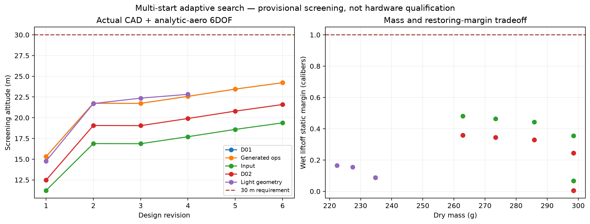
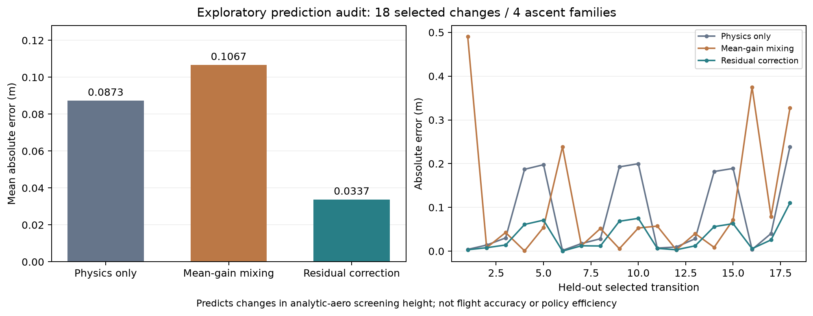

# 階層探索・反復履歴の検証結果

2026-11-07。探索、履歴補正、条件付きの数値確認を実行した。要求を満たす製作用の機体が完成したという結果ではない。要求高度30 m、静安定余裕1口径、元の数値精度基準は変更していない。

## 指摘された5点への変更

| 指摘 | 変更 | 確認できた範囲 |
|---|---|---|
| 1案・15操作で再設計に到達しない | 複数初期案、複数版、全体予算と確認用予約を導入 | 5登録開始点から28版の有効な計算、23件の変更結果 |
| 候補が少ない | 運用、フィン平面形状・肉厚・位置、ノーズ、材料、部品位置、取付を比較 | 3材料、複数運用案と独立した軽量形状。材料の許容強度は未確定 |
| 精度不足で探索全体が止まる | 暫定探索を許可し、採用には現在版の精度確認を要求 | 精度不足時の探索と、古い判定の失効を回帰テストで確認 |
| 固定優先順位が中心 | 事前予測、検証済み履歴、予測誤差、再解析費用を提示 | 実ローカルLLMへ別案件の履歴と補正値が渡り、候補が選択された |
| 計算の信用範囲が曖昧 | 厳密解、文献飛行、GPU壁処理、球、機体の独立CFD監査を追加 | 一致しない条件も保存。現在機体の実験的検証は未完了 |

設計と運用は[設計ガイド](adaptive-search-feedback.md)、コードは `rocketwright/analysis/`、公開用の実行データは `scenarios/adaptive_design/` にある。

## 実際の探索

5登録開始点のうち2点は上昇条件が同じなので、独立した上昇条件は4系統である。初期案ごとに最多6版・100操作を許可した。最終候補の詳細確認は固定案として行った。これは有限予算内の探索で、全候補を調べ尽くした最適化ではない。

[全体データ](../scenarios/adaptive_design/search-verification.json)では、ローカルLLMの選択98回、選択肢が一つだけの依存処理126回を記録した。19件の高度改善と4件の高度悪化をどちらも保持した。この長い探索は平均改善量を参照する旧版で行い、その結果から残差補正を検討した。以下の28版を、残差補正版で全面再探索した結果とは扱わない。

| 条件 | 初期版 | 暫定選択版 |
|---|---:|---:|
| D01由来の運用案の簡易6DOF高度 | 15.314 m | 24.226 m |
| 乾燥質量（ペイロード別） | 298.502 g | 262.879 g |
| 水充填状態の静安定余裕 | 0.00583口径 | 0.35822口径 |

この経路では、圧力シナリオ変更による高度差が+6.431 m、続くフィン根元弦の変更が+0.847 m、2回の肉厚変更が+0.872 m・+0.772 mだった。途中の部品配置変更は高度が−0.009 mだが、静安定余裕を改善した。これらは順に条件を変えた局所差分であり、各変数の普遍的な寄与率ではない。

選択案は1.5 L、60 gのペイロード、フィン根元弦76.5 mm・先端弦40 mm・スパン120 mm・後退量35 mm・厚さ1.734 mmの仮定で計算した。圧力シナリオの採用は、現物ボトルの許容圧力の確認を意味しない。

## 完了済みの詳細確認

16/20セル・元の精度条件で完了した一巡の確認値は次の通り。

| 項目 | 計算結果 | 判定・範囲 |
|---|---:|---|
| 摂動付きの確認高度 | 21.033 m | 30 m未達 |
| 静安定余裕 | 0.358口径 | 1口径未達 |
| CFD格子間差 | 18.851% | 5%未達 |
| 独立点での補間差 | 4.488% | 当該1条件では5%以内 |
| 独立点での領域差 | 0.705% | 当該1条件では5%以内 |
| 格子速度変更による差 | 4.918% | 3%未達 |
| 計算時間延長による差 | 3.383% | 3%未達 |
| 独立点の第3格子との差 | 5.910% | 5%未達 |
| FEMメッシュ差 | 1.920% | 仮定した材料・支持条件で5%以内 |
| FEM変形量／スパン | 2.260% | 仮定した材料・支持条件で5%以内 |

梁近似の最初のモードは23.668 Hz・130.357 Hzだった。固有振動数が正であることや凍結したピッチ系の条件付き評価が通ることは、実機の共振回避や全飛行の非線形安定性の証明ではない。高度の時間刻み差は小さかったが、空力の精度不足とは別の判定である。

20/24セルの全条件のCFD再計算も完了したが、格子間差は17.168%で5%に届かなかった。次の独立監査は予約時間・メモリの条件を満たさず、24セルを使った飛行・FEM・再確認は未完了のまま停止した。上表の21.033 mは16/20セルの完了済み一巡の値であり、24セルで再確認した高度ではない。

62件のGPUケースを含む、197件のmanifest・1,298ファイルを照合した。全体の実測経過時間は5,639.344秒。予算上の予約残高は915.353秒だが、次の監査を予約できる量ではなかった。ソフトウェア上の最終状態は `unresolved`、採用判定はなし。

この実行から、細分化の操作だけを安価に見積もる欠点も修正した。[保存された境界での再評価](../scenarios/adaptive_design/refinement-budget-verification.json)では、一巡分の保守的な予約量とメモリを照合し、新しい処理はこの細分化を開始前に除外する。元の実行履歴や結果を書き換えてはいない。

## 履歴はどこに効いたか

23件には同じ物理的変更の5件の重複が含まれる。重複を除いた18件について、上昇条件の系統を丸ごと評価用に外す監査を行った。過去の改善量の混合は平均絶対誤差0.10665 m、物理予測だけでは0.08730 m、予測誤差の縮約補正では0.03373 mだった。

この比較は「簡易モデルにおける変更前後の高度差」を予測する診断である。実飛行の高度が約3 cmの精度で当たることを示さない。補正方式を検討した後の探索的比較であり、選ばれなかった候補の結果も不明である。別の初期案と同一予算での繰り返し比較が、探索効率の主張には必要になる。

分割条件と個々の予測差は[監査データ](../scenarios/adaptive_design/iteration-learning-audit.json)に保存した。

[別途実行した2案件](../scenarios/adaptive_design/residual-feedback-verification.json)では、1件目の予測誤差と実測の再解析時間が、2件目の実LLM選択へ届くことを確認した。LLMの重みは追加学習していない。

## 残る未達と再現範囲

- 現案は高度と静安定余裕が未達。製作・打ち上げ用の採用案にはなっていない。
- 高レイノルズ数の現在機体の空力、印刷材料の異方性・許容応力・取付条件は、現物に対する検証が残る。
- 文献の5飛行は測定誤差内が2件で、追加照合には約1.695 mの過小予測がある。球のRe=100の照合を現在機体へ一般化しない。[文献比較](../scenarios/adaptive_design/reference-validation.json)、[球の比較](../scenarios/adaptive_design/sphere-controls.json)
- 長い探索の数値ソースは `aeeb15a`、全体ハッシュは `d6e332d6faae575eff3d72baa9746d84cd63962e7fa2dbe62becb75255cde84c`。履歴補正の実LLM検証は `0431737`。後から加えた資源判定は別の回帰テストで確認している。
- 中断した診断2回の消費も保持し、15,000秒から控除した13,702.536秒を長い探索に与えた。ハーネスの保守的な予約費用と実測時間は同じ値とは限らない。

最新コードの関連回帰テストは97件通過、失敗・スキップは0件。静的チェックと2枚の図の目視確認も行った。これは全ての機体形状・運用条件の正しさを保証するテストではない。
