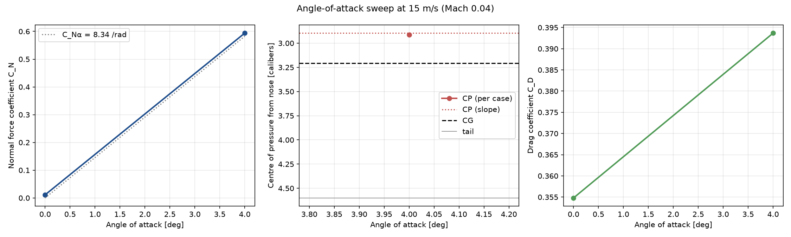

# CFD report: rw

Model: `/case/airframe.stl`  
Regime: incompressible, mesh preset: medium  
OpenFOAM cases: `/case/foam/rw`

## Geometry

- Length: 0.3759 m, reference diameter: 81.72 mm (reference area 0.005245 m²), fineness ratio 4.6
- Moments about the nose tip; reference length = reference diameter
- Watertight: True, source units: m

## Mesh

- Cells: 428,503, max non-orthogonality: 60.81765681, max skewness: 2.306925362
- Surface cell size: 2.94 mm (level 4), boundary layers: 3
- checkMesh: OK

## Results

| case | V [m/s] | α [°] | Mach | C_D | C_A press. | C_A visc. | C_N | X_cp [cal] | drag [N] | converged |
|---|---|---|---|---|---|---|---|---|---|---|
| V015p00_A+00p00 | 15 | 0 | 0.044 | 0.3548 | 0.2239 | 0.1309 | 0.0113 | – | 0.256 | no (0.0% CD swing) |
| V015p00_A+04p00 | 15 | 4 | 0.044 | 0.3937 | 0.2213 | 0.1319 | 0.5938 | 2.91 | 0.285 | no (0.0% CD swing) |

C_Nα (α ≤ 6°, 15 m/s): **8.344 per radian**

### Centre of pressure

- **237 mm from the nose tip** (2.90 calibers, 63% of the length), from the moment/force slope over the angle sweep at 15 m/s
- Stability margin: **-0.31 calibers** with the CG at 262 mm (above 1 is the usual rule of thumb)

### Angle-of-attack sweep

### Flow: 15 m/s, α = 0°

### Flow: 15 m/s, α = 4°

## Notes

- Steady RANS (k-ω SST, wall functions), incompressible (simpleFoam). Fully turbulent: no laminar run on the nose, so drag at low Reynolds number is somewhat overestimated.
- Coefficients are averaged over the last iterations; check `cd_fluctuation` and the `converged` column before trusting a number.
- Run a finer mesh preset to check the numbers do not change much (mesh independence).
