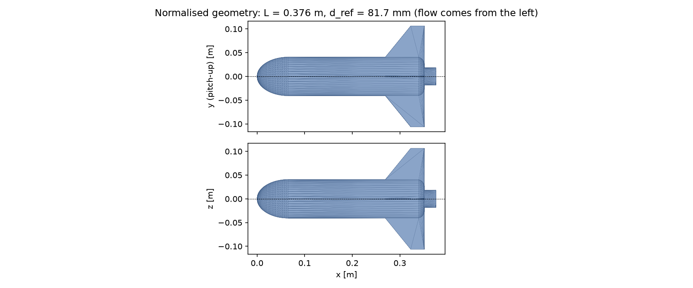
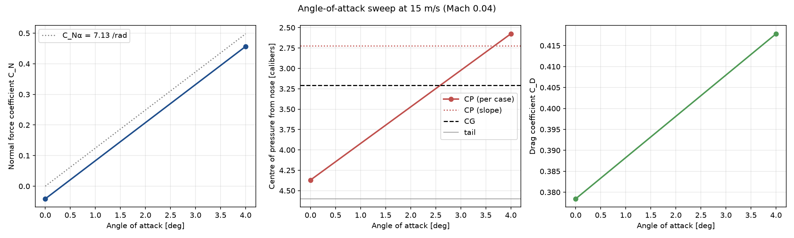
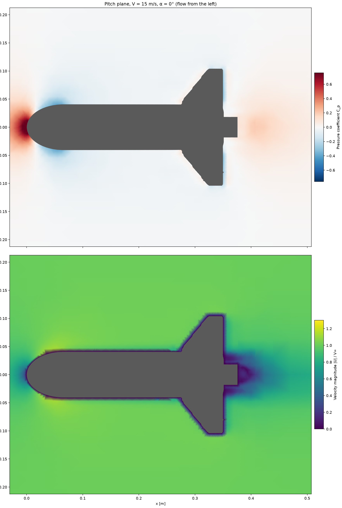
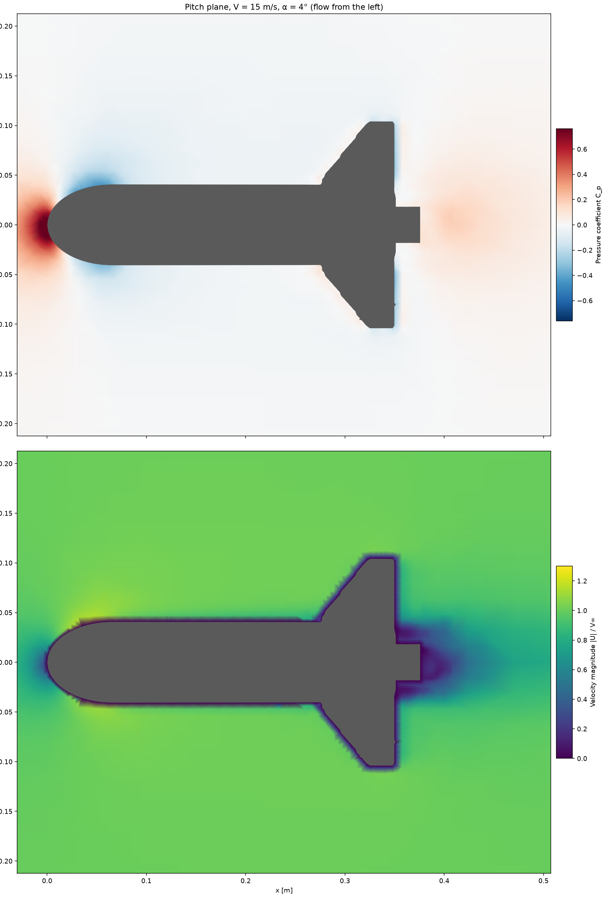

# CFD report: rw

Model: `/case/airframe.stl`  
Regime: incompressible, mesh preset: coarse  
OpenFOAM cases: `/case/foam/rw`

## Geometry

- Length: 0.3759 m, reference diameter: 81.72 mm (reference area 0.005245 m²), fineness ratio 4.6
- Moments about the nose tip; reference length = reference diameter
- Watertight: True, source units: m

## Mesh

- Cells: 120,569, max non-orthogonality: 44.67386249, max skewness: 1.235951522
- Surface cell size: 7.83 mm (level 3), boundary layers: 0
- checkMesh: OK

## Results

| case | V [m/s] | α [°] | Mach | C_D | C_A press. | C_A visc. | C_N | X_cp [cal] | drag [N] | converged |
|---|---|---|---|---|---|---|---|---|---|---|
| V015p00_A+00p00 | 15 | 0 | 0.044 | 0.3784 | 0.2419 | 0.1365 | -0.0412 | 4.37 | 0.274 | no (0.0% CD swing) |
| V015p00_A+04p00 | 15 | 4 | 0.044 | 0.4178 | 0.2508 | 0.1361 | 0.4567 | 2.58 | 0.302 | yes |

C_Nα (α ≤ 6°, 15 m/s): **7.132 per radian**

### Centre of pressure

- **223 mm from the nose tip** (2.72 calibers, 59% of the length), from the moment/force slope over the angle sweep at 15 m/s
- Stability margin: **-0.48 calibers** with the CG at 262 mm (above 1 is the usual rule of thumb)

### Angle-of-attack sweep

### Flow: 15 m/s, α = 0°

### Flow: 15 m/s, α = 4°

## Notes

- Steady RANS (k-ω SST, wall functions), incompressible (simpleFoam). Fully turbulent: no laminar run on the nose, so drag at low Reynolds number is somewhat overestimated.
- Coefficients are averaged over the last iterations; check `cd_fluctuation` and the `converged` column before trusting a number.
- Run a finer mesh preset to check the numbers do not change much (mesh independence).
