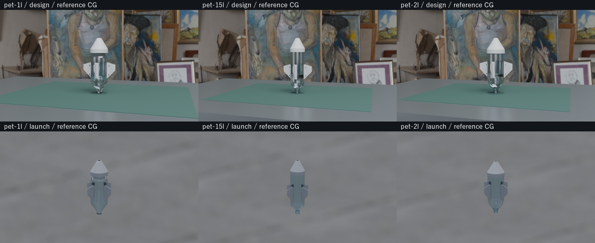
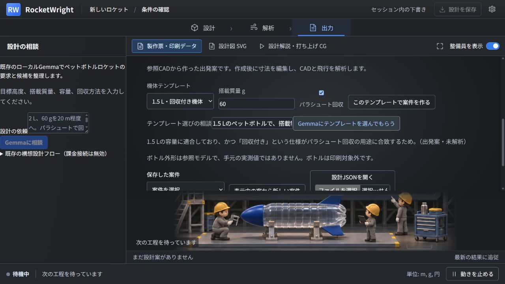

# 機体テンプレートの実装と実測

1 L・1.5 L・2 Lの出発案を登録し、統合画面から選択・編集・解析・採用・出力へ接続した。
テンプレートは完成済みの設計や性能保証ではない。新規案件は未解析で始まり、寸法と質量を
保存してから、実際のCAD生成と飛行計算を行う。2026-11-07の同一PCでの試行記録。

## 参照チャットのモデル

[資料収集チャット](codex://threads/01a1a42d-e515-7920-888e-19704ae2bbef)と
[資料PR #54](https://github.com/masatoshibukawa/RocketCreater/pull/54)の
`3da2a935aa621e8060605063b50ca3756f976224`を確認し、次のモデルだけを取り込んだ。

| 出発案 | 外形の参照 | 扱い |
| --- | --- | --- |
| 1 L | Adrian Schlatter / RocketFins、BSD-2-Clause | 公開回転断面を1 Lの仮定寸法へ調整。原作者の1 L実測モデルではない |
| 1.5 L | castetsb / waterRocketToolbox、Kirin Lemon STEP、MIT | CADの直径88.8 mm・全高306.919043 mmを初期入力に使用 |
| 2 L | 同、Soda 2L STEP、MIT | CADの直径109 mm・全高約297 mmを初期入力に使用 |

原本、完全なライセンス、出典コミット、SHA-256は
[reference/](../rocketwright/catalog/airframes/reference/)に保存。
Gmsh 4.15.2を隔離したローカル環境で使い、STEPから映像用の表面メッシュを準備した。
[変換スクリプト](../scripts/prepare_airframe_references.py)と変換条件も保存した。
製品実行時にGmshは不要。

手元のボトルの実測値ではなく、耐圧容器の製造データでもない。映像では編集後の
外径・全高に合わせ、ノーズで隠れる面を表示上切り詰める。印刷するノーズ・フィン・
試着リングは既存の設計入力に基づく決定的な生成・検査を使う。

## 責任分担と再利用

- ローカルGemmaは登録IDと短い理由を返す。任意のCAD、コード、パスは生成しない。
- ハーネスは型・選択肢・版・出典ハッシュを検証し、新しい未解析案件を作る。
- スクリプトがCAD・質量・飛行・機種別スライス・映像を処理する。
- 同じ製作条件のCADだけを、全ファイルのハッシュを確認して再利用する。質量・飛行・
  採用判定はコピーしない。寸法変更、生成コードの変更、破損時は再生成する。
- ボトル外形、舞台、解説、飛行、字幕は別のキーで再利用する。新規案件には参照レシピを
  保存し、後日のカタログ変更で古い案件の外形が黙って変わることを防ぐ。

## 実測

Windows / RTX 4090 / Blender 5.2.2 LTS。各条件1回の観測で、統計的なベンチマークではない。
計測ソースは`1ed3041f64149ad6e67f238bd2afc49602f07aa1`。
[実行器](../scripts/benchmark_airframe_templates.py)と
[生記録](../assets/product-demo/production-plan/airframe-templates/native-benchmark.json)。

| 出発案 | 初回CAD・質量・飛行 | CAD再利用・搭載質量60→80 g・再計算 | 1080p静止画6枚 | 同じ6枚の再利用 |
| --- | ---: | ---: | ---: | ---: |
| 1 L | 2.701 s | 0.125 s | 19.556 s | 2.543 s |
| 1.5 L | 2.758 s | 0.138 s | 19.960 s | 2.858 s |
| 2 L | 2.933 s | 0.155 s | 20.310 s | 2.866 s |

CADは全ハッシュ一致、搭載質量変更後の計算高度は変化した。1.5 Lのフィンスパンを
5 mm増やす試験はキャッシュ不使用となり、CAD・質量・飛行を2.771 sで再生成した。
静止画は1920×1080・32 samplesで各機体の解説/飛行の始点・中間・終点を描画。
再利用した全18画像はバイト一致。1.5 Lでは同じCAD・軌跡で旧包絡形状との比較も作った。
フル1080p動画3組を生成したという意味ではない。

[旧包絡と参照CADの比較](../assets/product-demo/production-plan/airframe-templates/reference-comparison.jpg)。
参照CADの口元・肩の形を保ち、全18静止画と実動画の18時点で胴体がつながって見えることを
確認した。原寸静止画も比較した。あらゆる寸法での写実品質や、連続全フレームの目視確認は
主張しない。

## 実際の画面からの生成

既存のBoeingプロジェクトのOllama（127.0.0.1:11436）と`gemma4:12b`を利用。
新しいモデルはダウンロードしていない。UIで2 Lを選んだ状態から「1.5 L、パラシュート回収」
と依頼し、Gemmaが1.5 Lを選んだことを確認。そのまま新規案件の作成、再解析、試作版採用、
固定演出の540pプレビュー制作を行った。課金APIは無効のまま。

案件`f68dfdab0e6f4ca6b8e75b986c38bfe0:v1`。16秒の解説＋12秒の飛行を960×540・12fpsで生成。
ボタン後のworker開始から登録完了まで236.694 s、描画進捗の経過227.819 s。
舞台・ボトルメッシュは準備済み、動画336枚はすべて新規描画。前のv4の生成時間とは
機体・条件が異なるので速度比にはしない。
両MP4の336フレーム全復号と位置記録の照合が成功し、ブラウザーで両方が終端まで再生。
観測したコンソール・再生エラーはなし。

[解説MP4](../assets/product-demo/production-plan/airframe-templates/design-explanation.mp4) /
[飛行MP4](../assets/product-demo/production-plan/airframe-templates/launch-cg.mp4) /
[再生記録](../assets/product-demo/production-plan/airframe-templates/playback.json) /
[ジョブ実測](../assets/product-demo/production-plan/airframe-templates/ui-measurement.json)。

## 印刷・再現・制約

保存したBlenderシーンを実CADと独立に照合し、3機体×ノーズ1・フィン4の15部品について
頂点・面・印刷姿勢の境界・尺度・配置が一致した。
[ネイティブ監査](../assets/product-demo/production-plan/airframe-templates/mesh-audits.json)。
3機体それぞれのフィン1枚をS5 / Tough PLA Gray / AA0.4 / 20 mmブリムでスライスし、
最終3組の検査が成功した。[スライス記録](../assets/product-demo/production-plan/airframe-templates/slice-review.json)。
この試行ではプリンター送信、現物の印刷成功確認は行っていない。

再現ZIPには新しいレンダラー、参照モデル・ライセンス、プレビュー品質の指定を同梱する。
実UI案件のZIPを新しいフォルダーへ展開し、251ファイルを検査。展開したソースと素材から、
空の描画キャッシュでCAD・PDF・解析・540pプレビュー・ZIPを再生成した。
3部品の形状/体積と飛行17指標、シーンの全7メッシュハッシュとボトル参照記述が一致。
再生成側も336フレーム全復号に成功した。冷描画したPNGのバイト一致は0/336であり、
ピクセルまで同一の再現とはしない。元のZIPは製作手順PDF・印刷パッケージ・最終動画が
未生成の部分パッケージで、その欠落もmanifestに残る。再現判定も`full_reproduction=false`。
既存の分離済み映像ライブラリをPYTHONPATHへ指定して実行した同じPCの確認で、
別PCや新しいPython環境での確認ではない。
[数値比較](../assets/product-demo/production-plan/airframe-templates/reproduction-check.json) /
[再現監査](../assets/product-demo/production-plan/airframe-templates/replay-audit.json)。

関連45試験、Ruff、TypeScript、独立出力先のNext本番ビルドが成功。
この案件は目標高度未指定の試作で、P12や耐圧・回収・取付の実機検証を完了した扱いにしない。
P13/P14は引き続き対象外。PR #60の解析用初期候補との寸法定義の照合と、既報のmainとの
5ファイルの競合解消は、後続の統合で行う。
