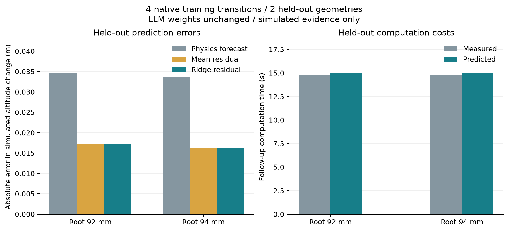

# 履歴参照と学習する予測器

ローカルLLMを判断に使い、外部の小さなリッジ回帰がシミュレーションの予測誤差と再解析時間を学習する。LLMの重みを追加学習する処理ではない。Claude API用の接続も用意したが、利用者の指定により今回の実行はローカルGemma 4 12Bを使い、有料APIを呼ばない。

追加の[8学習・6評価条件での比較](validated-predictor.md)では、学習内検証による予測方式の
選択を導入した。高度差の予測誤差は旧固定リッジより82.75%減少し、重複照合を除くことで
予測器単体の処理時間も短縮した。下記の4学習・2評価条件は更新前の記録として保持する。

## 選択の流れ

1. ハーネスが依存関係、適用範囲、時間・メモリを満たす候補を作る。
2. 同じコード・精度・時間刻み・変更方向で、条件が近い測定履歴を検索する。
3. 変更前・変更後・事前予測の生データと、特徴量・計算時間を保存した観測ファイルを照合する。同一物理変更を重複して学習しない。
4. 4〜5件の有効例では従来の正則化回帰を使い、6件以上では同じ初期状態をまとめた交差検証で補正なし・平均・局所平均・リッジを選ぶ。4件未満では従来の縮約した平均残差を使う。これらは機構を動かす最低数で、統計的な十分性を意味しない。
5. LLMに生の予測、補正後の予測、予測器の識別子、参照例の識別子・結果・費用を渡す。最大9,000文字の判断表示を保存する。
6. LLMは提示された候補IDと理由だけを返す。ホストが再検査し、実計算の結果を次の履歴に加える。

予測器の係数、訓練データのハッシュ、利用件数を各選択に保存する。補正は上流の高度誤差予算内に制限し、計算時間の予測は保守的な実行予約を引き下げない。高度の改善と合格は別であり、印刷材料や実機の強度の保証にはならない。

## ローカル実行と任意のAPI設定

既定の選択器は `local_llm`。`ROCKETWRIGHT_OLLAMA_URL` と `ROCKETWRIGHT_LOCAL_MODEL` で既存のローカルモデルに接続する。

ホスト環境に `ANTHROPIC_API_KEY` を設定し、必要なら `ROCKETWRIGHT_CLAUDE_MODEL` を指定する。既定は `claude-sonnet-5-5`。キーを入力JSON、Git、レポートへ保存しない。解析設定の `planner` を `claude` とする。既定の `fallback=stop` では接続失敗をローカルモデルの成功に置き換えない。

API呼び出しには候補・要求・数値結果の判断表示を送信する。ソルバーファイルの絶対パスや認証情報は判断表示に含めない。各応答のモデルID、入出力トークン数、リクエストIDを記録し、最大2回・時間上限付きで試す。利用料はAnthropicのAPI契約に従う。

[Messages API](https://platform.claude.com/docs/en/api/messages/create)と[構造化出力](https://platform.claude.com/docs/en/build-with-claude/structured-outputs)の契約を使う。未知のID、不完全な出力、拒否は実行しない。

## 検証範囲

接続契約の自動テストと実API検証は別に記録する。新しい条件で収集した学習例と評価例を分離し、高度差と計算時間の予測誤差を比較する。段階5・6・7の結果は、使った選択器、実行コード、精度条件とともに報告する。APIキー未設定の環境ではClaudeによる通し検証を完了としない。

```powershell
python -m scripts.collect_learning_trials scenarios/adaptive_design/spec.json output/learning-trials
python -m scripts.run_learning_stages scenarios/adaptive_design/spec.json output/learning-trials/report.json output/local-stages host-runtime.json --planner local_llm --through 7
```

学習用の4条件と、訓練に含めない形状の2条件を事前に固定する。収集時の変更はホストが指定した実験であり、LLMの選択性能とは数えない。ソースが変わった履歴は再生成し、コード識別子を書き換えて流用しない。

拡張比較は収集コマンドに `--expanded` を付ける。学習8条件と、異なる初期根元長の評価6条件を
事前固定する。評価側の結果を方式選択やモデル調整には使わない。

段階5は元の30 m・1口径の要求を保って最多3版を再設計する。段階6はその候補でCFD表・独立点監査・飛行・FEM・確認を行い、9,000秒・24 GiBの予約上限内で次の精度改善を選ぶ。設定を選んだだけの状態と完了した計算を分ける。段階7の運用分岐は300 kPaから始める独立試験であり、製作用の圧力承認ではない。従来の分岐専用精度と、段階6の合格基準を混同しない。

Windowsでは `scripts/run_local_learning_stages.ps1` が既存のローカルモデル、CuPy/CUDA、構造ソルバーを事前確認し、子プロセス内だけに接続設定を渡す。完了済みの段階6について報告だけを作り直して段階7へ進む場合は `-ResumeStage6Report` を指定する。初回の事前確認記録を上書きせず、保存状態・数値ソース・生データのハッシュが一致する場合だけ再開する。実行中の解析を完了済みとして扱わない。

[今回の段階5〜7の記録](local-learning-stage-results.md)

## 記録の扱い

最初の評価形状88 mmでは短縮後74.8 mmが候補範囲外となったため、その試行は別に保持した。ローカルLLM試験では履歴を加えた判断表示が文字数上限を超えた。空欄の省略と表示用の丸めを加え、候補の種類と参照例を残す回帰テストを追加した。生の数値や合否判定は丸めない。

修正前後の数値ソースを混同せず、修正後のコードで学習と評価の6条件を再生成した。ベースライン実行のGPU環境接続エラーも別の実行記録として保持し、LLMやCFDの成功に数えない。

## 学習予測器の実計算結果

2026-11-07、数値ソース `135e902d…f84210`（コードコミット `a431e37`）を固定して6条件を計算した。学習4件と評価2件の物理変更IDは重ならず、生データのハッシュを照合済み。収集は272.1秒だった。

| 評価2件の平均絶対誤差 | 結果 |
| --- | ---: |
| 物理モデルの高度差予測 | 0.034169 m |
| 従来の平均残差補正 | 0.016727 m |
| リッジ回帰の残差補正 | 0.016734 m |
| リッジ回帰の再解析時間予測 | 0.1493 s |

これは**シミュレーション内の変更による高度差**の誤差であり、実機高度の予測精度ではない。今回の狭い評価では平均残差補正がわずかに良く、回帰の優位性や探索全体の高速化は証明していない。材料・形状・解析精度を広げた未使用条件での評価が必要になる。

[ハッシュ・条件・係数を含む検証データ](../scenarios/adaptive_design/learned-predictor-verification.json)


