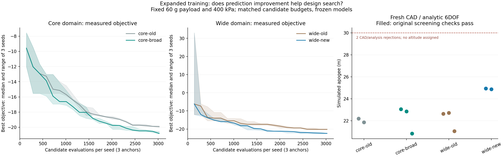

# データ拡張後の探索比較

予測誤差の改善が、物理計算で確認した設計探索の改善につながるかを調べる。
結果を見る前に以下の条件・選択規則を固定する。学習済みの重みは変更しない。

## 比較条件

| 試験 | 従来側 | 新モデル側 | 目的 |
|---|---|---|---|
| 通常域 | 既存の4層専門NN | 広域3モデルの平均、専門NNへの切替なし | 同じ範囲で予測器を交換する効果 |
| 広域 | 専門NNを適用範囲内だけで使用 | 通常域は専門NN、域外は広域NN | 広い候補を評価できる効果 |

公開済みの切替方式は通常域で既存NNと同じ予測を返す。その恒等性を3機体各32点で確認し、
通常域の比較だけは明示的に広域NN単体を用いる。既定の切替ルールを変更したものではない。

広域の従来側は、専門NNの範囲外へ外挿しない。同じ親に対する3候補のすべてで助言が
使えなければ無作為に選ぶ。一部で助言が使えれば、その有限な得点から選ぶ。
この適用範囲の違いも含む比較であり、同一の予測支持範囲での純粋な精度比較ではない。

- 3初期機体、未使用の探索乱数51893 / 63841 / 77933。
- 各方式・機体・乱数で48個体、20世代、**1,008候補評価**。4方式で36,288候補評価。
- DEの提案・生存選択の実装、乱数、同一範囲内の初期個体集合、30%の無作為選択率は共通。
- 全方式で世代ごとに144候補を予測順位付けし、そのうち48件を物理計算に渡す。
- 広域の初期個体は半数が通常域、半数が拡張域のLatin hypercube。
- 運用・環境の8入力は各機体の基準値に固定。搭載60 g、初期ゲージ圧400 kPa、4枚フィン、
  取付、その他質量、気温、日射・待機時間を変更せず、形状・配置・水量・ノズル・材質の
  12入力だけを探索する。広域の上下限は[拡張データの定義](expanded-training-distribution.md)に従う。
- 合格条件は変更しない。探索の得点は既存の `2000 max(0, 1.12−初期静安定余裕)−保守側高度`。
  強度を含む最終的な合否をこの得点だけで決めない。
- 全方式で同一方程式・排水各相60秒上限のスクリーニングを使い、再試行しない。
  無効形状も評価枠を消費する。実際の物理計算回数と棄却数は別に報告する。

## 詳細計算への選択

方式・初期機体ごとに3乱数の実計算で最良だった候補を1件選び、12件を新規CAD、熱・排水、
6自由度飛行、時間刻み半減、抗力増加の感度解析へ進める。CAD不適合や途中失敗を別候補へ
置き換えて成功率を上げない。

広域2方式それぞれについて、初期静安定・迎角・時間刻み・空力適用範囲の確認を通った候補を
抗力10%増の高度で順位付けし、最上位をCFD・構造・飛行の接続確認へ進める。
未達条件も残し、シミュレーション結果を実機の適格性とは扱わない。

学習データ収集・学習の費用は今回の探索予算に含まれない。同じ総費用での高速化とは主張しない。
探索結果は追加学習や方式変更に使わず、固定した条件で最後まで比較する。

```powershell
$env:OMP_NUM_THREADS='1'
$env:OPENBLAS_NUM_THREADS='1'
$env:MKL_NUM_THREADS='1'
python -m scripts.benchmark_expanded_search output/nn-expanded-model1 output/expanded-search1
```

## 探索と新規CAD・飛行確認の結果

36,288候補評価を完了。無効形状268件を除く物理計算は36,020回で、途中の物理計算失敗は0件。
36個の探索ログを再照合し、各組の初期評価・評価枠・要求・実計算の最良候補が一致することを確認した。
探索と12件の新規CAD・飛行確認までの経過時間は909.02秒。並行実行のため方式間の速度比較には使わない。

| 指標 | 通常域・従来 | 通常域・広域NN | 広域・従来 | 広域・新方式 |
|---|---:|---:|---:|---:|
| 評価枠 | 9,072 | 9,072 | 9,072 | 9,072 |
| 実際の物理計算 | 9,072 | 9,072 | 8,850 | 9,026 |
| 無効形状 | 0 | 0 | 222 | 46 |
| 対応する従来側への勝敗 | 基準 | **8勝1敗** | 基準 | **9勝0敗** |
| 3機体中の最良得点、3乱数の中央値 | −19.8979 | −20.8177 | −20.1315 | −22.3666 |
| CAD・飛行のスクリーニング通過 | 2/3 | 3/3 | 3/3 | 2/3 |
| 通過候補の最大高度 | 22.198 m | **23.060 m** | 22.717 m | **24.939 m** |

通常域の最良高度は約3.9%、広域では約9.8%改善した。ただし各方式で選んだ少数候補の比較であり、
すべての機体や乱数で改善する保証ではない。通常域では1組で従来側が上回った。
広域の新方式は無効形状を減らして物理計算に回せる件数も増えた。したがって、同じ候補評価枠では
あるが、成功した物理計算件数まで同じとは説明しない。

`core-old-2` と `wide-new-2` はフィンCADでそれぞれ自己交差1組を検出して棄却。
別候補への置換はせず、飛行高度を与えていない。残る10件は初期静安定1口径、迎角15度、
時間刻み・空力適用範囲のスクリーニングを通過したが、30 mには届かなかった。
合計354個のネイティブ解析ファイルをハッシュ照合した。



[全組の比較・誤差・候補と証拠ハッシュ](../scenarios/adaptive_design/expanded-search.json)。
これらは探索後に選ばれた点での誤差であり、独立な無作為テストの予測精度ではない。
学習重み・切替・探索条件を結果に合わせて調整していない。

次段の比較候補は事前規則どおり `wide-old-1` と `wide-new-0`。
両者の新規CAD・解析的空力による高度は22.717 mと24.939 m、抗力10%増では22.432 mと24.562 m。
CFD・FEM・振動・安定性の接続確認は進行中であり、この表を最終合格と解釈しない。

## CFD領域の事前確認と再実行

最初の幅10口径の実行は、両候補とも45度で回転させた機体が横方向境界へ近づきすぎて停止した。
各3ケースの結果と失敗ログは `output/esc-old1` / `output/esc-new1` に保持した。
未計算の角度を補間で埋めたり、必要な角度を省いたりしない。

選択済みの同じCADから全迎角での横方向包絡を計算する事前確認を追加した。
既存ソルバーの境界余裕0.75口径を確保する必要幅は最大12.0178口径。
格子上の丸めも確認し、両候補とも幅12.5口径、領域依存性の監査は14.5口径で再実行する。
格子16/20口径セル、第三格子24、時間設定、選択機体、合格条件は維持した。
この修正は領域不適合への対処であり、良い高度が出る設定を選んだものではない。
登録済みの領域上限に収まらない場合は自動で切り詰めず、未実行として止める。

```powershell
python -m scripts.prepare_paired_cfd output/expanded-confirm-runtime.json output/esc-old1/cfd_coarse/assembly.json output/esc-new1/cfd_coarse/assembly.json output/expanded-confirm-domain-runtime.json
```

## 先行した構造診断（CFD荷重とは別）

粗い格子16セル／口径・幅12.5口径の14条件が両候補で完了した時点で、
そのテーブルを明示的に6自由度計算へ渡した中間診断も保存した。
高度は旧候補19.130 m、新候補20.554 m、上昇中の最大迎角は8.569度と7.845度。
同時刻の流速・迎角・動圧から取り出したフィン最大法線力は0.388 Nと0.515 Nである。
下表の解析的な最大動圧×最大迎角の荷重とは、荷重モデル・時刻の扱いが異なる。
細かい格子、時間・補間監査、CFD荷重によるFEMは未完了のため、この中間値で合否を確定しない。
[入力と結果を照合した中間JSON](../scenarios/adaptive_design/expanded-coarse-flight.json)に記録した。

```powershell
python -m scripts.preview_coarse_flight output/esc-old2 output/ecf-old2
python -m scripts.preview_coarse_flight output/esc-new2 output/ecf-new2
```

CFD計算中に、同じ選択候補を解析的な飛行荷重で梁・モード・粗密FEMへ通した。
最大動圧と最大迎角を掛け合わせる保守的な包絡荷重であり、同時刻のCFD荷重ではない。

| 指標 | 従来候補 | 新候補 |
|---|---:|---:|
| 仮定したフィン荷重 | 1.108 N | 1.019 N |
| 梁の変形／スパン比 | 35.44% | 29.31% |
| FEMの変形／スパン比 | 35.77% | 30.10% |
| FEM細分化による最大変化 | 1.03% | 0.82% |
| 梁の第1／第2固有振動数 | 11.09／66.88 Hz | 12.87／71.86 Hz |

両者とも5%の変形基準を超える。この大変形では線形の梁近似を定量的に信用できない。
一方、FEMは保存した粗密両方の入力で `*STEP,NLGEOM` を確認しており、幾何学的非線形と
変形面に追従する圧力を考慮する。FEMを線形解析と説明した初期の記述は訂正した。
材料は仮定した弾性モデルで、印刷方向・損傷や実測取付特性を確定したものではない。
格子差が小さくてもこれらの実物との差は保証しない。実際の同時刻の動圧・迎角を使う
CFD荷重での確認は別に続ける。高度・初期静安定を中心にした現在の探索得点だけでは、
フィンの剛性まで満たす候補を選べないことへの注意点である。

68ファイルを照合した[構造診断JSON](../scenarios/adaptive_design/expanded-structural-preview.json)を参照。
最初の呼出しは作業場所の環境設定不足、次はWindows実行制限下でのDLL読込により停止した。
両失敗のログを残し、同じハッシュのCalculiXと入力で通常プロセスから再実行した。
成功分は `output/ess-old3` / `output/ess-new3`。これらをCFD荷重による構造検証へ流用しない。

```powershell
# 既存のハッシュ検証済みネイティブCalculiXと短い作業場所を指定したプロセスで実行
python -m scripts.preview_selected_structure output/esc-old2 output/ess-old3
python -m scripts.preview_selected_structure output/esc-new2 output/ess-new3
python -m scripts.report_structural_preview output/expanded-search1 output/ess-old3 output/ess-new3 scenarios/adaptive_design/expanded-structural-preview.json
```

```powershell
python -m scripts.report_expanded_search output/expanded-search1 output/nn-expanded-model1 scenarios/adaptive_design/expanded-search.json --plot-libraries output/optimizer-plot-libs
```
