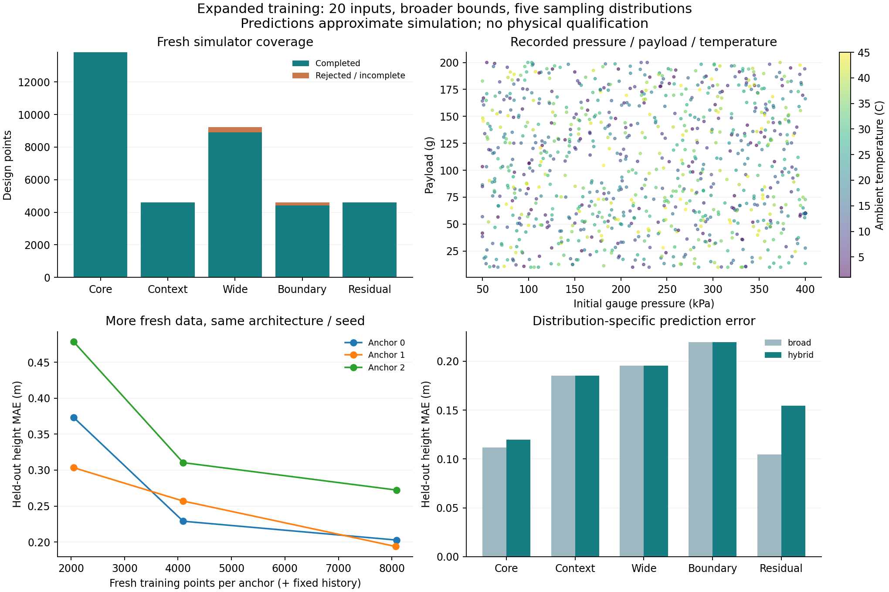

# 学習データの範囲と分布を拡張する

従来の12設計変数に、運用条件と機材のカテゴリを加えた20変数のデータを生成する。
入力範囲を明示した別モデルとし、旧NNへ範囲外の数値を渡して外挿しない。
物理計算からラベルを作り、NN予測を正解ラベルとして水増ししない。

## 範囲

| 変数 | 旧範囲・条件 | 新しいデータ範囲 |
|---|---|---|
| 水量比 | 0.08～0.35 | 0.03～0.75 |
| ノズル径 | 7～22 mm | 3～35 mm |
| フィン根元弦長 | 50～160 mm | 35～200 mm |
| 先端弦長／根元弦長 | 0.20～0.60 | 0.10～0.90、先端弦長10～180 mmの制約あり |
| 後退量／弦長差 | 0～1 | 0～1を維持。幾何的な端点を増やす |
| フィンスパン | 45～145 mm | 15～150 mm |
| フィン厚 | 1.2～3.6 mm | 1.2～6 mm |
| ノーズ長 | 60～280 mm | 30～280 mm |
| ノーズ肉厚 | 1～1.6 mm | 1～3 mm |
| 機材位置／全長 | 0.15～0.40 | 0.05～0.85 |
| ペイロード位置／全長 | 0.06～0.20 | 0.02～0.75 |
| フィン材料 | 登録3材料 | 同じ3材料、カテゴリとして扱う |
| 初期ゲージ圧 | 400 kPa固定 | 50～400 kPa |
| ペイロード | 60 g固定 | 10～200 g |
| 気温 | 初期機体の条件 | 1～45 ℃ |
| その他乾燥質量 | 150 g固定 | 80～300 g、固定ボトル質量を含む |
| 日射 | 800 W/m²固定 | 0～1,200 W/m² |
| 密閉待機時間 | 120秒固定 | 0～600秒 |
| フィン枚数 | 4枚固定 | 3～6枚 |
| 取付 | 元の取付 | standard / reinforced |

CAD登録上限に既に達している変数の上限は維持する。3つのボトル外形・容量も固定。
400 kPaは既存キャンペーンの上限であり、実物の耐圧保証ではない。
低温の水の凍結をこのモデルは解かないため、気温は1 ℃以上とする。
軸方向評価では風や姿勢の影響を再現できないため、それらを可変入力として学習させない。

ペイロード等を変えた点では、その点の解析入力と要求内のペイロードを一致させる。
元の60 g・30 m要求はデータセットの機体テンプレートに保持し、軽い荷物で飛べた点を
元の要求への合格に読み替えない。製作可能性・安定性・実機安全性は別の確認が必要。
20入力すべてを自由な最適化変数として扱うわけではない。設計探索では指定された荷物・環境を
固定して比較する。今回、通常の探索コマンドの要求制約や既定方式は変更していない。

## 分布と分割

3機体×（学習8,192＋検証2,048＋テスト2,048）＝36,864点を新たに計算する。
初回の6,144点生成に対して6倍。既存の21,666学習例も保持して新規学習例と合わせる。
新しい点の内訳は各分割で共通。

- 通常域37.5%：旧範囲、元の運用条件。
- 条件変化12.5%：旧形状範囲で圧力・温度・荷物などを変える。
- 広域25%：全20変数の広い範囲。
- 境界12.5%：1つの連続変数を下限または上限に置く。
- 高誤差近傍12.5%：既存の学習データだけで予測誤差が大きかった点の近く。

Latin hypercubeと独立した乱数で各分割を生成し、カテゴリは離散値のまま扱う。
近傍生成の親設計はハッシュで学習・検証・テストに分け、同じ親を分割間で共有しない。
新規分割間および既存学習例との同一設計の重複を検査する。
近傍例の親は旧学習データなので、完全に未知の機体への汎化試験とは解釈しない。

形状違反や解析未完了を記録から消さず、0 mなどの偽のラベルも与えない。
予備1,152点では1,120点完了、17点が形状違反、15点が5秒の排出制限に達した。
15点は同じ方程式のまま各排出フェーズの上限を60秒に延ばして全件完了した。
本生成は通常の5秒計算が未完了のときだけ延長し、追加計算回数を記録する。
通常ケースの数値が変わらないことを検証済み。予備の乱数864179と本生成975313は分ける。

## 学習と使い分け

広域NNは128→128→64→32の4隠れ層。3つの初期化の予測を平均する。
高度と変形比をlog1p、符号のある静安定余裕をasinhで変換して学習し、出力時に戻す。
極端な値だけが学習損失を支配するのを抑えるためで、物理ラベル自体は保存したまま。

既存学習例を共通に使い、新規学習例を2,048・4,096・全件と増やした学習曲線を比較する。
小さい2段階は学習乱数9021、全件は9021～9023。学習曲線は同一初期化の比較であり、
アンサンブル化の効果をデータ増加の効果に混ぜない。

通常域では既存の4層専門NN、新しい範囲・条件では広域NNを使う。
気温・荷物・圧力・枚数・取付などが1つでも違えば、旧専門NNへは流さない。
広域NNは5分布それぞれで高度と静安定余裕の平均誤差が定数予測を下回ることを
検証用データで確認してから候補ランキングに使える状態にする。
軸範囲・物理ソース・解析スクリプト・機体・CADが一致しない利用は拒否する。
NNの出力から設計合格を出さず、入力上の形状違反も候補ランキングから除外する。

全重みと選択規則を凍結してからテストを集計する。全体平均だけでなく、分布別誤差・
静安定余裕の誤判定・計算の失敗・通常域の予測が変わっていないことを記録する。
静安定余裕1.12 calの±0.25 calにある点を別集計し、境界付近の誤差・過大評価・見逃しも示す。
離陸しない点は正当な0 mの結果として残す。簡易フィン変形比が既存目安5%を超える点は
別集計し、線形梁の近似値を実機強度の合格根拠には用いない。

```powershell
python -m scripts.expanded_design_data output/nn-refined1 output/nn-depth-selected1 output/nn-expanded1 --workers 3
python -m scripts.train_expanded_surrogate output/nn-expanded1 output/nn-refined1 output/nn-depth-selected1 output/nn-expanded-model1 --ml-libraries output/optimizer-libs
```

出力先には未使用のディレクトリを指定する。原データや既存モデルを上書きしない。
[層数比較](surrogate-depth-comparison.md)と[先行探索比較](refined-reinforcement-search.md)も参照。

## 生成結果

36,864候補の生成・検査を完了し、36,369件で有効な解析結果を得た。
495件は形状制約で棄却。通常の5秒制限で完了しなかった511件は延長して完了したため、
解析未完了は0件。物理スクリーニングの実行回数は、延長分を含め36,880回。
原データ生成の経過時間は1,117.95秒、並列数3。

| 分割 | 既存の保持分 | 新規の有効例 | 合計 |
|---|---:|---:|---:|
| 学習 | 21,666 | 24,242 | **45,908** |
| 今回の検証 | 0 | 6,073 | 6,073 |
| 今回のテスト | 0 | 6,054 | 6,054 |

既存検証・既存テストを新しい学習へ移していない。新規の学習・検証・テストは同一設計の
重複0件で、近傍生成の親設計も分割間で共有していない。
原データ `output/nn-expanded1` と、旧学習データ `output/nn-refined1` を保持した。

## データ増加の効果

同じ4層構成・学習乱数9021・既存学習例を共通にした、6,054テスト点での比較。
機体ごとに新規有効例の全件数が異なるため、全件は8,071～8,087件。

| 新規学習例／機体 | 高度MAE（3機体の件数加重平均） | 静安定余裕MAE |
|---|---:|---:|
| 2,048 | 0.3850 m | 0.04958 cal |
| 4,096 | 0.2655 m | 0.03406 cal |
| 全件（約8,000） | **0.2229 m** | **0.02798 cal** |

データを増やした比較で高度MAEは約42%、静安定余裕MAEは約44%減った。
これは同じ学習初期化の学習曲線で、複数初期化による統計的な保証ではない。
追加した温度・圧力・ペイロード条件の解析精度や実飛行精度がこの割合で改善したとは解釈しない。

その後、全件で学習した3初期化の平均を使い、通常域は既存専門NNへ切り替えた予測器を保存した。
3機体とも5分布すべての検証条件を通過。切り替え込みの高度MAEは機体順に
0.1387 / 0.1324 / 0.2183 m、全体0.1631 mだった。
通常条件へ切り替えた3,072テスト点では、既存専門NNとの予測値の差は厳密に0。

広域アンサンブルだけの方が今回のテストでは平均誤差が小さい分布もあった。
この結果を見て通常域の切り替え規則を変更せず、既存予測を保つ設定で集計した。
テスト値を用いた切り替えの調整は行っていない。

静安定余裕1.12 calを十分と予測したのに実計算では未達だった点は4件、逆の見逃しは9件。
高度の最大誤差は約5.19 m残るため、NNを合格判定には使わない。
新規有効例には離陸しない1,710点、簡易変形比5%超の6,697点も含まれ、
良い機体だけのデータではない。範囲拡張による飛行設計の最適化成績はこの試験では未確認。



[範囲・分布別誤差・境界誤判定・モデル照合](../scenarios/adaptive_design/expanded-training.json)。
36,864記録、15学習モデル、3モデル束の重みとテスト予測を再照合した。
3モデル束は各64点の実データでランキングAPIの読み込み・入力範囲も確認済み。
学習からテスト集計まで192.72秒。データ生成費用とは別に記録する。

保存モデルは `output/nn-expanded-model1/context-model-0.json` ～ `context-model-2.json`。
`scripts.expanded_surrogate.predict` が予測、`advisor` が適用条件を検査するランキング入口。
従来の12変数モデル用フォルダーとは区別する。

```powershell
python -m scripts.report_expanded_training output/nn-expanded1 output/nn-refined1 output/nn-depth-selected1 output/nn-expanded-model1 scenarios/adaptive_design/expanded-training.json --plot-libraries output/optimizer-plot-libs
```

関連する35テストとRuffが成功。公開集計・図・文書リンクを確認済み。
