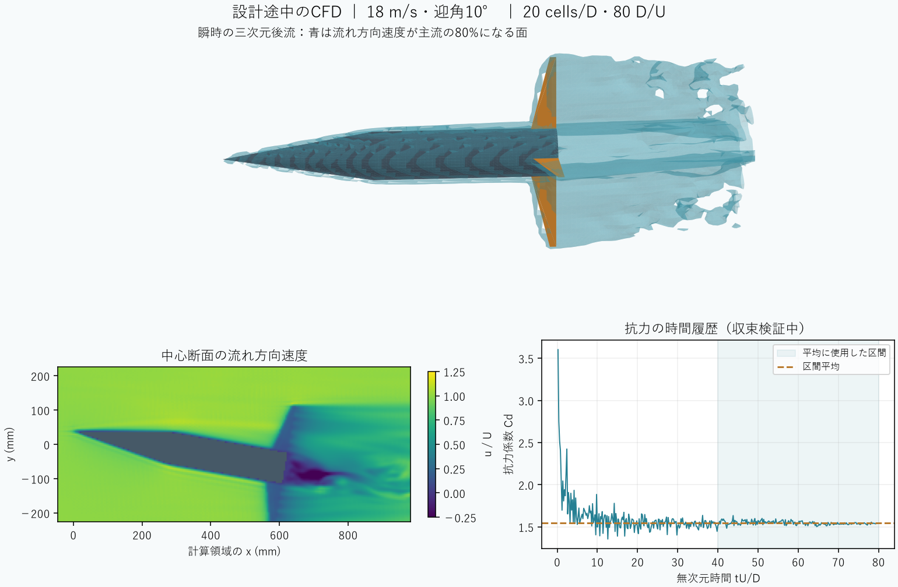

# 400 kPa・40 g・20 m の再設計

初期ゲージ圧400 kPa、搭載物40 g、目標高度20 mを固定して、既存候補の再評価に続き形状を探索する。気温15°C、日射800 W/m²、密閉待機120秒、その他乾燥質量150 g（うちボトル48 g）、4枚フィン、取付条件は元の条件を保持する。400 kPaは加温前の設定であり、発射時の圧力は熱解析で再計算する。

`scripts/search_fixed_mission.py` は3つの既存アンカーごとにGAとDEを実行する。探索する12変数は水量、ノズル径、フィン根元弦・先端比・後退量・スパン・厚さ、ノーズ長・壁厚、機材位置、搭載物位置、材料である。既存のGPU学習済みNNは未計算の提案の順位付けに使い、生存個体は熱・噴射・軸方向飛行・質量中心・梁の物理計算で選ぶ。NNを使わない探索提案も残す。NNの追加学習やAPI呼び出しは行わない。

選別の目安は保守的高度22 m、初期静安定余裕1.15 calibers、簡易梁変形比20%。最後の値は最大動圧と迎角15°を同時に与えた**探索用の指標**であり、飛行荷重による変形の合格基準ではない。実際の合否は従来の `Precision` に従い、飛行荷重下の梁と非線形FEMの両方で5%以下を要求する。空力格子・時間平均・補間・領域・時間刻み、飛行・構造の精度判定も維持する。

最初の試行 `mission40-redesign1` は簡易梁にも1.5%を要求した。この荷重仮定では既存案の簡易変形比約145%に対して飛行荷重下の梁評価は約13%であり、候補選別が過度に保守的だった。7,406回の候補評価後に明示的に中断し、入力・実行スクリプト・評価履歴と中断理由を保存した。完了した試行や不可能性の証明として扱わない。

調整後の `mission40-redesign2` は各手法40個体・50世代で実行する。各手法の選抜案は新しいCADを生成し、質量、熱、噴射、6自由度飛行、時間刻みと抗力感度を再評価する。この段階の出力だけでは合格とせず、CFD・FEM・最終確認につなげる。

再実行には既存の監査済み学習モデル、親候補プール、CUDA版PyTorchが必要。

```powershell
$env:OMP_NUM_THREADS='1'
$env:OPENBLAS_NUM_THREADS='1'
$env:MKL_NUM_THREADS='1'
python -m scripts.search_fixed_mission output/mission40-redesign2
```

## 再探索と構造へのフィードバック

調整後の探索は534.562秒で完了した。目的関数呼び出し12,240回、各探索内の重複を除いた候補評価12,145回、NNで順位付けした提案36,000件。6案すべて新CADと6自由度飛行の再評価を完了した。NNの重み更新や新たなLLM/API呼び出しは行っていない。

1.5 LのDE案は簡易空力で22.544 m、静安定余裕1.143 calibersに達した。ただし梁変形6.224%、非線形FEM変形6.379%で不合格。FEMメッシュ差1.402%は基準内だった。

この実際の不合格を受け、厚さ2.2/2.3/2.4 mm、水量22〜30%（0.5ポイント刻み）、ノズル18/20/22/25/32.817 mmの255条件を追加評価した。初期静安定余裕1.04以上の候補から、ノズル22 mm以下の各厚さの最良案を新CADで再計算した。1.04は探索時の余裕であり、最終判定の1.0を変更していない。いずれも水量24.5%、ノズル22 mmとなった。

|フィン厚|簡易空力の高度|初期静安定余裕|飛行荷重による梁変形比|
|---|---:|---:|---:|
|2.2 mm|23.127 m|1.058|4.727%|
|2.3 mm|22.980 m|1.053|4.372%|
|2.4 mm|22.836 m|1.047|4.113%|

2.4 mm案はさらに非線形FEMの2段階メッシュを計算し、変形比4.015%、メッシュ差2.010%となった。固有振動数は正、調べた時刻の凍結線形化したピッチ系は漸近安定。初期姿勢を変えた飛行の最大迎角は7.898°だった。これらは**簡易空力の飛行荷重に基づく予備評価**であり、CFD荷重へ置き換えた最終構造評価や全飛行の安定性証明ではない。

2.4 mm案の乾燥質量は260.241 g（40 gのペイロードと水を除く）。材料は仮定物性のPrusament ASA、フィン根元弦47.196 mm、先端弦11.825 mm、スパン137.661 mm、後退35.25 mm、ノーズ長279.594 mm、壁厚1.002 mm。部品の実測や取付強度、圧力容器としての資格確認は未実施。

## 空力の追加確認

元の1.997 mm案に対する独立した18 m/s・迎角10°のGPU CFDでは、20→24 cells/Dで軸力・横力・モーメントの最大相対差が11.235%。各計算は40 D/U、格子流速0.075、領域横幅12.5 Dで、計算時間84.7秒/147.5秒だった。1点の確認であり風洞表一式ではない。合格基準5%を満たしていないため、精度確認を追加している。

修正した2.4 mm案では20/24/28 cells/D、80 D/U、格子流速0.05に増やした3格子検証を1,479.125秒で完了した。20→24格子の最大差は9.805%、24→28格子は9.745%で、基準5%に未達。各格子の全成分の平均区間差は100.78%/147.47%/36.47%で、基準3%に未達。25ファイルをマニフェストと照合した。この設計全体はまだ合格していない。

同じ2.4 mm案の抗力感度を追加計算した。仮定した一定の軸方向Cd=0.8/1.1/1.4で、高度は21.464/20.073/18.894 mとなる。横力は元の簡易モデルのままなので、これらはCFDによる飛行予測ではない。空力の不確かさが20 mの合否を変え得ることを示す診断であり、都合のよいCdを採用して合格させるものではない。



この図は18 m/s・迎角10°・20 cells/Dの保存された速度場から描いた。機体の表示はCFDと同じ回転中心・座標変換を使い、断面の軸は計算領域の座標を表す。青は瞬時の流れ方向速度0.8 Uの等値面であり、平均流や実測画像ではない。画像と元データのハッシュを `mission40-flow.audit.json` に保存した。

この20格子ケースの主要な平均係数Cx/Cy/Cmzの二分区間差は1.11%/1.33%/1.53%だが、検査対象全成分の最大差は100.78%だった。既存の飛行表は対称性によってCz/Croll/Cpitch_yをゼロに投影する一方、平均区間の判定は投影前の全成分を使っている。これはモデルと精度評価の対象が異なる問題として記録する。この観察を理由に検査項目を削除したり、既存の判定を合格に書き換えたりはしていない。格子収束と時間刻み・平均区間の収束を分けて調べる方針は、[NASAの検証手順](https://www.grc.nasa.gov/www/wind/valid/tutorial/verassess.html)と[非定常計算の時空間精度検証](https://www.nas.nasa.gov/assets/nas/pdf/papers/housman_j_space_time_accuracy_2011.pdf)も参照する。

さらに、旧案を180°回転すると入口から機体までの実距離が0.239 Dまで減ることを確認した。`--upstream 3` は未回転の鼻先座標との距離であり、回転した機体から3 Dを保証していなかった。今回の2.4 mm案でも同条件は1.036 D。現在の迎角10°の収束プローブと区別し、全迎角の表を作る前に回転後の外形を使う領域検査を修正する。

完成済みの数値とハッシュは [mission40-redesign.json](../scenarios/adaptive_design/mission40-redesign.json) に保存。探索・追加3案のネイティブ生成物309ファイルと2回の構造評価72ファイルを照合し、最初のCFD 2条件の12ファイルのハッシュを記録している。9件の関連テストとRuffが通過した。過去の途中停止を成功に数えず、実機安全性や実験での妥当性確認を主張しない。

## 回転後の領域修正と時間平均の追加検証

上記の探索と3格子実験の数値ソースは `b7c3d1e…`（保存したコードは `af24da1`）。以降は境界配置を修正した別ソース `0fee0358…` の実験として扱う。過去の学習モデル・結果のソース識別子を書き換えていない。以前の実験を再現するときは、その版の隔離した作業ツリーを使う。

回転後の円錐・円筒・有限厚フィン・取付シューの外形を計算し、機体の最前端から入口まで最低3 Dを取るようにした。追加した検査は入口・出口・横境界との距離を記録し、0.75 D未満の条件をGPU計算前に拒否する。これは領域の独立性の証明ではなく、不適切な配置を防ぐ検査である。

旧案の35 m/s・迎角180°・20 cells/D・40 D/Uで、入口設定3 Dは新検査により拒否された。設定6 Dにすると実距離は3.239 Dとなり、同条件の比較でCdは6.789から1.651へ変化した。形状、格子幅、速度、迎角、粘性・乱流・サンプリング条件とCUDAの2つの計算ソースが一致することを照合した。旧案のこの結果は境界影響が大きいため、合格根拠には使わない。これは旧機体を使った対照実験であり、修正候補の飛行高度ではない。

修正したコードで2.4 mm案のCAD・熱・噴射・飛行・時間刻みを新規に再計算し、高度・迎角・初期静安定余裕・質量・重心・圧力中心の6指標は以前の値と一致した。[境界対照と再実行の記録](../scenarios/adaptive_design/mission40-cfd-boundary.json)に入力照合とハッシュを保存した。32件の領域・精度・予算・ハーネス関連テストとRuffが通過した。

平均区間差の合格基準3%は維持したまま、ホストの計算時間上限を100から800 D/Uへ拡大した。長い計算は従来通り後続解析・最終確認を含む時間予算に計上する。現在は新ソースの同一候補について、正面風80 D/Uと迎角10°で80→320→必要なら800 D/Uの独立した診断を実行している。1条件の時間検査が通っても、格子収束・補間・全飛行・最終FEMが通るまで設計合格とはしない。

## 抗力に余裕を持たせた再探索

時間平均の診断と並行し、一定の軸方向Cdを1.4と仮定して3アンカーのDE探索を実行した。旧版から使ったのは形状・材料・配置などの設計仕様だけであり、CAD・物理評価はすべて新ソース `0fee0358…` で再計算した。旧学習モデルのソース番号を書き換えたり、NNの古い予測を合否に使ったりしていない。

各アンカー40個体・80世代、計9,720候補を479.766秒で評価した。水量・ノズル・フィン形状と厚さ・ノーズ長と壁厚・材料・部品位置の12変数を探索し、400 kPa・40 g・20 m、非印刷部品150 g、熱環境と取付条件を維持した。探索時の余裕は高度22 m、初期静安定余裕1.10、最悪動圧×迎角15°の簡易梁比20%。生産用の精度・強度・姿勢・高度の合格基準は変更していない。

|選抜案|新CADによる6自由度高度|初期静安定余裕|乾燥質量|
|---|---:|---:|---:|
|drag-de-0|18.964 m|1.100|254.652 g|
|drag-de-1|18.920 m|1.107|258.238 g|
|drag-de-2|16.928 m|1.102|257.803 g|

3案ともこの抗力仮定では高度未達。Cd=1.4は検討用の仮定であり、これらの形状をCFDで計算した結果ではない。また、有限回の探索の未達は設計不可能性の証明ではない。新しいCAD・解析の204ファイルを照合し、[監査付きの結果](../scenarios/adaptive_design/mission40-drag-reserve.json)に保存した。関連5テストとRuffが通過した。実行時スクリプトはローカル生データの `executed-script.py` に保存し、その後の変数名の整形と区別する。
