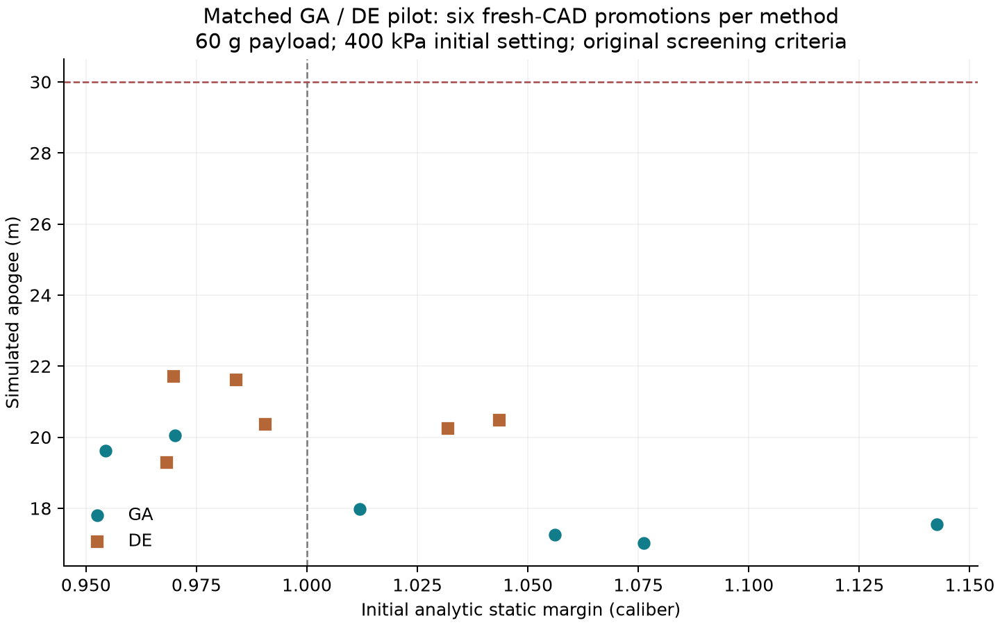

# 遺伝的アルゴリズムによる候補生成

後続の[GA・DEの適応化とNNによる候補の絞り込み](adaptive-evolution-search.md)では、
複数変数の学習例生成と、旧方式・適応版・NN併用版の3乱数設定での比較を行っている。
以下は導入時の旧GA/DE・1乱数設定の記録。

GAを、既存の差分進化法（DE）と並ぶ探索手法として追加した。
11個の連続変数と登録済み材料のカテゴリを同時に扱う。
材料名は親から継承するか登録候補へ変異させ、材料番号の平均を新材料として扱わない。
フィン枚数は詳細CFDの4枚対称の前提が残るため、今回のGAの探索対象に加えていない。


GAの役割は候補生成であり、解析精度を上げることでも、合格を判定することでもない。
ハーネスは60 g・30 mの要求、初期圧力上限、変数範囲、依存する解析を管理する。
学習予測器を組み合わせる場合も、近い実測履歴のある変更方向に限って概算の残差を補正し、
交叉で生まれた未経験の同時変更へ、そのまま信頼度を付けない。
今の比較スクリプトでは方式はホストが指定する。LLMがGAとDEを自動選択する実装や、
GAの全候補に学習予測器を適用する連携は、今回追加した機能には含まれない。

実装は依存追加のない小規模な混合変数GA。2個体のトーナメント、連続変数の拡張ブレンド交叉、
各変数1/変数数の突然変異、2個体のエリート保持、約10%の新規ランダム個体を使う。
遺伝子は単位区間に制限し、従来のデコーダーで翼端長・後退量などの整合性を保つ。
1世代あたり集団数と同じ回数を評価し、停止要求は握りつぶさず、詳細確認の時間を残す。

比較では3初期機体、同じ初期集団、同じ概算目的関数・評価回数上限・昇格件数を使う。
集団は72個体。目的関数は従来のDEと同じ、静安定余裕不足へのペナルティと保守側高度。
探索用の余裕1.12口径と最終判定1口径を区別する。`guided` は診断用のままで、
発射時の余裕を自由上昇の余裕に置き換えて合格にはしない。
繰り返し評価は独立設計数に数えず、各初期集団と実装ファイルのハッシュを残す。

```powershell
python -m scripts.search_joint_designs input.json output/ga-new --optimizer ga --count 48 --rounds 1 --evolve-generations 12 --promote 6 --budget 900
python -m scripts.search_joint_designs input.json output/de-new --optimizer de --count 48 --rounds 1 --evolve-generations 12 --promote 6 --budget 900
```

現在の方式は単一の目的関数を使うGAで、NSGA-IIではない。高度・質量・たわみなどの
交換条件を複数案として残す段階では、非劣解と混雑距離を使うNSGA-IIを次の候補にできる。
制約未達の案を、単に軽い・高く飛ぶという理由で採用しない点は共通する。

参照：[pymooの混合変数の扱い](https://pymoo.org/customization/mixed.html)、
[GAの構成](https://pymoo.org/algorithms/soo/ga.html)、
[NSGA-II](https://pymoo.org/algorithms/moo/nsga2.html)。
考え方の参照先であり、今回pymooを導入・実行したという意味ではない。

## 同条件での試行結果

2026-11-07、`f8c6398`で両方式を実行した。初期集団の3ファイルは方法間でハッシュが一致。
各初期機体で初期72個体＋12世代を評価し、同じ144件の初期探索も含めて各2,952回。
元の60 g・30 m・400 kPaを保ち、両方式とも未実測の固定容器質量48 gを同じ仮定とした。
容器48 gは全初期機体に対する比較用の仮定で、1.5 L品や特定メーカー品の保証値ではない。

| 項目 | GA | 差分進化法 |
|---|---:|---:|
| 概算評価回数（重複を含む） | 2,952 | 2,952 |
| 不正形状などの棄却数 | 3 | 0 |
| 完了した新規CAD・6自由度確認 | 6 | 6 |
| 初期静安定・迎角・時間刻み等の条件を満たす候補の最高高度 | 17.979 m | 20.474 m |
| 同条件で30 mに達した候補 | 0 | 0 |



今回の昇格候補ではDEが良い結果だった。GAを既定方式への置換とはせず、選択可能な
追加手法として保持する。1組の乱数設定・限られた世代数の比較であり、GA/DE一般の
優劣や最適性は未証明。2方式を同じPCで同時実行したため、322.58秒対335.94秒という
実行時間を一般的な速度の優劣として使わない。

昇格には両方式で共通の要求違反度による順位を使った。進化探索のスカラー目的関数の
最良個体を必ず昇格した比較ではなく、「探索＋共通昇格規則」の試行である。
高くても初期余裕1口径に届かない候補は、上表の最高高度から除外した。
これらは解析的空力のスクリーニング結果で、CFD/FEMの最終確認や実機安全性の合格ではない。

最初のGA試行は翼端長と後退量の丸め境界で幾何検査に失敗して停止した。
比較中だったDEも中断し、不正候補を記録して棄却する修正後に両方を新規実行した。
失敗・中断したディレクトリは保存し、完了した比較の回数へ加算していない。
数値ソースは前回予測器と同じ `b7c3d1e2…a5b50a` で、既存の学習履歴は有効なまま。
[入力・集団・実装・原データの照合情報](../scenarios/adaptive_design/genetic-comparison.json)
に比較条件と12候補の結果を残した。
