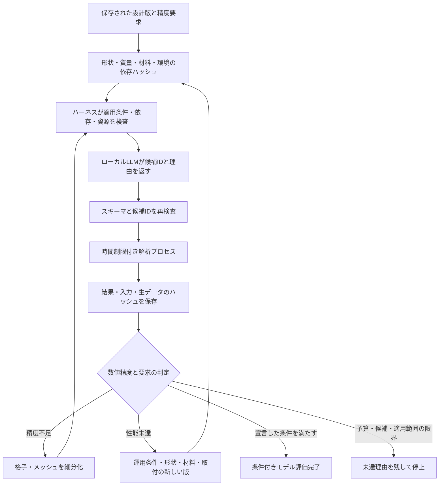

# 階層型の適応解析・再設計（第1〜5段階）

保存済みの `DesignSpec` を起点に、ホストが許可した解析対象・手法・評価の組からローカルLLMが次の一手を選ぶ。計算結果の合否、実行コマンド、要求精度、計算資源の上限はホストが保持する。



## 実装した範囲

| 段階 | 実装 | 主な検証点 |
|---|---|---|
| 1 | CAD体積・材料密度・実測総質量・取付追加質量から同じ機体記録を作る。形状、材料、質量、運用、環境、要求、コードの依存ハッシュを分離 | 質量収支、重心、変更の伝播、不正な容積 |
| 2 | CAD、熱、推進、簡易6DOF、3D CFD、CFDによる6DOF・断面荷重、固体FEM、振動、安定性を共通契約へ接続 | 同じ設計からの入力、実行失敗、生データ整合 |
| 3 | 依存結果、対応フィン枚数、実行環境、メモリ、計算時間、要求精度で候補を絞る | 候補と除外理由の保存、精度不足時の細分化 |
| 4 | `LocalDirector` の実ローカルモデルへ候補IDを列挙したJSON schemaを渡す | 不正ID・余分なキーを拒否、再試行2回、時間制限、明示した場合だけベースラインへ移行 |
| 5 | 未達に応じて運用→形状・材料・取付を変更し、設計版を増やして再計算 | 版数・操作数・時間上限、既訪問案の除外、失敗した確認計算を完了扱いしない |

形状が変わらない運用条件の比較ではCADを再利用する。形状・材料変更時は旧部品の実測質量を外し、新しい推定質量で飛行・荷重を計算する。結果やソルバー入力が書き換わっていれば失効させる。中断した実行には予約した計算時間と試行回数を課し、再開による無制限の再試行を防ぐ。

CFD格子、FEMメッシュ、飛行の時間刻みは別の依存ハッシュを持つ。例えばFEMだけを細分化しても熱・推進・飛行結果は再利用する。空力モーメントの格子比較には、局所の偶力と、重心からの力の作用位置によるモーメントの両方を含める。

## 解析と評価の境界

- 空力：4枚の無カントフィンを持つ包絡形状を、有限厚さ・補間壁の3D LBMで計算する。速度2点、迎角7点を表にし、2段階の格子で力とモーメントを比較する。実際の印刷部品の穴や取付詳細は包絡に含まれない。
- 上流精度：抗力側の有限摂動から高度感度を計算し、許容空力差を `min(固定上限, 高度精度予算×空力配分/感度)` とする。局所感度と2段階差分であり、真の誤差の保証ではない。
- 飛行：質量・重心・慣性の時間変化と発射台・回収傘を扱う。環境から求めた発射地点の密度を飛行中一定とする。地球自転は未対応として拒否する。簡易空力の大迎角側は計算継続用の仮定で、適用範囲の合格根拠にしない。
- 構造：飛行中の最大動圧と最大迎角から求めるフィン荷重包絡を暖機後のFEMと梁モデルへ渡す。この段階のフィン荷重分布は解析的仮定で、CFD表面の局所荷重そのものではない。変位と応力のメッシュ差を確認する。材料強度の許容値は未確定のまま保持する。
- 安定性：凍結した2状態モデルのLaSalle条件、時間変化する低次モデルのGrönwall評価、初期傾斜を変えた有限時間飛行を記録する。有限飛行からBarbalatの無限時間条件や全機体の漸近安定性を証明したとは扱わない。
- 温度：5節点の熱モデルでガス圧と材料剛性へ温度を伝播する。接触熱抵抗、対流係数、材料の温度依存性には仮定が含まれる。

`model_criteria_met` は指定したモデル・条件における評価完了。CFD/FEMを省いた構成は `screening_criteria_met` と分ける。いずれも `physical_qualification=false`。材料・取付・圧力容器・回収機構の実機保証にはならない。高度未達や精度不足では `unresolved`、計算予算到達では `budget_exhausted`、ローカルモデルの選択失敗では `planner_failed` を残す。

## 実行

既存のローカルOllamaへ `ROCKETWRIGHT_OLLAMA_URL` と `ROCKETWRIGHT_LOCAL_MODEL` で接続する。CADには既設Blenderを使う。FEMは `ROCKETWRIGHT_CALCULIX` でCalculiXの実行ファイルを指定する。CFDには既存のCuPy/CUDA環境と `ROCKETWRIGHT_CFD_ENABLED=1` が必要。実行ファイルの場所をLLMに決めさせない。

```powershell
python -m scripts.run_adaptive_design --spec scenarios/adaptive_design/spec.json
python -m scripts.run_adaptive_design --project <保存された案件ID>
```

この例の形状・材料・圧力は接続確認用の仮定で、購入・製作・加圧の許可値ではない。`--precision`、`--limits`、`--runtime` にホスト設定JSONを渡せる。`--steps` は今回の実行操作数だけを制限し、保存された総予算はリセットしない。

API：`POST /design-projects/{id}/adaptive/start` に `revision`、`precision`、`limits` を渡す。`GET .../adaptive/options` で候補と除外理由を確認し、`POST .../adaptive/step` または `.../adaptive/run` に最新の `revision` を渡して実行する。長時間処理は202で返り、案件のGETで進捗と履歴を確認できる。

既存の初期探索から始める場合は `GET /design-projects/initial-seeds` がD01・D02・独立生成案を返す。`POST /design-projects/from-seed` に `seed_id` と、明示した形状・その他部品質量・要求・環境を持つ `template` を渡す。文献機体の合否や質量を改変後の機体へ流用せず、初期パラメータと出典情報だけを引き継いで全解析を行う。

回収要求がある場合は仮の着地速度上限5 m/sも判定する。予算要求があるのに部品価格の根拠がない場合は `cost_evidence` を未達にする。これらを飛行高度だけで満たした扱いにはしない。運用は単一のAPIプロセスを前提とし、同じ案件を別のCLIと同時操作しない。

各版の `adaptive/` に候補プール、要求、選択履歴、共通機体記録、解析入力、結果、生データのmanifestが残る。通常の基本解析だけをやり直して階層解析の未達を迂回して採用することはできない。

第6段階以降の高忠実度モデル改善、実験との照合、広範な設計ベンチマーク、公開サイトでの操作画面はこの実装範囲から分けている。
