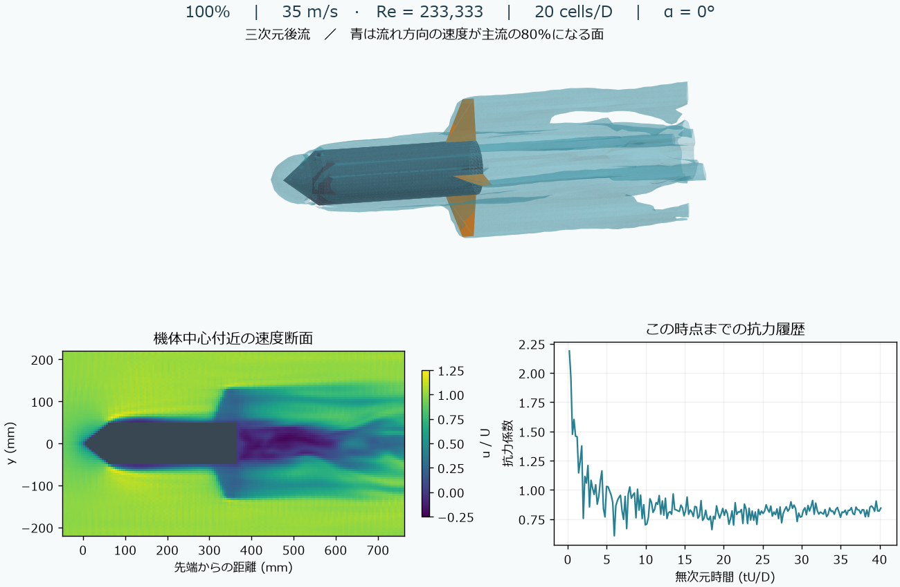

# 2 L候補のCFD・構造・飛行確認

60 g搭載・目標30 mの候補について、CFD、熱・排水、6自由度飛行、振動、フィンFEMを
接続した確認計算を完了した。高度・姿勢・フィン変形の数値条件は満たしたが、
**初期静安定余裕と空力精度の6項目が未達で、設計は未合格**。実機安全性も未確定。

図の100%は計算時間の進捗を示す。収束・精度・安全性の合格率ではない。
三次元の速度等値面、中心断面、抗力履歴は同じ保存済みCFDケースから作った。

| 条件・結果 | 値 |
|---|---:|
| 容積／搭載量／初期ゲージ圧 | 2 L／60 g／400 kPa |
| 水量比／ノズル径 | 0.3358／20.178 mm |
| フィン根元・先端・スパン・厚さ | 57.7・21.095・80・1.55 mm |
| ノーズ長／材質シナリオ | 64.523 mm／Prusament ASA |
| 乾燥質量（印刷部を含む） | 約202.08 g |
| 解析的空力による概算高度 | 35.976 m |
| CFDによる高度／独立確認 | 31.651 m／31.641 m |
| 空力係数を10%増やした感度計算 | 30.619 m |
| 最大迎角（初期傾きの摂動も含む） | 5.644° |
| フィンFEM最大変位／スパン比 | 0.644 mm／0.806% |
| FEM細分化による最大差 | 1.608%（基準5%） |
| フィンの梁モデルでの最初の2固有振動数 | 53.34／267.20 Hz |

「その他150 g」のうち48 gを直胴部の固定ボトル質量とし、残りだけを前方配置した。
48 gは文献の代表値で、購入品の実測ではない。容器寸法・材料・保持方法も仮定を含む。
モデルの出発点と固定質量への修正は[共同探索の記録](joint-design-search.md)を参照。

| 未達項目 | 今回の値・理由 | 判定基準 |
|---|---|---|
| 初期静安定余裕 | −0.174口径（既存の空気質量を除く判定） | 1口径以上 |
| CFD格子差 | 16.12% | 5%以下 |
| 時間平均の差 | 全成分・全角度の最大304.9% | 3%以下 |
| 格子差の高度への伝播 | 0.949 m | 0.750 m以下 |
| 中間点の補間差 | 6.05% | 5%以下 |
| 計算継続時間の差 | 4.99% | 3%以下 |

時間平均の最大差には、平均が小さい面外モーメントなども含む。
飛行用の対称面モデルでは捨てる成分であっても、既存の判定から都合よく除外していない。
平均誤差の尺度と適用範囲を見直す場合は、その影響を別に検証する必要がある。
格子差や係数10%の感度計算は、実物との差を保証する誤差上限ではない。

自由上昇では解析的CPと変動CGから求めた余裕が最小1.190口径だったが、これは
初期条件の代わりにはしない。理想ガイドに要求される最大反力1.370 N・反モーメント
0.167 N mを記録した。ガイドの保持能力、遊び、摩擦、離脱時の片側接触は未検証。
153時点の凍結ピッチ線形モデルは安定判定を通ったが、時変・液体・柔軟モードを含む
全飛行の安定性は未証明。Barbalatの前提も満たしたとは判定していない。

FEMは飛行中のフィン法線合力・根元2方向モーメントの同時極値を圧力へ再構成した
2荷重ケースを粗密メッシュで計算した。最大相当応力0.244 MPaはこのモデルの結果であり、
積層方向・印刷欠陥・取付接触の実測許容値との強度保証ではない。局所CFD表面トラクションや
接線荷重、圧力容器の耐圧、回収装置の動作保証をこのフィン解析で代替しない。

空力は16/20セル径の各14条件と追加監査6条件、計34 GPUケース。
監査点18 m/s・迎角10°では領域幅差1.60%、格子時間差1.10%、第3格子差2.98%。
一部係数は単調収束、一部モーメントは振動的で、漸近収束域は確立していない。

数値ソースは `1f3d1a0`、内容ハッシュ
`25e417a5da0cf7614924a5e41df621521ddc5e7af2e416a449811b42f4815b76`。
最初の実行 `output/jcf1` は複数デッキ共通の `spooles.out` が衝突して停止した。
輸送アダプターでジョブ別名を付け、入力・ソルバーのハッシュを維持して再実行した。
`output/jcf3` はCFDなど12工程の原ファイルを再照合して引き継ぎ、FEM2工程と確認だけを新規計算した。
失敗した実行も保存し、再開結果と混ぜて成功扱いにしていない。
350ファイルを照合し、[携帯可能な結果JSON](../scenarios/adaptive_design/joint-candidate-confirmation.json)
に数値・前提・未達条件・証拠ハッシュをまとめた。ソルバーの配布バイナリーは同梱しない。

次に必要なのは、初期余裕も満たす形状・配置への再設計、飛行に効く空力成分の格子・
平均化・補間精度の改善、既知の実験値との照合。合格基準、要求ペイロード、圧力上限は変更していない。
