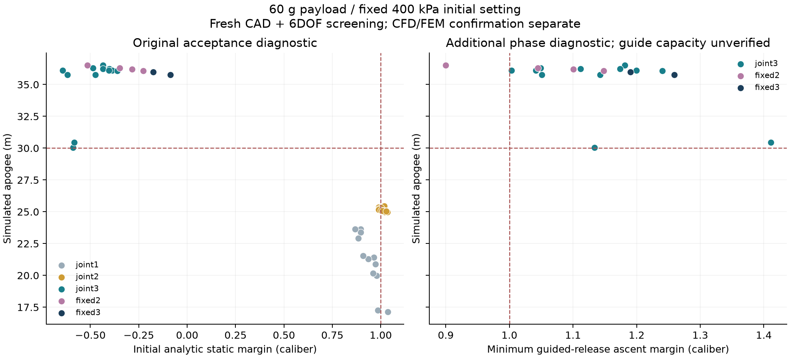

# 複数変数を同時に動かす設計探索



図と[数値データ](../scenarios/adaptive_design/joint-design-search.json)の `joint1` は最初の
同時探索、`joint2` はノーズ範囲拡大と差分進化、`joint3` はガイド離脱を考慮した診断、
`fixed2` / `fixed3` はボトル48 gを固定した後のフィンスパン再解析を表す。
42件の新規CAD・飛行結果に対応する1,428ファイルのハッシュを確認した。
これらは小迎角の簡易空力によるスクリーニングで、CFDによる合格結果ではない。

ボトル固定後、スパン80 mm案は高度35.977 m、自由上昇の最小余裕1.190口径、
最大迎角3.403°。ガイド反力の要求最大値は1.667 N、反モーメントは0.199 N m。
初期静安定余裕は−0.174口径で従来条件には未達。ガイド支持は理想拘束の仮定であり、
保持能力、収納・取付、実材料の許容値は未確認。詳細CFD/FEM確認を別途進める。

60 g搭載・高度30 m・初期静安定余裕1口径の要求を保持し、既存3形状から探索する。初期圧力は入力の設定を保持し、400 kPaを超える入力は受け付けない。これは数値設計の探索であり、部材の現物適合や発射を承認する処理ではない。

## 追加する候補プール

水量比0.08～0.35、ノズル7～22 mm、フィン根元長50～160 mm・翼端比0.2～0.6・後退量0～根元長と翼端長の差・スパン45～145 mm・厚さ1.2～3.6 mm、ノーズ長60～280 mm・壁厚1～1.6 mm、機材質量位置0.15～0.40・ペイロード位置0.06～0.20（いずれも先端からの全長比）、登録済み3材料を組み合わせる。機体長径・容積は各初期形状を保持する。その他部品150 gを都合よく軽くする変更は行わない。

これらはホストが定義した探索範囲。印刷材料の実物強度や耐圧の許容値ではない。機材位置は集中質量の仮定で、収納・固定・ボトル自体の質量分布との整合を別途確認する必要がある。参考形状の出典は [初期モデル比較](initial-model-survey.md) と [出典通知](initial-model-source-notices.md) に保持する。

## 解析の選び方

1. Latin hypercubeで広い範囲を覆う。同一形状内で複数変数を同時変更し、単変数の局所探索だけでは現れない組合せを調べる。
2. 実CADの体積を基準にした近似質量、熱・排出、軸方向飛行で全候補を計算する。抗力+25%／乾燥質量+10%の悲観側シナリオと、初期静安定余裕の不足を合わせて順位を付ける。温間の梁変形も補助指標として保存する。
3. 各形状の上位3点の周囲を細分しながら、各追加ラウンドの4分の1は全域の探索へ残す。既定は3形状×192点×3ラウンド。シード固定で再現する。
4. 形状ごとの代表を含む上位12案でCADを新規生成し、温度・推進・6自由度飛行・時間刻み半減・抗力+10%の感度を実計算する。見積り結果を採用判定へ直接流用しない。
5. 数値適用域・時間刻み・迎角・初期静安定余裕を通る案から詳細確認の入力を出す。高度未達なら未達として残す。CFD、FEM、振動・安定性・最終確認は次の段階で既存の精度条件を維持する。

この探索の選択は明示した数値順位で行い、LLMの選択や追加学習を実行したとは扱わない。各候補の入力、親となる初期形状、座標、結果、近似と新規CADの区別を保存する。数値ソースと探索スクリプトのハッシュを固定し、途中で変われば結果を統合しない。

```powershell
python -m scripts.search_joint_designs output/tp1/input-reconciled.json output/joint1
```

出力は未使用の短いディレクトリを指定する。`exploration.json` に全候補、`report.json` に新規CADによる確認結果、`selected.json` に詳細解析へ渡す仕様を保存する。既定の時間予算は3600秒で、候補確認は2ワーカー。詳細解析の予算は別に固定する。

初回（ソース `34a5a0b`、`output/joint1`）はノーズ上限160 mmで1728案と新規CAD12案を計算したが、元の高度・初期静安定余裕を同時に満たす案はなかった。この結果を保存した上で、共有形状モデルの既存上限280 mmまでノーズ候補を広げた。長いノーズの取付・強度・製作可能性は詳細確認に残る。

追加手法は差分進化法（`--evolve-generations`）。集団を交叉・変異させて同時変数を探索し、近似CADの誤差に対する探索上の余裕として初期静安定余裕1.12口径を狙う。最終合否の1口径条件は変更しない。重複評価を独立設計として数えず、新規CADへ進める案は仕様ハッシュで重複除去する。探索側には時間枠を置き、新規CAD・飛行再計算の時間を残す。
# 発射拘束と自由飛行を分けた追加探索

続く[CFD・構造・飛行確認](joint-candidate-confirmation.md)では、固定ボトル質量を含む
80 mmスパン案を計算した。CFD高度31.651 m、独立確認31.641 mだが、初期静安定と
空力精度が未達で未合格。概算高度35.977 mを最終結果として扱わない。

第2バッチ（`9de87c4`）は7,416回の概算評価から12案を新規CAD・6自由度解析へ進めた。
初期静安定余裕1口径を満たす最高高度は25.461 mで、60 g搭載・30 mには未達。
条件を外して高度だけで選ぶ診断バッチでは2 L案が34.112 mとなったが、
自由上昇でも静安定余裕が約0.018口径しかなく、そのまま採用できない。

そこで探索専用の `--profile guided` を追加する。軸方向概算で1.5 mのガイド離脱時刻を
求め、排水・空気流出に伴うCG移動から自由上昇の最小静安定余裕を推定する。
探索得点には温間のフィンたわみも含める。選抜後は新規CADと6自由度計算で再評価し、
初期・離脱時・自由上昇の余裕、ガイド反力・反モーメントの要求値を保存する。

第3バッチ（`ee9be00`）は5,688回の概算評価と12案の新規CAD・6自由度計算を実施。
2 L案q5475は60 g搭載で36.516 m、最大迎角3.364°、自由上昇最小余裕1.181口径。
ただし初期余裕は−0.435口径で、従来の初期条件は不合格のまま。
さらに「その他150 g全体を前へ動かせる」という配置仮定を含むため、そのまま採用しない。

次の詳細解析では、`fixed_bottle_mass_g` をその他質量の内数として固定する。
ボトル分の質量・慣性は直胴部の薄肉円筒近似に置き、残りの機材だけを移動する。
[Michael de Podesta / NPL, Water Rockets, p.39](https://www.npl.co.uk/getmedia/9562a6ed-13e3-45e6-8234-205f6a2538d6/wr_booklet_print.pdf)
の2 L容器の代表値48 gを初期仮定に用いる。購入予定品の実測値・保証値ではない。
従来入力は0 g（従来の一括質量）として再現可能なまま残し、旧結果を新仮定での結果に
読み替えない。総質量150 gの予算は減らさず、フィン形状と姿勢を再計算する。

これは**評価候補を増やすための診断**であり、従来の確認解析にある「初期1口径」の
合否は変更しない。ガイドは連続的な理想拘束で、遊び・摩擦・片側支持になる離脱過程・
部品の保持強度は未確認。ガイドの荷重要求を計算できても、保持能力の証明にはならない。
`selected-guided-diagnostic.json` は詳細解析への入力で、合格設計とは分ける。

[NASAの水ロケット説明](https://www1.grc.nasa.gov/beginners-guide-to-aeronautics/water-rocket/)
が述べる排水中の質量変化を扱うための追加診断である。
[UKRAの安定性・ガイド条件](https://ukra.org.uk/safety/safety-code/)を適用・認証したものではない。
同コードは全飛行段階で1口径を求めており、今回の自由上昇だけの検査でその適合を主張しない。
