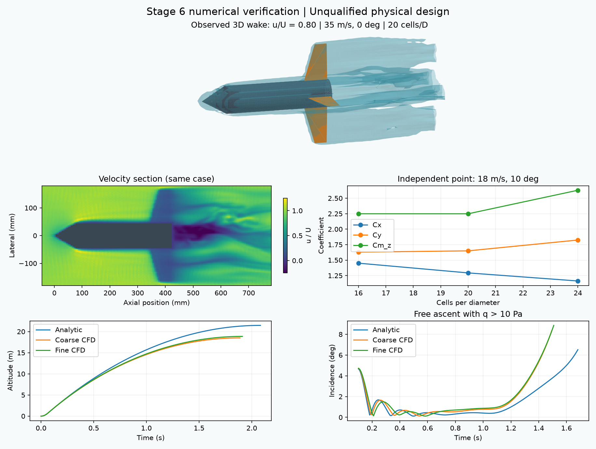

# ローカルLLMと学習予測器の段階5〜7検証

2026-11-07。選択器はローカルの **Gemma 4 12B**。Claude APIは使わず、LLM本体の重みも変更しない。履歴検索と外部の残差・計算時間予測器を組み合わせ、段階5・6・7を実行した。数値ソースは `a431e37` の `135e902dd2068536f43982526c8f3e299b2566c49b195bfd8d0dfde849f84210` に固定した。

**段階7の5状況はすべて通過。ただし機体は高度・静安定余裕・空力精度が未達で、採用されていない。** [選択理由・予測器・参照例・判定・証拠ハッシュを含む結果](../scenarios/adaptive_design/local-learned-stages.json)。ハーネスの動作確認と、実機の製作・飛行承認は別である。

## 学習と未使用条件での評価

4件の測定履歴から、物理モデルが予測する高度変化の残差と再解析時間を学習した。評価は別の2形状で行い、平均絶対誤差は物理モデルだけの0.034169 mから0.016734 mとなった。単純な平均残差補正は0.016727 mで、今回の回帰モデルよりわずかに良かった。回帰の優位性、探索全体の高速化、実機精度を示す結果ではない。

[学習の設定・結果・比較図](claude-learned-selection.md#学習予測器の実計算結果)

## 段階5：履歴付きの候補から再設計する

30 m・静安定余裕1口径の要求を維持し、最多3版・60操作・1,800秒の探索を実行した。ここでは概算の空力と実CADを使い、精密CFD/FEMは次の段階に分ける。

| 版 | 選択された変更 | 概算高度 | 乾燥質量 | 静安定余裕 |
| --- | --- | ---: | ---: | ---: |
| 1 | 初期案 | 17.549 m | 298.502 g | 0.289口径 |
| 2 | シミュレーション上の圧力条件を変更 | 20.605 m | 298.502 g | 0.289口径 |
| 3 | フィン根元長を短縮 | 21.465 m | 285.831 g | 0.375口径 |

ローカルLLMの選択9回、依存関係による一意の実行13回。22個のマニフェストが参照する85個のファイルを照合した。入力表示は最大8,837文字。フィン変更の判断には4件で学習した予測器と参照履歴を渡し、補正前の高度増分0.829207 m、補正後0.846642 m、実計算0.860769 mを記録した。

この選択は学習履歴にある変更の再利用を含むため、未使用条件での方策評価とは数えない。LLMの説明は「高い確信」などを述べたが、予測器の信頼区間は校正しておらず、ハーネスの合否には使わない。3版の上限に達して `unresolved` となり、採用仕様ハッシュは空のまま。圧力条件は解析上の候補であり、現物の許容圧力を認定していない。

## 段階6：CFDから飛行・構造・振動へつなぐ

16・20セル/胴径の空力表28条件と、独立点の6条件を実GPUで計算した。飛行、格子差の伝播、熱、構造FEM、振動、局所安定性、最終確認まで完了。要求・精度条件は維持した。

| 判定対象 | 最終結果 | 要求・判定 |
| --- | ---: | --- |
| 高度 | 18.857 m | 30 m、未達 |
| 静安定余裕 | 0.375口径 | 1口径、未達 |
| 上昇時の迎角 | 9.011° | 15°以内、モデル内で通過 |
| 空力表の格子差 | 14.412% | 5%以内、未達 |
| 独立点の第三格子との差 | 14.470% | 5%以内、未達 |
| 独立点の時間刻み側の差 | 5.188% | 3%以内、未達 |
| 構造格子・フィン変形・振動 | 通過 | 仮定した材料・取付と計算荷重の範囲 |

未達は `altitude / static_margin / aero_grid / aero_averaging / aero_lattice / aero_third_grid`。平均化窓の差も基準外だった。独立点では領域幅3.283%、延長時間2.594%、補間1.670%となり、それぞれの基準は通過したが、一点での通過を全飛行条件へ一般化しない。凍結したピッチモデルの安定性と、変化する実機の全飛行安定性も区別する。

残り予約予算は4,067.3秒。格子改善後の再確認一式は9,108.1秒・27.13 GiBを要する見積りで、24 GiB上限も超える。時間平均の延長は6,979.4秒、時間刻み側の改善は9,245.9秒の見積りとなり、いずれも残り予算内では完結しない。そのため精度未達を残して `unresolved` となった。時間が残っていることだけで未完の精度改善を開始しない。

### Windowsの構造ソルバー実行問題と復旧

CalculiXの補助ファイルを含むパスが261文字になり、最初の2試行が失敗した。同じ入力を短いパスに移すと正常終了したため、数値入力・バイナリを固定した実行アダプターを用意した。初版アダプターの2試行は終了ログの転送不足でハーネスが失敗扱いにした。この4件も履歴から消していない。

修正版では264文字となる元の出力場所から起動し、短い一時ディレクトリで同じCalculiXを実行した。入出力のコピーをハッシュ照合し、長い補助ファイル名は対応表付きの短い名前で保存する。直接実行とアダプター経由の `.dat`（応力・変位等）はバイト単位で一致し、正常終了ログも取得できた。

アダプターのバイナリに実ソルバーのSHA-256を埋め込み、別のソルバーへの差替えを拒否する。変更した実行環境はFEMの識別子へ反映し、完了済みの12解析を保持した。失敗4件と診断計算時間を予算に残し、予算・精度・設計の上限を増やさずに続行した。

[ソルバー転送の一致検証・拒否チェック](../scenarios/adaptive_design/local-solver-transport.json)。ビルドは `python -m scripts.build_calculix_transport <native-solver.exe> <new-output-directory>`。`ROCKETWRIGHT_CALCULIX_NATIVE` に元のソルバー、`ROCKETWRIGHT_FEM_SCRATCH` に短い作業場所を指定し、実行設定の `calculix` を生成した `solver.exe` とする。生成物はローカルの環境設定として扱い、別PCでは利用するソルバーに対して作り直す。外部ファイルを参照する `*INCLUDE` 入力はこのアダプターでは受け付けない。

## 段階7

| 状況 | 実行結果 | 判定 |
| --- | --- | --- |
| 同じ高度不足でも運用候補の残りに応じて変更先を変える | 300→350 kPaのシミュレーション条件を選び、その後にASA材料へ切替 | 通過 |
| 厚さ増加で変形が減っても、質量増による高度不足を見直す | 厚いフィンの案からスパン変更を選択 | 通過 |
| 空力精度が不足している | 段階6の未達を保ち、予算・メモリ内に収まらない精度改善を拒否 | 通過 |
| 材料・取付を変更する | 保存済みの強度・振動・安定性・確認結果を失効 | 通過 |
| LaSalle等の適用条件を満たさない | 外力ありでは原点安定性の証明を選ばず、時変モデルでは有限時間誤差評価へ進む | 通過 |

運用→材料の試験はLLM選択8回・一意の依存実行12回、厚さの試験はLLM選択6回・依存実行10回。厚さ2.4→3.6 mmで乾燥質量は285.83→327.20 g、概算高度は15.168→13.196 m、たわみ/スパンは0.01977→0.01051となった。変形の改善と高度の悪化を同時に確認している。

定理試験は、外力なしの凍結モデルで `theorem-precheck → frozen-origin`、外力ありでは事前チェックのみ、区分時変モデルでは `theorem-precheck → finite-error-bound` だった。有限長の飛行記録からBarbalatの前提や全飛行の漸近安定性を証明したとはしていない。

初回の長い出力先では、2つの再設計試験がCADファイルの保存前に停止した。他の3項目は通過したが、5項目通過とは数えなかった。短い出力先で同じ5条件を新たに実行し、最終結果はすべて通過。最初の失敗報告と生データも保持し、公開結果に両試行を区別して記載した。

段階7の分岐専用精度はCFD/FEMを必須にせず、静安定余裕の閾値を0.01口径とする既存の試験設定。段階6はCFD/FEM必須・1口径のままであり、分岐試験の通過を実機や段階6の合格に流用しない。学習の一般的な効率改善を証明するには、未使用の初期機体群と同一予算による履歴なし・平均補正・回帰補正の比較が残る。

## 検証と再現

関連テスト110件と報告処理の回帰テスト5件が通過し、変更したPythonのRuff検査も通過。段階5・6と初回段階7の40マニフェスト・415ファイル・GPU34条件を照合した。新しい段階7の36マニフェスト・136ファイルも別途照合した。ソルバーの実行アダプターは直接実行との結果一致と不正ジョブ名・別ソルバーの拒否を実測した。

学習収集・段階実行・報告出力は `scripts/collect_learning_trials.py`、`scripts/run_learning_stages.py`、`scripts/report_local_learning_stages.py`。新規実行では段階7の出力先を短い兄弟ディレクトリにして保存先を報告へ記録する。現物の材料特性・取付部・ボトルの状態・実測空力の未確認は残る。
