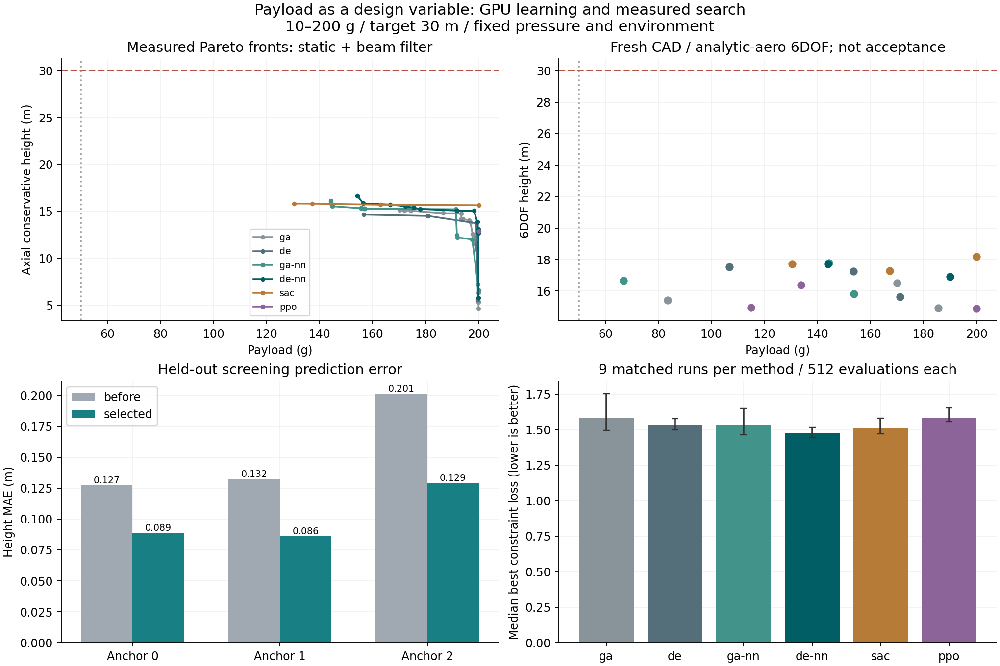

# ペイロードを変数にした探索とGPU学習

搭載質量を10〜200 gで探索する。目標高度は30 mのまま、設計の搭載質量と要求値を常に一致させる。
50 gは比較点として残す。過去の50 g固定比較とは異なり、今回は形状・材料・配置・水量・
ノズルと搭載量を同時に変更する。初期ゲージ圧400 kPa、環境、その他質量、取付、4枚フィン、
各初期機体の胴体寸法は固定した。

## 圧力固定での実行結果

27,648評価枠のうち27,256件の物理計算が完了し、392件を無効形状として棄却した。
選んだ18案のうち17案は新規CAD・6自由度飛行まで完了したが、30 m到達案はなかった。
DE+NNの初期機体0の案はフィンCADの境界辺・非多様体辺が各8本あり棄却された。
以前の本文の「18案すべて完了」は誤記であり、40 g再評価時のログ照合で訂正した。
保存済みJSONは当初から17案完了・1案失敗を記録しており、数値結果は変更していない。
学習と探索・18案の確認を含む本比較の経過時間は787.4秒。環境準備・実装確認・NN追加学習は別。

| 方式 | 最良探索得点の中央値（小さい方が良い） | 詳細確認3案中の最大高度 | その案の搭載量 |
|---|---:|---:|---:|
| GA | 1.583 | 16.53 m | 170.03 g |
| DE | 1.533 | 17.53 m | 106.75 g |
| GA+NN | 1.532 | 17.77 m | 144.21 g |
| DE+NN | **1.478** | 17.72 m | 143.87 g |
| SAC | 1.508 | **18.20 m** | 200.00 g |
| PPO | 1.582 | 16.40 m | 133.70 g |

同じ機体・乱数の9組で、NN補助はGAに対して8勝、DEに対して9勝だった。
得点ではDE+NNが良く、選定後の高度だけではSACの案が高い。搭載量や形状が異なるため、
高さだけを全設計の優劣とは扱わない。図の得点の棒は9実行の中央値、誤差棒は最小〜最大。
パレート曲線は初期静安定・梁変形を満たす実計算点で、30 mを保証する境界ではない。



[全方式の集計・条件・検証ハッシュ](../scenarios/adaptive_design/payload-search-gpu.json)。
圧力も探索変数にする[追加比較](pressure-payload-search.md)は、この400 kPa固定試験と区別する。

## 同じ評価条件で比較する6方式

GA、DE、GA+NN、DE+NN、SAC、PPOを比較する。NNは候補の予測順位付けに使い、
GA・DEの生存選択と最終集計には物理シミュレーションの値を使う。

- 3初期機体×3個の未使用探索乱数×6方式。各実行は32個体・15世代相当、512評価枠。
  無効形状や解析失敗も枠を消費する。全方式で対応する初期32個体をそろえる。
- 探索変数は従来の形状・配置・運用・材料12変数に搭載質量を加えた13変数。
  広域NNの20入力のうち、残りの環境・運用条件は固定して入力する。
- 高度30 m、初期静安定余裕1.12口径、保守的な梁の変形／スパン5%以下を探索上の制約とする。
  未達時は各制約の正規化不足量を最小化する。すべて満たせた場合は搭載量を最大化する。
  搭載量を減らしただけで合格する評価にはしない。1.12口径は探索の余裕で、詳細評価の
  1口径基準を置き換えるものではない。
- GA+NN・DE+NNは各世代3倍の候補を予測し、30%の物理評価を予測順位に依存しない探索へ割く。
  予測器が見る候補数と、物理計算の評価枠を区別する。
- SAC・PPOは64環境をまとめて処理し、各方式3学習乱数・各65,536ステップを学習する。
  状態は搭載量、形状、材料、機体番号、予測された高度・静安定・梁変形、残り手数を含む。
  材料は各エピソードの初期値に固定し、12個の連続量を操作する。GA・DEは材料も変更できる。
- 1エピソード15手で、終了時の状態を保存する。悪い提案で現在の最良案を失わず、
  同じ案を往復して報酬を稼げないようにする。学習時はNN、比較時は実際の簡易物理計算を参照する。
- 方策をすべて固定してから未使用乱数で探索する。各方式・初期機体の最良案18件を、
  新規CAD、熱・排水、解析式による空力の6自由度飛行、時間刻み・係数感度の確認へ進める。
  CAD棄却を別候補で置き換えない。

この比較では梁変形も順位に入るため、以前の高度中心の探索結果とは目的関数が異なる。
重い搭載物が選ばれることもある。前方質量による重心移動や飛行荷重の変化を含む制約の競合を、
搭載量と高度のパレート曲線で確認する。

## GPUで学習する範囲と精度確認

RTX 4090を使用。既存CPU版を残し、作業用フォルダにPyTorch 2.9.0のCUDA 12.8版を追加した。
[公式のWindows向け導入情報](https://pytorch.org/get-started/previous-versions/#v2-9-0)に基づく。

3機体それぞれの3メンバーNNを、既存の学習データで追加学習する。構造は
入力26特徴→128→128→64→32→3出力。モデル・バッチをまとめたGPU演算を行い、
FP32を使用する。AMP・TF32による精度の変更は行っていない。
各NNの最良エポックと採否は検証データだけで決め、全モデルを固定してからテストする。
3出力の平均絶対誤差がすべて悪化せず、各分布で10%を超える悪化がない場合だけ更新版を採用する。

学習データ・検証データ・テストデータの設計識別の重複を確認する。テストで測る誤差は、
簡易物理計算をNNで予測する誤差であり、実機の飛行高度誤差ではない。
SAC・PPOのactor/criticと、探索候補の一括NN予測もGPUを使う。
GPU使用量のログは装置全体の測定なので、他プロセスを含む可能性がある。

採用モデルの追加学習1回は23.4秒。3機体合計45,908学習例を使用し、独立した6,054テスト例で、
高度の平均絶対誤差は0.15365→0.10138 m（34.0%改善）、初期静安定余裕は
0.02061→0.01351口径（34.5%改善）、梁変形比は0.001583→0.000903（42.9%改善）となった。
3機体の更新版をすべて採用した。機体設計の実物精度がこの率で改善したという意味ではない。

同一3メンバーNN・バッチ2,048・100更新を3回比較すると、CPU8スレッドの中央値0.349秒に対し
GPUは0.181秒、更新処理は約1.92倍速かった。これは順伝播・逆伝播・重み更新だけの測定で、
入出力や探索全体の高速化率ではない。CPU/GPUの変換後出力の最大差は約3.2×10⁻⁵。
[測定条件と全試行](../scenarios/adaptive_design/payload-gpu-speed.json)に保存した。
GPU使用率のNN学習中の装置全体の平均は約50%、最大65%。小さいモデルを含むため、
使用率100%を達成したとはしていない。

SAC・PPOは合計393,216遷移をCUDAで学習。SACは1本約24〜25秒、PPOは約20秒だった。
この前に行った実装確認の8,192遷移×2方策と24評価×6方式は本比較の予算に含めない。
12件の対象テスト、全54探索ログ・6遷移アーカイブ・585ネイティブ解析ファイルを検証した。

## 再現と制約

```powershell
python -m scripts.gpu_payload_surrogate output/nn-expanded1 output/nn-refined1 output/nn-expanded-model1 output/payload-gpu-model2 --cuda-libraries output/torch-cuda-libs --rl-libraries output/rl-libs --epochs 500
python -m scripts.benchmark_payload_search output/payload-gpu-model2 output/payload-search1 --cuda-libraries output/torch-cuda-libs --rl-libraries output/rl-libs --steps 65536 --workers 3
python -m scripts.report_payload_search output/payload-gpu-model2 output/payload-search1 scenarios/adaptive_design/payload-search-gpu.json --plot-libraries output/optimizer-plot-libs
```

出力先は新しいディレクトリを指定する。学習モデル・方策・遷移履歴・全評価ログはローカルの
実行出力に保存し、ハッシュと集計・図を公開用の報告にまとめる。
各方式の物理評価枠は同じだが、NNと方策の学習コストは別に記録する。
新しいCFD・FEMによる合格確認は、この探索比較に含めない。材料許容値、取付、実物との対応、
全飛行の非線形安定性の証明も未完了であり、探索結果を完成設計とは扱わない。
