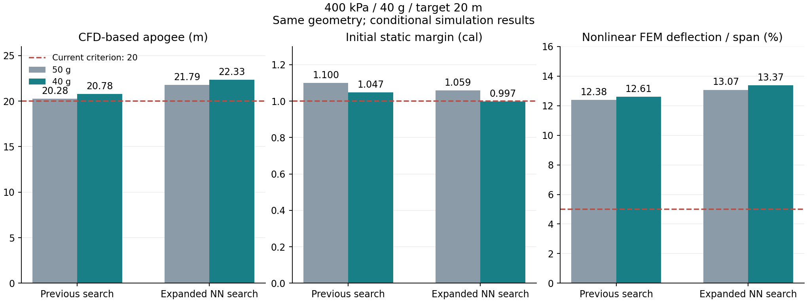

# 初期400 kPa・搭載40 g・目標20 mの条件変更試験

既存2案のCFDを使った最終飛行計算は **20.777 m / 22.331 m** となり、両案とも高度20 mを超えた。
ただしフィン変形と空力精度が未達で、22.331 mの案は初期静安定余裕も基準をわずかに下回る。
完成設計・製作可能という判定には至っていない。

今回は既存形状を維持した条件変更試験で、40 g向けの新しいGA・DE探索やNN再学習は行っていない。
設計と要求の搭載量をともに40 g、要求高度を20 m、初期ゲージ圧を400 kPaに一致させた。
静安定・変形・数値精度の基準は以前のまま維持する。

## 圧力・温度の意味

400 kPaは熱計算の開始時のゲージ圧である。従来と同じ外気温15 ℃、日射800 W/m²、密閉待機120秒を
維持すると、発射時のゲージ圧は従来案414.005 kPa、広域NN案413.962 kPaになる。
発射直前に400 kPaへ調整する条件とは区別する。今回の圧力値を実物のボトル・発射台の許容値とは扱わない。

## CFD・構造解析まである2案

| 指標 | 従来探索案 | 広域NN探索案 | 判定基準 |
|---|---:|---:|---:|
| 最終高度 | **20.777 m** | **22.331 m** | 20 m以上 |
| 空力係数を10%増した感度計算の高度 | 20.284 m | 21.720 m | 感度確認 |
| 初期静安定余裕 | 1.047口径 | **0.997口径** | 1口径以上 |
| 非線形FEMの最大変形／スパン | **12.61%** | **13.37%** | 5%以下 |
| FEMメッシュ間の差 | 0.521% | 0.697% | 5%以下 |
| CFD格子間の係数差 | **17.14%** | **29.90%** | 割当上限内、最大5% |
| CFD格子差を飛行に伝えた高度差 | **0.759 m** | **0.795 m** | 0.75 m以下 |
| 乾燥質量（搭載物・水を含まない） | 281.12 g | 240.92 g | 結果値 |

50 g時から高度は約0.50 m / 0.54 m増えた一方、前方搭載物が軽くなり静安定余裕が減った。
広域NN案の0.997口径を丸めて1口径の合格とはしない。
両案ともフィン変形、空力格子・平均化・飛行伝播・補間・格子時間刻み・第三格子比較が未達。
広域NN案には初期静安定の未達が加わる。全判定をJSONに保存した。



図の50 gは過去の同じ形状・初期400 kPaの値。過去の要求高度は30 m、今回の赤線は20 mである。
係数10%増や格子差の確認は、実機での誤差保証や確率的な信頼区間ではない。

外形が同じため、保存済みCADと各案34ケース、計68ケースのCFDを検証して再利用した。
**新規CFD求解は0件**。重心・慣性・モーメント基準を変更し、熱・排水、飛行、時間刻み半減、
係数感度、振動、局所安定性、粗／細メッシュの非線形FEM、最終確認を再計算した。
2案とも15段階を完了。元の682ファイルと、新たな154ファイルを照合した。
各実行時間は98.4秒 / 152.2秒で、並行実行したため合計を経過時間とはしない。

## 最近の候補群の再評価

固定圧・可変圧の2比較で選定された36案のうち、既知のCAD不成立2案を除く34案を再評価した。
圧力・搭載量・要求高度だけを変更し、各案の実CAD体積を用いた軸方向飛行と梁変形を計算した。
保守的高度20 m、探索用静安定余裕1.12口径、梁変形5%以下を同時に満たす案はなかった。
初期機体ごとに不足量の合計が小さい案を1つ選び、3案のCAD・解析式空力6自由度飛行を再実行した。

| 選定元 | 再解析高度 | 初期静安定余裕 | 保守的軸方向高度 | 梁変形／スパン |
|---|---:|---:|---:|---:|
| 可変圧SAC・初期機体0 | 20.392 m | 0.903口径 | 17.991 m | 3.56% |
| 固定圧PPO・初期機体1 | 19.893 m | 0.856口径 | 17.494 m | 5.16% |
| 固定圧GA+NN・初期機体2 | 18.710 m | 0.973口径 | 16.278 m | 5.73% |

この3案には新しいCFD・FEMを行っていない。上のCFD確認2案とは空力モデルが異なるので、
高さだけを並べて優劣を確定しない。候補群の再評価は50.1秒、元の1,170ファイルと新規102ファイルを照合した。

以前の固定圧報告にあった「18案すべて完了」は誤記だった。保存済み結果は当初から
17案完了・DE+NNの初期機体0の1案CAD不成立を記録している。今回、本文とPRの説明を訂正した。
可変圧側も17案完了・SACの初期機体2の1案CAD不成立である。

## 記録と再現

[比較・全34案の数値と3案の再解析](../scenarios/adaptive_design/payload40-comparison.json)、
[従来探索案の全判定](../scenarios/adaptive_design/payload40-old.json)、
[広域NN探索案の全判定](../scenarios/adaptive_design/payload40-new.json)を保存した。
[過去の50 g比較](payload50-mission.md)は変更していない。

```powershell
# 過去の解析と同じ非線形FEM実行環境・ソルバーハッシュを使用する。
python -m scripts.verify_payload_change output/esc-old3 output/payload40-old1 --payload-g 40 --altitude-m 20 --export scenarios/adaptive_design/payload40-old.json
python -m scripts.verify_payload_change output/esc-new3 output/payload40-new1 --payload-g 40 --altitude-m 20 --export scenarios/adaptive_design/payload40-new.json
python -m scripts.reevaluate_fixed_mission output/mission40-pool1 output/payload-search1 output/pressure-payload-search1
python -m scripts.report_fixed_mission scenarios/adaptive_design output/mission40-pool1 scenarios/adaptive_design/payload40-comparison.json --plot-libraries output/optimizer-plot-libs
```

出力先は新しいディレクトリを指定する。7件の対象テスト、Ruff、入力・物理実装・解析成果のハッシュ、
選定順位と指定条件の一致を確認した。材料許容値・取付の実物との対応、変形形状を空力へ戻す連成、
全飛行の非線形安定性証明は未完了である。
