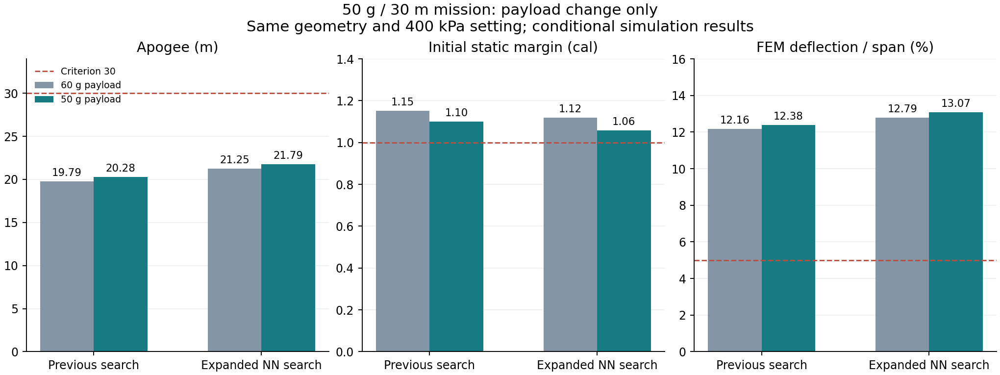

# 搭載50 g・目標30 mの再評価

搭載質量と要求値をともに **50 g**、目標高度を **30 m** とした。
前回の2案について、形状・材料・初期ゲージ圧400 kPa・水量・ノズル・環境・精度基準を
そのままにし、搭載質量だけを60 gから減らした比較である。50 g向けの再最適化ではない。

良い方の案は **21.786 m**。60 g時より0.536 m伸びたが、30 mまで8.214 m不足する。
両案とも最終判定は未達で、製作・飛行の適格性を確認した結果ではない。

| 指標 | 従来探索案・60 g | 同案・50 g | 広域NN探索案・60 g | 同案・50 g |
|---|---:|---:|---:|---:|
| CFDを使った最終確認高度 | 19.785 m | 20.277 m | 21.250 m | **21.786 m** |
| 空力係数を一律10%増した感度計算の高度 | 19.356 m | 19.818 m | 20.716 m | 21.217 m |
| 初期静安定余裕 | 1.152口径 | 1.100口径 | 1.118口径 | 1.059口径 |
| 非線形FEMの最大変形／フィンスパン | 12.16% | 12.38% | 12.79% | 13.07% |
| FEMメッシュ間の差 | 0.521% | 0.521% | 0.689% | 0.696% |
| CFD格子間の係数差 | 16.90% | 17.02% | 29.90% | 29.90% |



静安定余裕の基準は1口径、フィン変形はスパンの5%以下、CFD格子差は5%以下。
前方に置いたペイロードが軽くなるため、広域NN案の初期重心は先端から417.749 mm→423.116 mmへ
後退し、静安定余裕が減った。同案のCFDによる同時刻フィン荷重から計算した変形も少し増えた。
この案では「軽くすれば高度・安定性・変形がすべて改善する」とはならない。

両案に残る未達は、高度・フィン変形・空力格子差・時間平均差・補間差・格子時間刻み差・
第三格子との比較の7項目。広域NN案では格子の違いを飛行へ伝えた差が、高度0.746 m・
迎角0.812度となり、割当0.75 m・1度の範囲に入った。ただし係数側の精度基準は未達のままで、
この変化だけで空力精度を合格にはしていない。

## 計算の再利用範囲とやり直した内容

- 元の解析コード識別、親報告、全段階のファイル・ハッシュを確認した。親の実行に含まれる
  682ファイルと、今回の154ファイルを照合した。
- 外形が変わらないため、CAD形状と各案34ケース、計68ケースの既存CFDを再利用した。
  **新しいCFD求解は0件**。元の計算領域・回転中心・流れ場は変更していない。
- 空力の分布荷重は同じでも、重心・慣性・モーメント基準点を計算し直した。
  係数の時間平均差、格子差、独立条件の補間・時間・領域・第三格子の診断も再評価した。
- 熱、排水、解析式による飛行、CFD飛行、時間刻み半減、空力係数10%増、振動、局所安定性、
  初期姿勢の摂動、粗・細メッシュの非線形FEM、最終飛行を実行し直した。
  最終飛行は前回と同じ時間刻み0.005秒・初期傾斜を0.5度増した条件。
- 同じ60 gを入力した再利用処理では、元のCFD精度指標を許容差10⁻¹²以内で再現した。
  質量や要求値以外を変更した場合には、この再利用経路を使えない。

FEMはCFDの同時刻フィン法線力・根元モーメントを使った幾何学的非線形解析。
変形後の形状をCFDへ戻す流体・構造の相互作用は含まない。材料許容値・取付条件・実物との照合、
全飛行の非線形安定性証明は未完了。数値差を実機での誤差保証とは扱わない。

## 次の探索への入力

[50 g・30 mの入力案](../scenarios/adaptive_design/payload50-spec.json)を保存した。
過去の60 g試験の入力・結果は保持する。この入力案も未達候補であり、完成設計として使わない。
次の設計変更では軽量化だけでなく、減った静安定余裕、フィンの剛性と質量、空力の不確かさを
同時に比較する必要がある。圧力は今回引き上げていない。

[比較データ](../scenarios/adaptive_design/payload50-comparison.json)・
[従来探索案の全判定](../scenarios/adaptive_design/payload50-old.json)・
[広域NN探索案の全判定](../scenarios/adaptive_design/payload50-new.json)。

```powershell
# 前回のローカル解析出力と同じ非線形FEM実行環境を使用する。
python -m scripts.verify_payload_change output/esc-old3 output/payload50-old1 --export scenarios/adaptive_design/payload50-old.json
python -m scripts.verify_payload_change output/esc-new3 output/payload50-new1 --export scenarios/adaptive_design/payload50-new.json
python -m scripts.report_payload_change scenarios/adaptive_design scenarios/adaptive_design/payload50-comparison.json --plot-libraries output/optimizer-plot-libs
```

17件の対象テストとRuffを実行。2案とも15段階を完了し、合否基準の緩和は行っていない。
