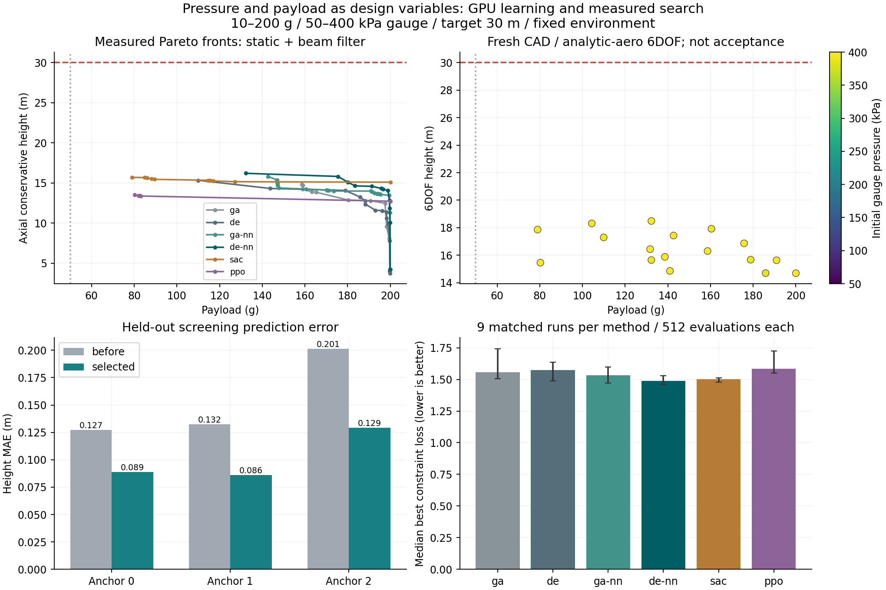

# 初期圧力と搭載量を同時に探索する

初期ゲージ圧を50〜400 kPa、搭載質量を10〜200 gで動かす。目標高度は30 m。
形状・材料・配置・水量・ノズルを含めて14変数になった。圧力は大気圧との差を表す。
この範囲は既存の予測器が学習したシミュレーション領域で、ボトルや発射台の許容圧力ではない。

| 探索変数 | 範囲・定義 |
|---|---|
| 初期ゲージ圧 `initial_gauge_pressure_pa` | 50,000〜400,000 Pa |
| 搭載質量 `payload_mass_kg` | 0.010〜0.200 kg |
| 水量割合 `water_fill_frac` | 0.03〜0.75 |
| ノズル径 `nozzle_diameter_m` | 0.003〜0.035 m |
| フィン根元弦長 `fin_root_mm` | 35〜200 mm |
| フィン先端弦長比 `fin_tip_ratio` | 根元の0.10〜0.90倍 |
| フィン後退割合 `fin_sweep_fraction` | 根元弦長と先端弦長の差の0〜1倍 |
| フィンスパン `fin_span_mm` | 15〜150 mm |
| フィン厚 `fin_thickness_mm` | 1.2〜6 mm |
| ノーズ長 `nose_length_mm` | 30〜280 mm |
| ノーズ壁厚 `nose_wall_mm` | 1〜3 mm |
| 機材配置 `equipment_station_fraction` | 機体基準長に対する0.05〜0.85 |
| 搭載物配置 `payload_station_fraction` | 機体基準長に対する0.02〜0.75 |
| フィン材料 `material` | 登録済み3候補の離散選択 |

上表は提案範囲で、形状が成立しない組合せは棄却して評価枠に数える。
胴体寸法、気温・日射・待機時間、取付、その他乾燥質量、フィン4枚は各初期機体の条件を維持する。

## 圧力固定との探索比較

54実行の27,648評価枠のうち27,286件が物理計算まで完了し、362件を無効形状として棄却した。
30 m・初期静安定・梁変形の3制約を同時に満たす案は得られなかった。

| 方式 | 400 kPa固定の得点中央値 | 圧力可変の得点中央値 | 圧力可変の勝数／9組 |
|---|---:|---:|---:|
| GA | 1.583 | 1.557 | 6 |
| DE | 1.533 | 1.575 | 2 |
| GA+NN | 1.532 | 1.533 | 6 |
| DE+NN | 1.478 | **1.487** | 4 |
| SAC | 1.508 | 1.501 | 5 |
| PPO | 1.582 | 1.584 | 4 |

得点は小さい方がよい。GAとSACは中央値が改善したが、全方式の一律改善にはならなかった。
GA・DE系が選んだ圧力は約363〜400 kPa、SACは9組すべて400 kPaだった。
探索変数を増やすと同じ計算枠で調べる空間も広がるため、この結果を圧力可変の無効性や
400 kPaの大域最適性とは解釈しない。勝数の比較は同じ初期機体・探索乱数の対応で行った。

可変圧試験内でNN併用を比べると、GA+NNとDE+NNはいずれも対応するNNなしに9組すべてで勝った。
探索中の実計算点に対する高度予測の平均絶対誤差は、方式ごとに約0.19〜0.58 mだった。
独立テストの約0.10 mより大きいため、最適化が集めた領域の予測誤差も別に保存している。

## CADと飛行の再解析

選定18案のうち17案は新規CAD・熱・排水・6自由度飛行まで完了した。
SACの初期機体2の案は生成フィンの閉じていない境界8本・非多様体辺8本でCAD検査に失敗した。
他の案への置換や飛行結果の補完はせず、CAD診断とファイルのハッシュを保存した。

| 方式 | 飛行まで完了／選定数 | 完了案中の最高高度 | その案の搭載量 | 初期ゲージ圧 |
|---|---:|---:|---:|---:|
| GA | 3/3 | 16.31 m | 158.64 g | 396.42 kPa |
| DE | 3/3 | 17.30 m | 109.96 g | 395.79 kPa |
| GA+NN | 3/3 | 17.43 m | 142.69 g | 399.14 kPa |
| DE+NN | 3/3 | **18.49 m** | 132.30 g | 399.34 kPa |
| SAC | 2/3 | 17.86 m | 78.99 g | 400.00 kPa |
| PPO | 3/3 | 15.46 m | 80.31 g | 400.00 kPa |

最高高度案も30 m未達であり、50 g固定案の結果ではない。
搭載量・形状・圧力が同時に変わるので、高度だけの順位と制約得点の順位を分けて読む。



図の左上は初期静安定と梁変形を満たす実計算点のパレート曲線。右上は飛行まで完了した17案で、
色は初期ゲージ圧。右下の棒は9組の中央値、誤差棒は最小〜最大で、信頼区間ではない。
左下は今回も共用したNNの独立テスト誤差で、可変圧の探索結果による再学習は行っていない。

CUDAでのSAC・PPO学習は計393,216遷移、1方策あたりSAC約36〜37秒、PPO約33〜34秒だった。
学習・探索・選定案の再解析の経過時間は817.8秒。NN追加学習と環境準備は含まない。
15件の対象テストに加え、54探索ログ・6遷移アーカイブ・成功／失敗を含む585解析ファイルを検証した。
比較時には物理実装・NN・初期13座標・評価枠の一致も照合した。
[全結果・CAD診断](../scenarios/adaptive_design/pressure-payload-search.json)と
[固定圧との54組の対応比較](../scenarios/adaptive_design/pressure-payload-comparison.json)に記録している。

## 比較条件

[400 kPa固定の比較](payload-search-gpu.md)を保存したうえで、GA、DE、GA+NN、DE+NN、
SAC、PPOを再実行する。3初期機体×3探索乱数×6方式、各512評価枠で合計27,648枠。
圧力以外の初期13座標は固定圧試験と完全に一致させ、ハッシュで照合する。
初期32候補の半数は400 kPaを維持し、残りの圧力を50〜400 kPaに分布させる。
同じNN・物理モデル・目的関数・評価枠を使う。

- 高度30 m、初期静安定余裕1.12口径、保守的な梁変形／スパン5%以下を制約とする。
  未達時は正規化不足量を減らし、全制約を満たした場合に搭載量を最大化する。
- 圧力変更も新しい設計として、熱・排水・推力・飛行荷重を反映した簡易物理で再評価する。
  方策学習ではNNを使い、最終順位とGA・DEの生存選択は実際の簡易物理計算を使う。
- NNは既に圧力を入力に含むため、固定圧試験と同じ学習済み9ネットワークを使用する。
  SAC・PPOは圧力の操作を追加した13連続操作・23状態量で学び直す。
  64環境をCUDAでまとめ、3学習乱数×2方式×65,536遷移を学習する。
- 各方式・初期機体の最良案、計18案を新規CAD・熱・排水・解析式空力の6自由度飛行・
  時間刻み確認へ進める。比較用の物理結果を学習へ戻す前に集計する。

有限予算で探索次元も変わるため、圧力を可変にすれば全手法が必ず改善するとは限らない。
学習乱数と探索乱数を分離するが、これは圧力だけの因果効果や大域最適性を証明する比較ではない。
固定圧試験はCPUワーカー3、可変圧試験は4であり、実行時間だけで手法の優劣は判定しない。
SAC・PPOの材料は各エピソード中固定、GA・DEは材料も変更可能という差も残る。

## 再現方法

```powershell
python -m scripts.benchmark_pressure_payload output/payload-gpu-model2 output/pressure-payload-search1 --cuda-libraries output/torch-cuda-libs --rl-libraries output/rl-libs --steps 65536 --workers 4
python -m scripts.report_pressure_payload output/payload-gpu-model2 output/pressure-payload-search1 scenarios/adaptive_design/pressure-payload-search.json --plot-libraries output/optimizer-plot-libs
python -m scripts.compare_pressure_payload output/payload-search1 output/pressure-payload-search1 scenarios/adaptive_design/payload-search-gpu.json scenarios/adaptive_design/pressure-payload-search.json scenarios/adaptive_design/pressure-payload-comparison.json
```

実行出力先は新しいディレクトリを指定する。方策・全遷移・全評価・解析ファイルはローカル保存し、
公開用JSONには集計、入力条件、モデル・実装・結果のハッシュを含める。
GPU環境とNN精度・CPU比較の条件は[学習報告](payload-search-gpu.md)を参照。

この比較の再解析には新しいCFD・FEMは含まない。初期静安定と仮定した梁モデルの判定は、
全飛行の姿勢安定性や取付の強度を保証しない。温度変化後の内部圧力、ボトル・取付・発射台の
実物との対応も含めた安全性は未確定で、得られた案を製作・発射可能と判定しない。
