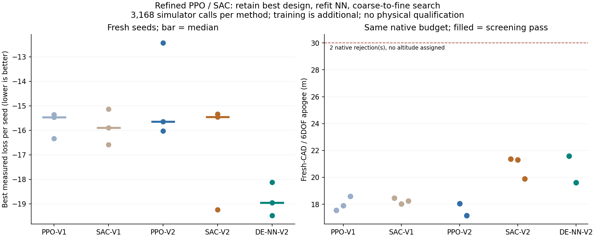

# PPO・SAC探索の改善と再検証

先行実験の方策は、良い案を通過してから悪い案で探索を終えることがあった。
PPOは288エピソード中258回、SACは208回で、最終案の目的値が途中の最良案より悪かった。
ただし先行の最終選抜自体は全履歴中の最良案を使用しており、良い案の記録が消えたわけではない。
改善の狙いは、良い案を起点とする残りの探索機会を増やすこと。

## 変更するもの

1. **最良案から探索を続ける。** 改善した候補だけを次の起点にする。
   悪化・不正形状の試行も計算回数に含め、最良案は保持する。
2. **変更幅を調整する。** 残り比率を `r` として、登録範囲に対する最大変更幅を
   `0.03 + 0.22*r` とする。10操作では最初25%、最後5.2%。
3. **実計算の履歴でNNを再学習する。** 先行GA/DE/PPO/SACの記録をハッシュ照合し、
   同一設計を除いて使用。旧評価乱数9901の履歴と旧LHS検証分を検証に回す。
   学習と検証が重なる設計は学習から除外し、旧LHSのテスト924例は使用しない。
4. **良い案の近くも学ぶ。** リセットの半分で、学習データだけから選ぶ上位128案に
   正規化範囲の標準偏差0.04の摂動を加える。残りは従来の一様サンプリング。
5. **学習量と報酬を調整する。** 各方策32,768遷移、前回の2倍。
   改善報酬は `5*Δ(-asinh(L/30)) - 0.001`。
   非改善は `0.1*max(-1, Δ(-asinh(L/30))) - 0.001`、不正形状は−1。
   SACのエントロピー係数初期値は0.02とし、自動調整する。

要求、物理方程式、初期機体、静安定余裕を含む探索損失は変更しない。
実計算による評価では、NNではなく元の軸方向シミュレーターの結果で起点を更新する。
最良案保持が局所解からの脱出を妨げる可能性もあるため、複数初期案とDE比較を残す。

再学習に使った一意の学習設計は21,666例、検証は9,610例。
検証高度MAEは、3初期機体で旧NNの0.320/0.334/0.471 mから
0.103/0.114/0.133 mへ改善した。これは開発用の検証結果であり、実飛行誤差ではない。
既存記録を再利用しており、この再学習のための新規物理計算は0回。

## 固定した比較条件

新しい評価乱数 `14291 / 22639 / 37117` を学習前に固定する。
改良前PPO・SACの保存方策、改良版PPO・SAC、改良NNを使うDEの5方式を比較する。
旧方策3個を順に新設定へ対応させ、新方策の学習乱数は81001～81003。
新しい6方策がすべて凍結するまで、新評価乱数で物理結果を計算しない。

- 各方式：3初期機体×3設定×352回＝3,168回。
- 同じ組では32初期候補のハッシュを一致させる。
- PPO/SACは各初期案から10操作、DEは32候補×10世代。
- 材料はPPO/SACの各エピソード中は固定、DEでは変更可能。
- 各方式・初期機体の最良実計算案を1つずつ、新規CAD・6自由度へ進める。計15案。
- 最終判定をNNで代用しない。CAD棄却も残し、別案に差し替えない。

変更をまとめた比較であり、個々の改善の寄与を分離するアブレーションではない。
旧方式とは学習量・利用できる過去データ量が異なる。評価時の実計算回数は揃えるが、
総計算費用が同じという比較ではない。既知の3機体に対する検証で、未知の機体・要求、
上位の解析手法選択への汎化は別に検証する。

```powershell
python -m scripts.refine_rl_surrogate output/nn-search1 output/evolution-comparison1 output/rl-comparison1 output/nn-refined1 --ml-libraries output/optimizer-libs
python -m scripts.benchmark_refined_rl output/nn-refined1 output/nn-search1 output/rl-comparison1 output/rl-refined1 --rl-libraries output/rl-libs
python -m scripts.report_refined_rl output/rl-refined1 output/nn-refined1 output/nn-search1 output/rl-comparison1 scenarios/adaptive_design/refined-reinforcement.json --plot-libraries output/optimizer-plot-libs
```

出力先は新規ディレクトリを指定する。前回の原データを上書きしない。
方策・遷移・モデル・探索記録・CAD/飛行証跡を照合してから公開用の集計を生成する。

参照：[先行PPO/SAC実験](reinforcement-design-search.md)、
[実装元の学習・評価指針](https://stable-baselines3.readthedocs.io/en/master/guide/rl_tips.html)。

## 実行結果

6方策の学習196,608遷移、物理シミュレーション15,840回、新規CAD・6自由度への15案を完了。
方策学習224.91秒、全体873.17秒。学習は2層の再学習NNを使用した。
後続の[4層予測NNの比較](surrogate-depth-comparison.md)とは結果を分ける。

| 方式 | 3設定の最良目的値の中央値↓ | 同じ旧方式に勝った組 | 確認計算の最高高度 | CAD完了・スクリーニング通過 |
|---|---:|---:|---:|---:|
| 旧PPO | −15.464 | — | 18.591 m | 3/3 |
| 旧SAC | −15.894 | — | 18.451 m | 3/3 |
| 改良PPO | −15.648 | 3/9 | 18.050 m | 2/3 |
| 改良SAC | −15.449 | 4/9 | 21.356 m | 3/3 |
| 再学習NN＋DE | −18.958 | — | 21.587 m | 2/3 |

中央値は各乱数設定の3初期機体から最良の目的値を取り、3設定で集計したもの。
改良SACの最高高度は伸びたが、9組の比較では5敗し、中央値も旧SACより悪い。
PPOも6敗しており、変更をまとめた方策が安定して良くなったとは判断しない。
DE＋NNは改良PPOに9/9、改良SACに7/9組で勝った。
よってPPO/SACの既定方式への昇格は行わず、再学習NNと実験用比較機能を残す。

実計算中の不正形状は改良PPOで2件、改良SACで38件。いずれも352回の予算に含めた。
新規CADでは `ppo-v2-0` に面積0の三角形1件、`de-nn-v2-2` に自己交差1組を検出して棄却。
別候補への差し替えは行っていない。残り13案が初期静安定余裕・迎角・時間刻み・空力適用範囲の
スクリーニングを通過したが、30 m達成、CFD/FEM、実機安全性の確認とは区別する。

予測器は新しい探索データでも改善した。旧NNの高度MAE 0.430/0.470/0.585 mに対して、
再学習NNは0.100/0.139/0.138 m。これは全方式の有効な試行15,800件に対する比較。
静安定余裕の平均誤差も下がったが、機体1では1.12 cal以上と誤判定する件数が52→68へ増えた。
平均精度と合否境界の誤判定は別に見る必要がある。



[結果と証跡照合](../scenarios/adaptive_design/refined-reinforcement.json)。
45探索ログ、456個のCAD/飛行証跡、12方策、6遷移記録を照合した。
同じ初期集団・計算予算と、改良版の各エピソードの最良案保持もログから再確認している。

未解決は、乱数条件による方策のばらつき、悪化を経由する探索の不足、CADで初めて分かる不正形状。
今回の結果だけで個別変更の因果効果は切り分けられない。
次に方策を変える場合は、保持だけ・カリキュラムだけ・報酬だけの比較と、方策NNの容量比較を
開発用データで行い、別の新しい評価条件で確かめる。今回の評価結果で学習し直したものを、
同じ条件の未使用テストとして扱わない。
