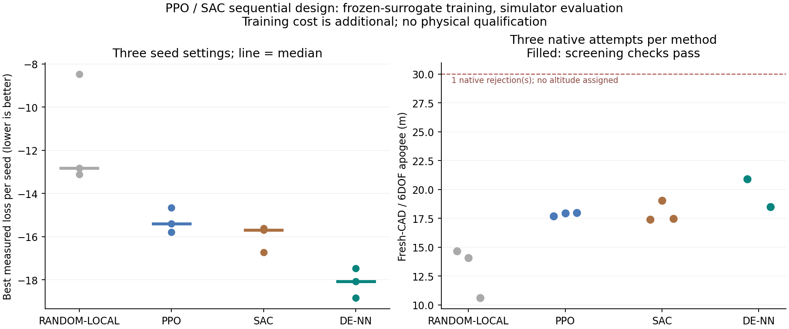

# PPO・SACによる逐次設計の実験

PPO・SACを、現在の設計から連続変数を少しずつ変える比較用の候補生成器として導入する。
今回は上位の解析手法選択や計算精度の選択を学習するものではない。
その用途では、解析の不確かさ・残予算・依存関係を状態に含め、実行可能な解析を選ぶ
別の環境が必要になる。

## 状態と操作

- 状態20項目：連続設計11項目、材料one-hot 3項目、初期機体one-hot 3項目、
  保守側高度、初期静安定余裕、残りステップ比率。
- 操作11項目：各連続設計値を、登録範囲の最大15%だけ増減する。
- 材料は32個の初期候補に含め、各10ステップの探索中は固定。
- ペイロード60 g、初期ゲージ圧400 kPa、3初期機体と既存の範囲・最終判定を維持。

標準SACは連続操作用で、材料名を実数として補間しない。PPOも比較条件を合わせて
同じ連続操作を使う。GA/DEは途中でも材料を変更できるので、探索方式だけでなく
操作の自由度にも違いがあることを記録する。

## 学習と評価の分離

学習は、既存の6,144例から学習して凍結したNNを環境として使う。
これらの静的データをPPOの軌跡やSACの遷移バッファにそのまま流用せず、新たに
`状態・操作・報酬・次状態・終端`を生成して保存する。
PPOとSACはStable-Baselines3 2.7.0を使用し、独自の近似実装とは区別する。

探索損失は既存と同じ `L = 2000 * max(0, 1.12 - 静安定余裕) - 保守側高度`。
学習報酬は `-asinh(L_next/30) + asinh(L_current/30) - 0.001`、割引率1。
10ステップを有限期間の終端として扱い、残り期間を状態に含める。
同じ設計へ戻る往復では利益が出ず、終了時の改善を学習する。
不正形状は負の報酬で終端。NN予測から合格判定は出さない。

学習終了後に方策を凍結し、状態と結果を元の軸方向シミュレーターで計算する。
32初期候補×（初期計算1回＋変更10回）＝352回／機体／設定。
既存のGA/DE比較と初期候補ハッシュ・実計算回数を一致させる。
3機体×3乱数設定で各方式3,168回。PPO・SAC・ランダム局所変更を比較し、
元のDE＋NNの記録も参照する。方策学習の乱数と評価用初期候補の乱数は分ける。

各方式の各初期機体について、3設定中で最良の実計算候補を新規CAD・6自由度へ進める。
学習費用・NN予測での遷移数・実計算回数・CAD棄却を別に記録し、実機安全性や
同じ総計算費用での高速化とは解釈しない。未知の機体や要求への汎化も別の検証対象。

```powershell
python -m scripts.benchmark_design_rl output/nn-search1 output/evolution-comparison1 output/rl-comparison1 --steps 16384 --workers 3
```

追加依存は `scripts/requirements-search-rl.txt`。隔離したディレクトリへ導入した場合は
`--rl-libraries` を指定する。重みはこの実験が生成したものだけを読み込む。

参照：[PPO原著](https://arxiv.org/abs/1707.06347)、
[SAC原著](https://arxiv.org/abs/1801.01290)、
[PPO実装仕様](https://stable-baselines3.readthedocs.io/en/master/modules/ppo.html)、
[SAC実装仕様](https://stable-baselines3.readthedocs.io/en/master/modules/sac.html)、
[独立評価と複数試行](https://stable-baselines3.readthedocs.io/en/master/guide/rl_tips.html)。

評価中に幾何検査で不正な設計になった場合、その実計算も予算に含める。
次の操作は方策を使わずランダムな局所変更で回復を試みる。これも残り10ステップ内に
数え、失敗案を消したり、評価回数を追加したりしない。

学習は `a49e84f` で実行した。PPO・SAC各3設定×16,384ステップで、
計98,304遷移を保存。方策学習の経過時間合計109.97秒。
これはNN環境内の追加学習で、98,304回の物理シミュレーションを行ったという意味ではない。
先行するNNの学習・検証用6,144回の計算費用も別に存在する。
学習中に幾何検査で終端になった回数は、PPO 62回、SAC 42回で、それらも記録に残した。

## 同条件の実シミュレーター評価

3初期機体×3設定×3方式で9,504回を計算した。各方式3,168回。
9組それぞれで初期集団ハッシュ・評価回数が先行DE＋NNと一致した。
方策の重みを評価結果で更新したり、最良の評価設定だけを選んで学習し直したりしていない。

| 方式 | 3設定の最良目的値の中央値↓ | DE＋NNに勝った組 | 確認計算の最高高度 |
|---|---:|---:|---:|
| ランダム局所変更 | −12.835 | 0/9 | 14.666 m |
| PPO | −15.407 | 1/9 | 17.992 m |
| SAC | −15.699 | 1/9 | 19.058 m |
| 先行DE＋NN | −18.077 | — | 20.893 m |

中央値は各設定の3初期機体の最良目的値を取り、3設定で集計したもの。
PPOはランダム局所変更に9/9組、SACは8/9組で勝ち、SACの残り1組は同値だった。
学習した方策の効果は見られるが、今回の学習量・行動範囲ではDE＋NNを置き換える根拠にならない。
PPO/SAC一般の優劣を示す実験ではなく、材料の変更自由度や訓練の追加費用も異なる。

新たに選抜した9案はすべて新規CAD・6自由度・時間刻み・空力適用範囲・初期静安定余裕・
迎角のスクリーニングを通った。PPO/SACの新案についてCFD・FEM・実機安全性は未確認で、
30 mにも達していない。比較に使った先行DE＋NNには前回のCAD棄却1件があり、図にも残している。

ランダム局所変更では実シミュレーター評価の幾何検査で11件を棄却し、その後の回復操作も
同じ予算に含めた。今回のPPO/SAC実シミュレーター評価では幾何棄却は0件だった。
一方、NN内の学習時には上記の不正形状終端がある。異なる忠実度の件数を混ぜない。

新規306件・先行585件のCAD/飛行証跡、27件の新規探索ログ・54件の先行ログ、
6つの方策と6つの遷移記録をハッシュ照合した。学習から確認までの経過時間は546.28秒。
この時間には今回の方策学習が含まれるが、先行NNの生成・学習や先行DE＋NN比較の費用は含まない。



[数値・環境バージョン・照合情報](../scenarios/adaptive_design/reinforcement-design.json)。
原データと保存方策は `output/rl-comparison1`。次のコマンドで既存原データを照合・集計できる。

```powershell
python -m scripts.report_design_rl output/rl-comparison1 output/evolution-comparison1 scenarios/adaptive_design/reinforcement-design.json
```

PPO/SACは実験用の比較コマンドとして残す。既存の探索の既定値を変更せず、
上位の解析手法選択・精度選択を学習する機能が完成したとは扱わない。
