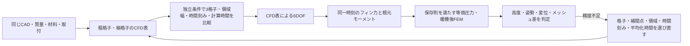
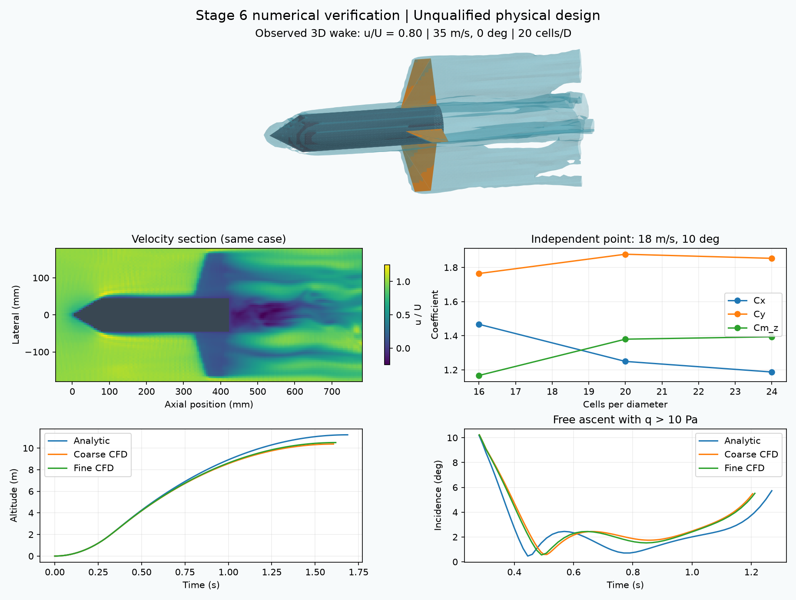

# 第6段階：空力精度と構造への荷重伝達

第1〜5段階の同一設計記録を使い、数値精度の不足を検出して候補選択へ戻す。現物の適合認定とは分ける。

## 追加した接続

- `cfd_audit` は補間表に含めない速度と迎角を選び、同じ条件で3段階の格子を計算する。細格子では横方向の領域幅を2直径拡大し、格子速度を半分にした計算、計算時間を2倍にした計算も比較する。比較成分は軸力・横力・ピッチモーメント。
- 3格子の値から観測次数を求めるが、振動的・不鮮明な収束では次数やGCIを出さない。算出できても漸近域を確認したとは扱わない。[NASA NPARCの格子収束資料](https://www.grc.nasa.gov/www/wind/valid/tutorial/spatconv.html)に基づき、単なる2格子差と誤差推定を区別する。
- 独立条件は上昇時の迎角0〜15度内の1点。全条件の補間誤差やモデル誤差を保証する検証ではない。横境界は周期境界のまま。上流・下流距離、乱流モデル、フィン方位、取付細部は未解決。
- CFDの各フィンの法線力と根元の2方向モーメントを、飛行の同一時刻の動圧で次元化する。それぞれの最大値を生む条件を保持し、両FEMメッシュで同じ条件を使う。
- 符号付きの等価面圧へ移す際に法線力と2モーメントを保存する。CFDの局所面圧分布そのものではなく、接線力は省略する。純偶力も扱い、ゼロの力で重心位置を除算しない。
- 温度依存の仮定物性・根元ばねを使う。応力の算出は材料の破壊強度の確認とは異なり、許容強度は未設定のまま保持する。

精度不合格は `quality_pending` に残す。数値設定を変えて古い確認結果が失効しても、精度不足が解決する前に形状変更へ進めない。全設定はホストの上限付きで、LLMは候補IDだけを選ぶ。

## 実行記録

2026年11月7日、実装 `1067698` で同じ1.5 L未製作案を実行した。材料は仮定物性のTough PLA、フィン厚2.4 mm、根元ばね500 kN/m、暖機待ち120秒。CADからの乾燥質量は298.50 g。要求は高度30 m、静安定余裕1径以上、格子差5%以下、時間設定差3%以下を維持した。

Gemma 4 12Bが15回選択し、34ケースのGPU CFD、CFDを用いた6DOF、熱、振動、凍結安定性、CalculiXの2条件×2メッシュ、確認飛行まで実行した。CFD表は16/20 cells/D、各14ケース、時間40 D/U。独立点18 m/s・10度では16/20/24格子、領域幅10→12径、格子速度0.075→0.0375、計算時間40→80 D/Uを比較した。

| 項目 | 結果 | 判定 |
|---|---:|---|
| 確認飛行の高度 | 10.509 m | 30 m未達 |
| 最大迎角 | 10.227度 | 発射台離脱後・上昇中・動圧10 Pa超で15度以下 |
| 静安定余裕 | 0.0678径 | 1径未達 |
| 全CFD表の力・モーメント格子差 | 11.11% | 5%未達 |
| 独立点の20→24格子差 | 4.97% | 5%以内。ただし全表の合格にはしない |
| 独立点の補間差／領域幅の差 | 4.23%／2.31% | 5%以内 |
| 独立点の流体時間刻み差／計算時間差 | 6.72%／4.83% | 3%未達 |
| CFD格子差から生じる高度差／最大迎角差 | 0.138 m／0.00466度 | 配分した0.75 m／1度以内 |
| FEM最大変位／スパン | 0.586 mm／0.488% | 5%以内 |
| FEM応力95パーセンタイル | 0.101 MPa | 許容強度が未設定のため強度合格とはしない |
| FEM同一荷重条件でのメッシュ差 | 3.68% | 5%以内 |

全表の分割平均差も不合格。各成分を `max(abs(平均), 0.05)` で正規化した最大差は3.105で、抗力そのものの誤差率ではない。特に小さい平均値を持つ横方向成分の変動が残る。3格子から得る収束傾向も、成分によって単調・振動的に分かれる。

LLMは最終確認後に `refine/averaging` を選び、設定を40→60 D/Uへ変更した。15操作の上限で停止したため、**60 D/Uの表は未実行**。結果ファイルは完了済みの40 D/U設定と選択後の60 D/U設定を区別している。停止理由は操作数上限で、時間予算は残っている。物理的な設計完成・実機安全性の確認とは扱わない。

14解析成果物のマニフェストと全参照ファイルのハッシュを照合済み。60件の回帰テストが成功し、失敗・スキップは0。最初の起動はローカルLLM接続変数の指定誤りで解析前に停止し、正しい接続先で新規実行した。CFD・FEMの完了実行ではソルバー失敗はなかった。

- [機械可読の検証記録](../scenarios/adaptive_design/stage6-verification.json)
- [計算結果図](../scenarios/adaptive_design/stage6-verification.png)
- [報告生成スクリプト](../scripts/report_stage6.py)：生データを照合してから概要と図を生成する。

