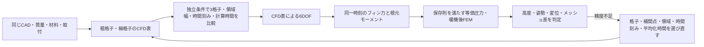

# 第6段階：空力精度と構造への荷重伝達

第1〜5段階の同一設計記録を使い、数値精度の不足を検出して候補選択へ戻す。現物の適合認定とは分ける。

## 追加した接続

- `cfd_audit` は補間表に含めない速度と迎角を選び、同じ条件で3段階の格子を計算する。細格子では横方向の領域幅を2直径拡大し、格子速度を半分にした計算、計算時間を2倍にした計算も比較する。比較成分は軸力・横力・ピッチモーメント。
- 3格子の値から観測次数を求めるが、振動的・不鮮明な収束では次数やGCIを出さない。算出できても漸近域を確認したとは扱わない。[NASA NPARCの格子収束資料](https://www.grc.nasa.gov/www/wind/valid/tutorial/spatconv.html)に基づき、単なる2格子差と誤差推定を区別する。
- 独立条件は上昇時の迎角0〜15度内の1点。全条件の補間誤差やモデル誤差を保証する検証ではない。横境界は周期境界のまま。上流・下流距離、乱流モデル、フィン方位、取付細部は未解決。
- CFDの各フィンの法線力と根元の2方向モーメントを、飛行の同一時刻の動圧で次元化する。それぞれの最大値を生む条件を保持し、両FEMメッシュで同じ条件を使う。
- 符号付きの等価面圧へ移す際に法線力と2モーメントを保存する。CFDの局所面圧分布そのものではなく、接線力は省略する。純偶力も扱い、ゼロの力で重心位置を除算しない。
- 温度依存の仮定物性・根元ばねを使う。応力の算出は材料の破壊強度の確認とは異なり、許容強度は未設定のまま保持する。

精度不合格は `quality_pending` に残す。数値設定を変えて古い確認結果が失効しても、精度不足が解決する前に形状変更へ進めない。全設定はホストの上限付きで、LLMは候補IDだけを選ぶ。

## 実行記録

実装の荷重保存・座標変換・精度候補の検証後、同じ1.5 L未製作案でGPU CFDとCalculiXを実行し、結果と残る不合格項目を記録する。ネイティブ再解析の結果は検証後に追記する。
