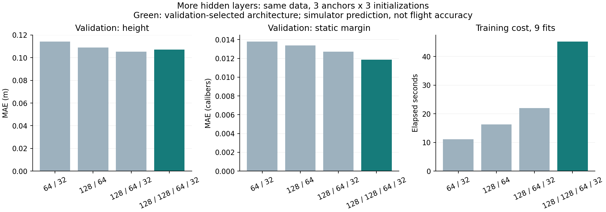

# NNの層数・幅を増やした比較

予測NNを2～4隠れ層へ変更したところ、4層構成で平均予測誤差が改善した。
PPO/SACの方策NNは別物で、この比較では方策の層数を変更していない。

## 比較条件

再学習用の同じ21,666学習例・9,610検証例を使用する。
4構成×3初期機体×3学習乱数（9021～9023）＝36モデルを学習。
正規化、最適化器、正則化、最大500エポック、内部早期停止の条件を揃えた。
学習時間は揃えていない。層数と同時にパラメーター数も変わるため、深さだけの効果を
パラメーター数一定で分離した実験ではない。

選択規則は、各機体・学習乱数で2層基準に対する高度MAEと静安定余裕MAEの比を取り、
全9組・2指標の平均が小さい構成を選ぶこと。
テスト値を読む前に選択結果を保存し、その後に未使用の旧LHSテスト924例を評価した。
学習・検証との同一設計ハッシュの重複は0件。テスト結果から構成や学習乱数を選び直していない。

| 隠れ層 | パラメーター数／モデル | 検証高度MAE | 検証静安定余裕MAE | 9モデルの学習時間合計 |
|---|---:|---:|---:|---:|
| 64→32 | 3,139 | 0.1143 m | 0.01380 cal | 11.14秒 |
| 128→64 | 10,371 | 0.1089 m | 0.01338 cal | 16.23秒 |
| 128→64→32 | 12,355 | 0.1054 m | 0.01271 cal | 22.02秒 |
| **128→128→64→32** | **28,867** | **0.1071 m** | **0.01186 cal** | **45.22秒** |

高度だけなら3層が検証で僅かに良いが、事前に固定した2指標の選択規則では4層を選ぶ。
学習時間はこのPCで他の確認計算も動く中で測った経過時間で、一般的な速度比ではない。

## 構成を固定した後のテスト

同じ924例に対する、3機体×3学習乱数の平均MAE。

| 指標 | 再学習2層 | 選択した4層 | 平均誤差の減少 |
|---|---:|---:|---:|
| 保守側高度 | 0.1486 m | 0.1342 m | 約9.7% |
| 静安定余裕 | 0.01653 cal | 0.01397 cal | 約15.5% |
| 簡易フィン変形比 | 0.00323 | 0.00293 | 約9.3% |

これは近似シミュレーターへの予測誤差であり、実飛行精度や飛行高度が9.7%向上したという意味ではない。
最大誤差は一様には改善せず、静安定余裕は0.113→0.123 cal、変形比は0.103→0.176と悪化した。
平均誤差が小さくても、合否境界や強度の確認をNNに任せない。



[数値・モデル照合情報](../scenarios/adaptive_design/surrogate-depth.json)。
36個の重みと、テスト予測から再計算した誤差を照合済み。

## 通常探索で使う方法

4層モデルを `output/nn-depth-selected1` にまとめた。機体ごとの学習乱数はあらかじめ
固定した9021を用い、最良のテスト結果を持つ乱数を選ばない。
既存の `--surrogate-dir` と同じモデル形式で、通常のDE候補ランキングに読み込める。
4層推論でもNumPyのみで動き、物理ソース・機体・CADの一致を必須とする。
既定の探索方式や最終判定は変えない。4層化による探索成績そのものの改善は未検証。

```powershell
python -m scripts.benchmark_surrogate_depth output/nn-refined1 output/nn-search1 output/nn-depth1 --ml-libraries output/optimizer-libs
python -m scripts.report_surrogate_depth output/nn-depth1 output/nn-refined1 output/nn-search1 scenarios/adaptive_design/surrogate-depth.json --bundle output/nn-depth-selected1 --plot-libraries output/optimizer-plot-libs
```

新しい学習では未使用の出力先を指定する。同じ計算結果の再集計は、内容が一致する既存モデル束を照合できる。
原データは既存シミュレーションの再利用で、この比較のための新規物理計算は0回。
データ追加の効果は[再学習と探索比較](refined-reinforcement-search.md)を参照。
