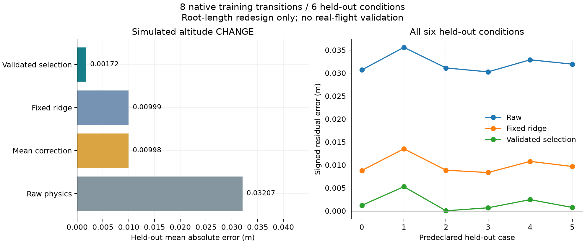

# 学習予測器の更新

2026-11-07、数値ソース `1f3d1a0` で14件の新規CAD・変更前後の解析を完了。
学習8条件とは異なる根元長の6条件で、以下の誤差を得た。
表は**設計変更によるシミュレーション上の高度差**の予測誤差であり、実飛行高度の誤差ではない。

| 予測方法 | 評価6条件の平均絶対誤差 |
|---|---:|
| 物理概算のみ | 0.032069 m |
| 従来の平均残差補正 | 0.009983 m |
| 従来の固定リッジ | 0.009987 m |
| 学習内検証で選んだ予測器 | 0.001723 m |

固定リッジに対して82.75%小さく、6条件すべてで誤差が減った。
方式は学習データだけで選び、6条件とも正則化係数0.3のリッジを使用した。
評価側の最大絶対誤差は0.005263 m。計算時間予測の平均絶対誤差は0.281秒。
全収集には672.86秒を要し、168マニフェスト・798ファイルを検証した。
原データを封印し、[比較データ](../scenarios/adaptive_design/validated-predictor.json)に
使用履歴、係数選択の検証値、各条件の誤差と証拠ハッシュを残す。

今回確認したのは、2種類の未学習根元長×3水量条件での、根元長15%短縮への一般化。
異なる機体系列・材料・温度・CFD精度の補正、LLM探索全体の計算時間短縮は未証明。
この誤差を、空力モデル自体の不確かさや材料の保証値の代わりに使わない。

ローカルGemma 4 12Bでも接続を確認した。8回の実モデル選択のうち、圧力変更後に
学習予測を付けた根元長15%短縮を選び、新規CAD・飛行を再計算した。
その選択時には8学習事例、補正量0.031069 m、学習内検証誤差0.001902 m、
選択方式 `ridge_0.3` と参照事例がモデルへ渡った。21マニフェスト・82ファイルを照合。
3版のスクリーニング高度は17.014→19.994→20.918 mで、これは予測器の接続試験。
独立に探索中の2 L案とは別機体であり、この試験自身は30 mを満たさず未解決として保存した。

6件以上の検証済み解析履歴があれば、補正なし、平均、縮小平均、旧固定リッジ、
正則化係数を変えたリッジ、類似事例を重視する局所平均を学習データ内で比較する。
同じ初期状態の履歴をまとめて検証側へ外し、未知の初期状態に対する誤差を見る。
外部の評価用データは方式の選択に使わない。6件未満では従来方式を保持する。

高度の補正値には従来と同じ上限を課し、近い事例のない領域では補正を見送る。
計算時間は対数値で別に学習するが、計算予算の予約量・合否基準は変えない。
方式別検証誤差、使用履歴とハッシュ、特徴量、学習値、問い合わせを保存する。
LLMには選ばれた方式、検証誤差、適用範囲内かを渡す。誤差は信頼区間ではない。

履歴ファイルの二重検証を除き、6条件の交互順序による速度比較では、1問い合わせの
中央値が2.720秒から1.371秒へ約49.6%短縮した。ファイル照合は維持し、予測値・
使用モデル・ハッシュを含む出力が6件とも完全一致した。
[計測記録](../scenarios/adaptive_design/predictor-runtime.json)に各対の時間とソースハッシュを残す。
これはファイルキャッシュが温まった状態での予測器単体の計測であり、探索全体の速度ではない。
高速化でも解析ソース識別子は変わるため、旧版の履歴を現行版の結果と偽って移し替えない。

高速化を組み込んだ `cf11865`（数値内容ハッシュ `b7c3d1e2…a5b50a`）でも、同じ事前定義の
14条件を新規CADから再計算した。学習8条件・評価6条件を揃え、予測高度差の平均絶対誤差
0.001723 mを再現した。変更前後の高度と残差は14条件すべて旧実行と一致した。
[再現照合](../scenarios/adaptive_design/predictor-source-replay.json)と
[現行版の予測・LLM接続記録](../scenarios/adaptive_design/validated-predictor-current.json)を保存。
同じ条件の再実行であり、独立した検証条件が14件増えたとは数えない。

再実行は693.75秒、168マニフェスト・798ファイルを照合した。
計算時間予測の平均絶対誤差は今回は1.752秒で、前回0.281秒より大きい。
壁時計時間は同時実行負荷も変わるため、時間予測の精度向上は主張しない。
現行履歴だけを渡したGemmaで9回の選択を実行し、根元長15%短縮を選んだ。
補正量0.031069 m、方式 `ridge_0.3`、参照事例を判断表示に記録。
22マニフェスト・85ファイルを照合し、3版の高度17.014→19.994→20.918 mを再現した。
この接続試験は依然30 m未達で、合格へ変更していない。

新しい実測比較プロトコルは、根元長90/105 mm・水量比0.16/0.22/0.28/0.34の8件を
学習し、根元長95/100 mm・水量比0.19/0.25/0.31の6件を評価する。
各ケースは実CADを再生成し、根元長を15%短くする前後の6自由度計算を行う。
60 g搭載の要求と400 kPaの初期設定を保持する。
概算だけの探索候補を正解ラベルとして水増しせず、履歴の原データ・予測・結果を照合する。

再現コマンド：`python -m scripts.collect_learning_trials input.json output/new --expanded`。
LLM本体の重みは変更せず、Claude APIは使わない。有限のシミュレーション内比較であり、実飛行の
精度向上や全候補・全変更方向での一般化は別途検証が必要。
